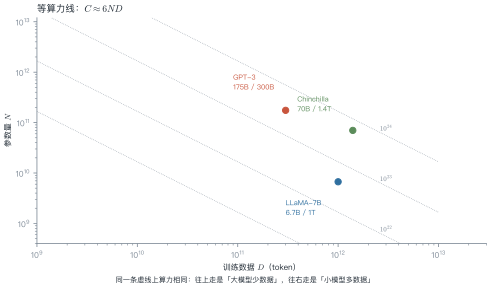
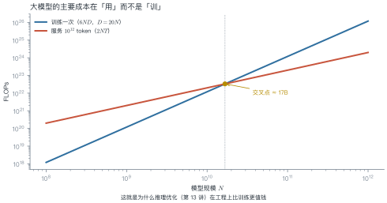
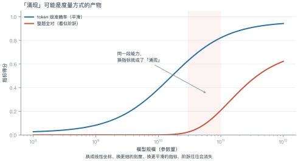
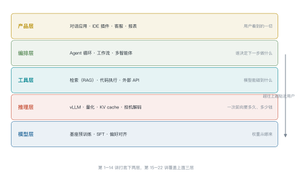

# 第 1 讲　大模型是什么

!!! abstract "本讲位置"
    全书的入口。本讲不推导公式，只回答三个问题：**什么叫"大"、能力从哪来、"涌现"是真的吗**。之后第 2–3 讲回到历史，看这条路是怎么走过来的。

!!! info "📅 事实核查至 2026-11"
    本讲引用的模型规格（GPT-3、Chinchilla、LLaMA）与涌现之争的两篇论文均已核对原文，见文末来源。

## 学习目标

学完本讲，你应该能够：

1. 用参数、数据、算力三个轴描述一个模型，并估算它的训练算力；
2. 解释"涌现能力"（emergent ability）为什么可能是**度量方式的产物**，并举出反例；
3. 说出大模型应用栈的五层结构，以及每一层解决什么问题；
4. 判断一个任务是否真的需要大模型。

---

## 0 直觉：三次跃迁

大模型不是"更大的神经网络"，它在三个尺度上同时跃迁：

| 维度 | 上一代 | 现在 | 变化 |
|---|---|---|---|
| 参数 | 1 亿（BERT-base） | 千亿–万亿 | $10^3$–$10^4$ |
| 数据 | 30 亿 token | 10–20 万亿 token | $5\times10^3$ |
| 算力 | $10^{19}$ FLOPs | $10^{23}$–$10^{25}$ | $10^4$–$10^6$ |

三个数量级同时发生，才产生了质变。只放大其中一个——比如只堆参数不增数据——效果会明显打折（这正是第 6 讲 Chinchilla 要纠正的偏差）。

!!! note "一句话总结"
    大模型 = **用海量文本做"下一个词预测"，把语言规律压缩进参数**；规模足够大时，这种压缩本身就能支撑推理、翻译、写代码。

---

## 1 什么叫"大"：三个轴与一个公式

### 1.1 三轴

描述一个模型只需要三个数：

- $N$：参数量；
- $D$：训练用的 token 数；
- $C$：训练消耗的浮点运算次数（FLOPs）。

它们的关系近似为

$$
C \approx 6ND
\tag{1.1}
$$

**为什么是 6？** 前向传播每个参数参与一次乘加，约 $2N$ FLOPs/token；反向传播约为前向的两倍，合计约 $6N$ FLOPs/token；乘上 token 数 $D$ 就是 $6ND$。

<figure markdown="span">
  { width="100%" }
  <figcaption>图 L1-1　读图要点：同一条虚线代表同样的算力。GPT-3 在虚线上偏左（大模型、少数据），Chinchilla 偏右（小模型、多数据）——<b>同样算力，两种分法</b>，后者效果更好。</figcaption>
</figure>

### 例 1.1　手算 GPT-3 的训练算力

GPT-3：$N=175\times10^9$，$D=300\times10^9$。

**第一步，代公式：**

$$C = 6 \times 175\times10^9 \times 300\times10^9 = 3.15\times10^{23}\ \text{FLOPs}$$

**第二步，换算成 GPU 时间。** A100 的 bf16 峰值约 $312$ TFLOPS $=3.12\times10^{14}$ FLOPs/s：

$$\frac{3.15\times10^{23}}{3.12\times10^{14}} \approx 1.0\times10^{9}\ \text{s} \approx 32\ \text{年}$$

**第三步，按集群规模折算。** 1024 张卡、40% 利用率（MFU，model FLOPs utilization，实际算力占硬件峰值的比例）：

$$\frac{32\ \text{年}}{1024 \times 0.4} \approx 28.5\ \text{天}$$

这和公开报道的"约一个月"吻合。

!!! tip "从这个例子里能读出三件事"
    1. **算力估算不需要看代码**，三个数就能估个八九不离十；
    2. **MFU 是关键变量**：40% 是常见水平，优化到 50% 等于省 20% 的钱；
    3. **显存比算力更早成为瓶颈**：175B 参数用 bf16 存要 $175\times10^9\times2\,\text{B}=350$ GB；加上 Adam 的一阶、二阶动量与 fp32 主权重（每参数 $2+4+4+4=14$ 字节），单是模型状态就要 $175\times10^9\times14\approx2.45$ TB。

```python
def train_cost(n_params: float, n_tokens: float, gpus: int = 1024,
               mfu: float = 0.4, peak_flops: float = 3.12e14):
    """返回 (总 FLOPs, 训练天数)。默认按 A100 bf16 峰值与 40% 利用率。"""
    flops = 6 * n_params * n_tokens
    seconds = flops / (peak_flops * gpus * mfu)
    return flops, seconds / 86400


flops, days = train_cost(175e9, 300e9)
print(f"{flops:.2e} FLOPs, 约 {days:.0f} 天")   # 3.15e+23 FLOPs, 约 28 天
```

### 1.2 一个模型的三张账单

同样一个 70B 模型，训练、微调、推理是三种完全不同的开销结构：

| 场景 | 算力公式 | 量级（70B） | 特点 |
|---|---|---|---|
| 预训练 | $6ND$ | $10^{24}$ FLOPs | 一次性，最大 |
| 全参微调 | $6ND_{\text{sft}}$ | $10^{22}$ FLOPs（$D_{\text{sft}}\approx2\times10^{10}$） | 数据少，但显存同训练 |
| LoRA 微调 | $\approx 6N_{\text{adapter}}D$ | $10^{19}$ FLOPs | 显存降一个数量级 |
| 推理 | $2NT$ | $2\times70\times10^9\times T$ | 随调用量线性增长 |

三者的工程含义完全不同：

- **预训练**是资本开支，一年做一次；
- **微调**是研发开支，每周都可能做；
- **推理**是运营开支，按 token 计费，用户越多越贵。

选型时最常犯的错，是拿"预训练成本"去论证"推理成本可控"——两者差着两三个数量级。

---

## 2 能力从哪来：一个目标函数

所有基座模型的预训练目标都一样：**给定前文，预测下一个 token**。

$$\mathcal{L}(\theta)=-\sum_{t=1}^{T}\log p_\theta(x_t\mid x_{<t})$$

这个目标看起来简单得可疑——它怎么能同时学会语法、事实、推理？

一个有用的解释：**要准确预测下一个词，模型必须隐式地建模产生这个词的所有因素**。预测"法国的首都是___"需要事实知识；预测代码的下一行需要语法与类型约束；预测议论文的下一句需要论证结构。目标只有一个，被压缩进去的知识有很多种。

<figure markdown="span">
  { width="100%" }
  <figcaption>图 L1-2　读图要点：训练成本随 $N^2$ 增长，推理成本随 $N$ 线性增长。按 Chinchilla 配比，两者在 <b>约 17B</b> 处交叉——超过这个规模，服务 1T token 的算力就超过训练一次。</figcaption>
</figure>

**这张图的工程含义**：模型越大，"用"比"训"越贵。所以推理优化（第 13 讲）在商业上比训练优化更值钱。

---

## 3 "涌现"是真的吗

### 3.1 两种说法

- **Wei et al. (2022)**：某些能力在规模达到阈值前几乎为零，之后突然出现，称为"涌现"（emergence）；
- **Schaeffer et al. (2023)**：这可能是**度量选择的假象**——换个更平滑的指标，阶跃就消失了。

### 3.2 为什么会这样

关键在于"任务对错误有多敏感"。考虑一个需要 8 步全部正确的任务：

- 每步正确率 0.55 → 整题全对概率 $0.55^8=0.0084$；
- 每步 0.85 → $0.85^8=0.272$；
- 每步 0.95 → $0.95^8=0.663$。

**例 1.2　同一个能力，两种曲线**

| 每步正确率 | 整题全对（exact match） | token 级正确率 |
|---|---|---|
| 0.55 | 0.84% | 55% |
| 0.85 | 27.2% | 85% |
| 0.95 | 66.3% | 95% |

每步正确率只是从 55% 平滑地爬到 95%，但"整题全对"这个指标却从 0.84% 跳到 66%——**看起来就像突然"开窍"了**。

<figure markdown="span">
  { width="100%" }
  <figcaption>图 L1-3　读图要点：两条曲线来自同一个潜在能力。平滑的那条是 token 级指标，陡峭的那条是"整题全对"。<b>阶跃的陡峭程度由指标决定，不由模型决定</b>。</figcaption>
</figure>

!!! tip "从这个例子里能读出三件事"
    1. **指标越严，曲线越陡**：全对、pass@1 这类指标天然放大阶跃；
    2. **"阈值"会随指标移动**：换个指标，涌现点就从 10B 挪到 50B；
    3. **结论**：说"某能力在 X 亿参数涌现"时，必须同时说明用什么指标测的。

### 3.3 那还剩下什么

即使"涌现"是度量假象，有两件事仍然成立：

1. **能力确实随规模提升**，只是曲线比传闻中平滑；
2. **某些能力在特定规模以下确实不可用**（比如长链推理），工程上仍要按"阈值"来做选型。

### 3.4 怎么自己验证"涌现"

别人说的阈值不一定适用于你的任务。三步就能自己测：

1. **选一条规模序列**：同一家族的小、中、大三档模型（如 1B / 8B / 70B），其他条件尽量一致；
2. **用两种指标各测一遍**：严格指标（全对、pass@1）与平滑指标（token 级准确率、编辑距离）；
3. **画两条曲线**：如果严格指标出现阶跃而平滑指标没有，那"涌现"就主要来自度量。

这个实验一周内能做完，比读十篇综述更有用。

既然如此，与其纠结阈值落在哪里，不如先看清整个系统里各层的分工——

---

## 4 应用栈：模型只是最下面一层

<figure markdown="span">
  { width="100%" }
  <figcaption>图 L1-4　读图要点：五层各解决一个问题——权重从哪来、一次前向多贵、能碰到什么、下一步做什么、用户看到什么。<b>本书的讲次分布也按这五层排</b>。</figcaption>
</figure>

| 层 | 典型问题 | 对应讲次 |
|---|---|---|
| 产品层 | 交互怎么设计、怎么评测 | L23–L24 |
| 编排层 | 什么时候该让模型自己决定下一步 | L17–L18 |
| 工具层 | 知识从哪来、怎么调外部系统 | L16、L18 |
| 推理层 | 延迟、成本、并发 | L13–L14 |
| 模型层 | 预训练、对齐、能力边界 | L2–L12 |

**一个重要判断**：绝大多数"模型效果不好"的问题，其实出在上面三层。检索没做好、提示没写清、任务拆得不对——这些都不是换更大的模型能解决的。

---

## 5 三条主线

| 主线 | 关注点 | 代表讲次 |
|---|---|---|
| 规模线 | 参数、数据、算力如何共同决定能力 | L6、L13、L14 |
| 架构线 | 从 RNN 到 Transformer 到 MoE 到长上下文 | L3、L4、L5、L11、L12 |
| 对齐线 | 从"会说话"到"听话、有用、不危险" | L8、L9、L10、L21 |

三条线在应用层汇合：RAG、Agent、多模态都是"模型能力 × 系统设计"的乘积。

---

## 6 工程要点与坑

1. **先算账再选型**：用 (1.1) 估算训练/推理成本，别凭感觉选 70B。
2. **参数不是唯一指标**：同样 7B，数据质量差 10 倍，效果差一个档。
3. **显存优先于算力**：训练时先看模型状态能不能放下，再看 FLOPs。
4. **推理成本随使用量线性增长**：用户翻倍，账单翻倍，这和训练的一次性投入不同。
5. **别迷信"涌现阈值"**：阈值随指标与提示格式漂移，做选型要自己测。
6. **小模型 + 好系统常常打败大模型**：检索、工具、结构化输出能补上很多能力缺口。

---

## 7 论文与延伸

| 年份 | 论文 | 一句话贡献 |
|---|---|---|
| 2020 | [Scaling Laws for Neural Language Models](https://arxiv.org/abs/2001.08361) | 损失随规模幂律下降 |
| 2020 | [GPT-3](https://arxiv.org/abs/2005.14165) | 175B 参数，少样本学习成为范式 |
| 2022 | [Emergent Abilities of Large Language Models](https://arxiv.org/abs/2206.07682) | "涌现"的经典论述 |
| 2022 | [Chinchilla](https://arxiv.org/abs/2203.15556) | 参数与数据应同比扩展 |
| 2023 | [Are Emergent Abilities a Mirage?](https://arxiv.org/abs/2304.15004) | 涌现可能是度量假象 |
| 2023 | [LLaMA](https://arxiv.org/abs/2302.13971) | 小模型 + 充分数据 |

---

## 8 习题

**🟢 概念题**

1. 用一句话解释 $C\approx6ND$ 里的 6 是怎么来的。
2. 为什么说"推理成本随规模线性增长，训练成本随规模平方增长"？各自的工程含义是什么？

**🟡 推导题**

3. 某模型 $N=70$B、$D=1.4$T，估算训练算力；若用 2048 张 A100、MFU 45%，需要多少天？
4. 用 $p^n$ 的形式说明：为什么"整题全对"指标的曲线比"每步正确率"陡得多？给出陡峭程度的表达式。

**🔴 实现题**

5. 写一个脚本，输入 $(N, D)$ 输出训练算力、显存需求（bf16 + Adam）、以及 1T token 的推理算力，并与图 L1-2 的交叉点对照。

---

## 9 本讲小结

<div class="cheatsheet" markdown>

**一个公式**

$$C \approx 6ND$$

**两个判断**

- "涌现"多半是度量假象：指标越严，曲线越陡
- 大模型的成本主要花在"用"，不在"训"

**五层栈**

产品 → 编排 → 工具 → 推理 → 模型

**一句话**

> 大模型是"用海量文本做下一个词预测"的产物；规模是必要条件，但不是全部。

</div>

---

## 来源

- GPT-3、Chinchilla、LLaMA 的规格与 Wei/Schaeffer 两篇论文的结论均核对原文，链接见 §7，核查日期 2026-11。
