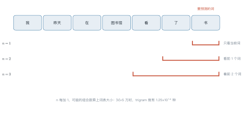
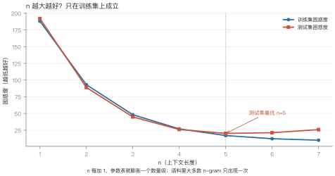
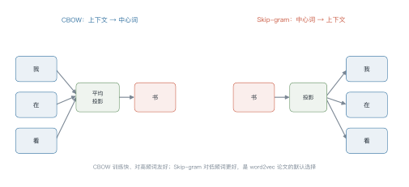
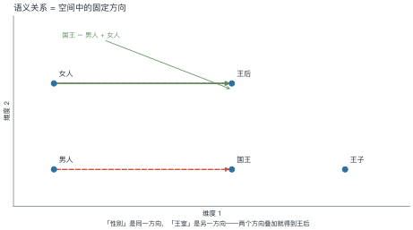

# 第 2 讲　统计语言模型与词的表示

!!! abstract "本讲位置"
    第二部分的开始。第 1 讲说了"大模型在做什么"，本讲回到起点：**在神经网络之前，人们怎么让机器预测下一个词**，以及这套方法的三个死结。

!!! info "📅 事实核查至 2026-11"
    本讲内容均为 2003 年前的经典方法（n-gram、Kneser-Ney、word2vec），结论稳定，无时效性问题。

## 学习目标

学完本讲，你应该能够：

1. 写出 n-gram 的马尔可夫假设与最大似然估计，并手算困惑度；
2. 说明为什么 n 不能一直加大（组合爆炸 + 零概率）；
3. 写出 skip-gram 的负采样目标函数，并手算一次损失；
4. 解释"分布式假设"为什么能让词向量带上语义。

---

## 0 直觉：查历史记录

假设你想预测"我今天去___"的下一个词。

最朴素的办法：**翻语料，看历史上"我今天去"后面都跟了什么**，谁出现得多就选谁。

这就是 n-gram 的全部思想——**用历史共现频率当概率**。它不需要神经网络，只需要计数表。

优点：简单、可解释、训练只需一遍扫描。
缺点：没见过就永远不会说（零概率），而且只能看很短的上下文。

!!! note "一句话总结"
    n-gram 用"数数"代替"学习"；它的天花板由**词表大小**和**上下文长度**共同决定。

---

## 1 从链式法则到马尔可夫假设

### 1.1 精确形式

一个句子的概率，按链式法则精确分解为

$$
P(w_1,\dots,w_T)=\prod_{t=1}^{T}P(w_t\mid w_1,\dots,w_{t-1})
\tag{2.1}
$$

问题：$P(w_t\mid w_1,\dots,w_{t-1})$ 的参数数量随历史长度指数增长，无法估计。

### 1.2 n-gram 近似

马尔可夫假设（Markov assumption）：**只看最近 $n-1$ 个词**。

$$
P(w_t\mid w_1,\dots,w_{t-1})\approx P(w_t\mid w_{t-n+1},\dots,w_{t-1})
\tag{2.2}
$$

最大似然估计就是数数：

$$
P(w_t\mid h)=\frac{c(h,w_t)}{c(h)}
\tag{2.3}
$$

其中 $c(\cdot)$ 是出现次数。

<figure markdown="span">
  { width="100%" }
  <figcaption>图 L2-1　读图要点：预测"书"时，$n=1$ 只看自己（等于词频），$n=2$ 看"了"，$n=3$ 看"看了"。<b>窗口每加长一格，可能的组合数就乘以词表大小</b>。</figcaption>
</figure>

### 1.3 困惑度：语言模型的标准尺子

困惑度（perplexity）定义为平均每 token 负对数似然的指数：

$$
\mathrm{PP}=\exp\!\left(-\frac{1}{T}\sum_{t=1}^{T}\log P(w_t\mid w_{<t})\right)
=P(w_1,\dots,w_T)^{-1/T}
\tag{2.4}
$$

**怎么读这个数**：困惑度 100 意味着模型平均在 100 个候选里犹豫，等价于"随机猜 100 个词"的不确定性。越低越好。

### 例 2.1　手算一个 bigram 的困惑度

语料只有两句话：

> 我 爱 猫 。 我 爱 狗 。

统计 bigram 计数：

| 历史 | 后继 | 计数 | $P(\cdot\mid\text{历史})$ |
|---|---|---|---|
| 我 | 爱 | 2 | 1.0 |
| 爱 | 猫 | 1 | 0.5 |
| 爱 | 狗 | 1 | 0.5 |

**测试句 A："我 爱 猫"**

似然 $=P(\text{爱}\mid\text{我})\cdot P(\text{猫}\mid\text{爱})=1.0\times0.5=0.5$

$$\mathrm{PP}=0.5^{-1/2}=1.41$$

**测试句 B："我 爱 鸟"**

$P(\text{鸟}\mid\text{爱})=0/2=0$，似然为 0，**困惑度无穷大**。

!!! tip "从这个例子里能读出三件事"
    1. **训练语料里没出现过的组合，概率直接是 0**——这就是零概率问题，必须靠平滑解决；
    2. **困惑度对零概率极其敏感**：一个 0 就让整句失效；
    3. **1.41 意味着模型几乎不犹豫**：每步只在约 1.4 个候选里挑，这显然是因为语料只有两句话、模型把训练集背了下来。真实语料的 bigram 困惑度通常在几百量级。

---

```python
import math
from collections import Counter

corpus = "我 爱 猫 。 我 爱 狗 。".split()
bigram = Counter(zip(corpus, corpus[1:]))
unigram = Counter(corpus[:-1])


def prob(w, h):
    """P(w | h)，最大似然估计"""
    return bigram[(h, w)] / unigram[h]


def perplexity(sentence):
    logp = sum(math.log(prob(sentence[i], sentence[i - 1]))
               for i in range(1, len(sentence)))
    return math.exp(-logp / (len(sentence) - 1))


print(perplexity(["我", "爱", "猫"]))   # 1.4142
print(perplexity(["我", "爱", "鸟"]))   # ZeroDivisionError -> 需要平滑
```

## 2 平滑：给没见过的组合留条活路

最常用的加一平滑（Laplace smoothing）：

$$
P(w_t\mid h)=\frac{c(h,w_t)+1}{c(h)+|V|}
\tag{2.5}
$$

分母加上词表大小 $|V|$，保证所有概率之和仍为 1。

更好的做法是 **Kneser-Ney**：它不按"出现次数"分配折扣，而按"能接在多少个不同历史后面"（延续计数，continuation count）来分配。直觉是：一个词能出现在很多不同的上下文里，说明它作为"通用后继"更可信，而不是只在某个固定搭配里高频出现。

| 方法 | 思路 | 效果 |
|---|---|---|
| 加一平滑 | 所有未见组合平分一点概率 | 简单，但给太多概率给罕见词 |
| 回退（backoff） | 没见过的 trigram 退回 bigram | 实用，需调折扣系数 |
| Kneser-Ney | 用延续计数分配折扣 | n-gram 时代的最好方法 |

---

## 3 n 的两难：组合爆炸与数据稀疏

<figure markdown="span">
  { width="100%" }
  <figcaption>图 L2-2　读图要点：训练集上 n 越大困惑度越低；测试集上到 4–5 就到顶，再大反而变差。<b>拐点是"数据稀疏"追上"上下文收益"的位置</b>。</figcaption>
</figure>

### 例 2.2　组合爆炸的算术

词表 $|V|=50{,}000$，问 trigram 有多少种可能？

$$|V|^3 = 5\times10^{4\times3}=1.25\times10^{14}$$

如果每个 trigram 存一个 float32（4 字节）：

$$1.25\times10^{14}\times4\ \text{B}=5\times10^{14}\ \text{B}=500\ \text{TB}$$

**结论**：不可能存下。实际实现用稀疏哈希表，但绝大多数条目计数为 0——**99.99% 的参数是浪费的**。

这正是神经网络语言模型要解决的问题：用稠密向量共享统计强度，把"没见过的组合"也赋予合理的概率。

---

## 4 词的表示：从 one-hot 到词向量

### 4.1 one-hot 的两个问题

把词表示成 $|V|$ 维 one-hot 向量：

- **维度灾难**：5 万维稀疏向量，存储和计算都昂贵；
- **没有相似性**：任意两个词的余弦相似度都是 0，"猫"和"狗"的距离与"猫"和"量子"一样远。

### 4.2 分布式假设

> 上下文相似的词，语义也相似。——Firth, 1957

这是词向量的理论依据，称为分布式假设（distributional hypothesis）。如果"猫"和"狗"经常出现在相似的上下文里（"我养了一只___"），它们的向量就该接近。

### 4.3 word2vec：两种结构

<figure markdown="span">
  { width="100%" }
  <figcaption>图 L2-3　读图要点：CBOW 把多个上下文词平均后预测中心词，Skip-gram 反过来用中心词预测每个上下文词（图中上下文词为示意，不必与图 L2-1 的句子一致）。<b>Skip-gram 对低频词更友好</b>，因为每个词都能贡献多次训练信号。</figcaption>
</figure>

### 4.4 负采样：把 5 万分类变成 2 分类

原始 skip-gram 要对整个词表做 softmax，每步计算 $|V|$ 次。负采样把它换成"判断这对词是不是真的共现过"：

$$
\mathcal{L}=-\log\sigma(\boldsymbol{v}_{w_O}^\top\boldsymbol{u}_{w_I})
-\sum_{j=1}^{k}\log\sigma(-\boldsymbol{v}_{w_j}^\top\boldsymbol{u}_{w_I}),
\quad w_j\sim P_n(w)
\tag{2.6}
$$

- 正样本：真实共现的（中心词，上下文词）；
- 负样本：随机抽的 $k$ 个词（通常 $k=5$–$15$），标签为"不共现"。

**为什么有效**：模型只需要学会"区分真假配对"，而不需要给 5 万个词各分配一个概率。计算量从 $O(|V|)$ 降到 $O(k)$。

### 例 2.3　手算一次负采样损失

中心词"猫"，真实上下文"爱"，抽两个负样本"书""跑"。

设点积得分：$\boldsymbol{v}_{\text{猫}}^\top\boldsymbol{u}_{\text{爱}}=2.0$，$\boldsymbol{v}_{\text{猫}}^\top\boldsymbol{u}_{\text{书}}=-1.0$，$\boldsymbol{v}_{\text{猫}}^\top\boldsymbol{u}_{\text{跑}}=0.5$。

**逐项算：**

| 项 | 点积 | $\sigma$ | $-\log\sigma$ |
|---|---|---|---|
| 正样本 | 2.0 | 0.881 | 0.127 |
| 负样本 1（取负号） | −1.0 → 1.0 | 0.731 | 0.313 |
| 负样本 2（取负号） | 0.5 → −0.5 | 0.378 | 0.973 |

$$\mathcal{L}=0.127+0.313+0.973=1.413$$

!!! tip "从这个例子里能读出三件事"
    1. **正样本项已经很小**（0.127）：模型对真配对很有把握；
    2. **负样本 2 贡献最大**（0.973）：$0.5$ 的分数说明模型觉得"猫—跑"有点关系，需要重点纠正；
    3. **负样本越多，损失越大**：$k$ 从 2 增到 15，相当于让模型做更多次判别，这也是 word2vec 慢的原因。

### 4.5 词向量空间长什么样

<figure markdown="span">
  { width="100%" }
  <figcaption>图 L2-4　读图要点：把 300 维压到 2 维后，"性别"是一个固定方向，"王室"是另一个固定方向。<b>两个方向叠加，就从"男人"得到"王后"</b>。</figcaption>
</figure>

### 4.6 静态词向量的天花板

word2vec 给每个词**一个固定向量**，这带来一个绕不过去的问题：**一词多义**。

"苹果"在"吃苹果"和"苹果发布会"里显然是两个意思，但静态词向量只能给一个折中的表示——它把两种含义平均了一下，结果两边都不像。

这个问题直到**上下文相关表示**才被解决：

| 阶段 | 表示 | 一词多义 |
|---|---|---|
| one-hot | $|V|$ 维稀疏 | 完全无法处理 |
| word2vec / GloVe | 每个词一个固定向量 | 只能折中 |
| ELMo / BERT | 每个位置一个向量，随上下文变化 | 解决 |

第 5 讲的 BERT 就是这条线的终点：同一个"苹果"，在不同句子里得到不同向量。

---

## 5 三个死结

| 死结 | 表现 | 后来怎么解 |
|---|---|---|
| **稀疏** | 没见过的 n-gram 概率为 0 | 稠密词向量（本讲）、神经网络 LM（第 3 讲） |
| **短视** | 只能看 $n-1$ 个词 | RNN / 注意力（第 3–4 讲） |
| **无组合泛化** | "红色的猫"见过，"蓝色的猫"没见过就废 | 分布式表示 + 深层非线性 |

第三个死结最致命：n-gram 把每个组合当成独立事件，而语言是**组合**出来的。这正是神经网络语言模型的出发点。

### 5.1 一张对照表

| 维度 | n-gram | 神经语言模型 |
|---|---|---|
| 参数存储 | 稀疏计数表，$|V|^n$ | 稠密矩阵，$O(d\cdot|V|)$ |
| 未见组合 | 概率为 0 | 由向量相似度外推 |
| 上下文长度 | $n-1$ 个词 | 理论无限（受显存限制） |
| 训练方式 | 一遍扫描计数 | 梯度下降，多轮 |
| 可解释性 | 高（能查到具体计数） | 低（黑箱） |

这张表解释了为什么 2003 年之后，语言建模的主线转向了神经网络：**它不是"更准的计数"，而是换了一种表示**。

---

## 6 工程要点与坑

1. **困惑度不能跨词表比较**：不同分词器的 PP 不可比，只能同词表内比。
2. **n 的选择看数据量**：语料小于 $10^7$ token 时，trigram 已经稀疏得厉害。
3. **负采样分布很重要**：按词频的 $3/4$ 次方采样（$P_n(w)\propto f(w)^{0.75}$）是经验最优。
4. **词向量要归一化**：余弦相似度计算前先 L2 归一化，否则高频词主导。
5. **OOV 要处理**：低频词映射到 `<unk>`，否则测试集全是零概率。
6. **词向量有偏见**：训练语料里的性别、种族偏见会被编码进向量空间。

---

## 7 论文与延伸

| 年份 | 论文 | 一句话贡献 |
|---|---|---|
| 1957 | Firth, *A Synopsis of Linguistic Theory* | 分布式假设的源头 |
| 1997 | [Kneser & Ney, Improved Backing-off for M-gram LM](https://doi.org/10.1109/ICASSP.1995.479394) | 最好的 n-gram 平滑方法 |
| 2003 | [Bengio et al., A Neural Probabilistic Language Model](https://www.jmlr.org/papers/v3/bengio03a.html) | 用稠密向量解决稀疏问题 |
| 2013 | [Mikolov et al., word2vec](https://arxiv.org/abs/1301.3781) | 负采样，训练可规模化 |
| 2014 | [GloVe](https://nlp.stanford.edu/pubs/glove.pdf) | 用全局共现矩阵做词向量 |
| 2016 | [Bolukbasi et al., Man is to Computer Programmer as Woman is to Homemaker?](https://arxiv.org/abs/1607.06520) | 词向量中的性别偏见 |

---

## 8 习题

**🟢 概念题**

1. 为什么 n-gram 的参数数量是 $|V|^n$ 而不是 $|V|\times n$？
2. 困惑度 10 和 100 分别意味着什么？为什么说它"不能跨词表比较"？

**🟡 推导题**

3. 证明加一平滑后的概率之和为 1。
4. 从 (2.4) 出发，证明"困惑度等于几何平均每 token 概率的倒数"。

**🔴 实现题**

5. 用 10 万字的语料训练 bigram 与 trigram，画测试集困惑度随 n 的曲线，找出拐点。
6. 实现负采样 skip-gram 的损失函数，验证例 2.3 的数值。

---

## 9 本讲小结

<div class="cheatsheet" markdown>

**两个公式**

- n-gram 估计：$P(w_t\mid h)=c(h,w_t)/c(h)$
- 困惑度：$\mathrm{PP}=P(w_1,\dots,w_T)^{-1/T}$

**三个死结**

稀疏 · 短视 · 无组合泛化

**一句话**

> n-gram 用计数代替学习；词向量用"上下文相似"把稀疏的计数变成稠密的几何。

</div>

---

## 来源

- 本讲内容为 1957–2016 年的经典方法，公式与结论稳定；word2vec 负采样细节核对自原文，核查日期 2026-11。
