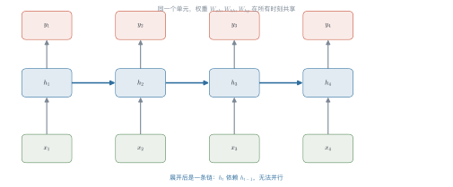
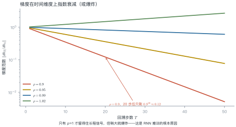
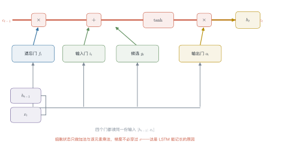
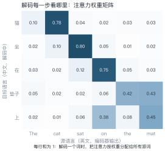

# 第 3 讲　神经序列建模

!!! abstract "本讲位置"
    第 2 讲留下了三个死结：稀疏、短视、无组合泛化。本讲看神经网络怎么一个个解开——先解决稀疏（NNLM），再解决短视（RNN/LSTM），最后用注意力迈出通往 Transformer 的第一步。

!!! info "📅 事实核查至 2026-11"
    本讲内容为 2003–2015 年的经典方法（NNLM、LSTM、seq2seq、Bahdanau 注意力），结论稳定。

## 学习目标

学完本讲，你应该能够：

1. 说出 NNLM 如何用稠密向量解决 n-gram 的稀疏问题，并估算其参数量；
2. 推导 BPTT 中梯度连乘的形式，解释梯度消失的数学原因；
3. 说明 LSTM 的加法通路为什么能缓解梯度消失；
4. 手算一次加性注意力的对齐权重，并解释它解决了 seq2seq 的什么瓶颈。

---

## 0 直觉：边读边记笔记

n-gram 的问题是"只看最近几个词"。人读句子不是这样的：你读到一个代词，会回头找它指代谁；读到转折词，会调整对整段的理解。

**循环神经网络（RNN）** 的做法很像记笔记：维护一个**隐状态** $h_t$，每读一个词就更新一次：

$$h_t = f(h_{t-1},\ x_t)$$

这个 $h_t$ 就是对"读到目前为止"的压缩摘要。它理论上能记住任意长的历史——只是"理论上"。

!!! note "一句话总结"
    RNN 用**一个不断更新的向量**代替 n-gram 的固定窗口；LSTM 用**门控**决定记什么、忘什么；注意力用**动态查询**代替固定摘要。

---

## 1 NNLM：先解决稀疏

Bengio 等人 2003 年的神经概率语言模型（NNLM）结构很朴素：

1. 每个词查表得到 $d$ 维向量；
2. 前 $n-1$ 个词的向量**拼接**起来；
3. 过一层 tanh 隐层；
4. 接 softmax 输出词表上的分布。

**关键变化**：词与词之间的相似性由向量承载。训练语料里没见过"蓝色的猫"，但模型见过"红色的猫"和"蓝色的天空"，它能把两者的统计强度"借"过来。

### 例 3.1　算一下参数量

设词表 $|V|=50{,}000$，词向量维度 $d=100$，隐层 $h=200$，上下文 $n=3$（看前两个词）。

| 部件 | 形状 | 参数量 |
|---|---|---|
| 词嵌入表 | $50{,}000\times100$ | $5.0\times10^{6}$ |
| 输入到隐层 | $(2\times100)\times200$ | $4.0\times10^{4}$ |
| 隐层到输出 | $200\times50{,}000$ | $1.0\times10^{7}$ |
| 合计 | | $\approx1.5\times10^{7}$ |

对比第 2 讲的 trigram：$|V|^3=1.25\times10^{14}$ 个格子。**参数少了七个数量级**，而且没见过的组合也能给出非零概率。

!!! tip "从这个例子里能读出三件事"
    1. **参数量的大头在输出层**：$200\times50{,}000$ 占了三分之二；后来的模型用权重绑定（tied embedding）把它省掉；
    2. **嵌入层是"共享统计强度"的载体**：50 万个词共用 100 维空间，相似词自然靠拢；
    3. **NNLM 仍然只看固定窗口**——短视的问题没解决，这才轮到 RNN。

---

## 2 RNN：把窗口变成状态

### 2.1 结构

$$
h_t=\tanh\!\left(\boldsymbol{W}_{hh}h_{t-1}+\boldsymbol{W}_{xh}x_t+\boldsymbol{b}\right),
\qquad
y_t=\mathrm{softmax}\!\left(\boldsymbol{W}_{hy}h_t\right)
\tag{3.1}
$$

注意 $\boldsymbol{W}_{hh}$ 在所有时间步**共享**——这正是 RNN 参数少的原因。

<figure markdown="span">
  { width="100%" }
  <figcaption>图 L3-1　读图要点：同一个单元在时间上被"复制"了四份，权重完全共享。<b>横向的箭头就是依赖关系</b>——$h_t$ 必须等 $h_{t-1}$ 算完，所以这条链无法并行。</figcaption>
</figure>

### 2.2 BPTT 与梯度消失

训练时要把误差沿时间反向传播（backpropagation through time，BPTT）。由链式法则：

$$
\frac{\partial h_T}{\partial h_1}
=\prod_{t=2}^{T}\frac{\partial h_t}{\partial h_{t-1}}
=\prod_{t=2}^{T}\boldsymbol{W}_{hh}^{\top}\operatorname{diag}\!\big(1-\tanh^2(\cdot)\big)
\tag{3.2}
$$

这是 $T-1$ 个矩阵的连乘。**矩阵连乘的范数会随 $T$ 指数变化**：谱半径小于 1 就衰减到 0，大于 1 就爆炸。

<figure markdown="span">
  { width="100%" }
  <figcaption>图 L3-2　读图要点：纵轴是对数刻度。$\rho=0.9$ 时 20 步后梯度只剩 12%；$\rho=1.02$ 时同样步数会放大到 1.5 倍。<b>只有 $\rho\approx1$ 才留得住长程信号，而这个点极难调</b>。</figcaption>
</figure>

### 2.3 两个常用变体

**双向 RNN**：把序列正着跑一遍、反着跑一遍，两个隐状态拼起来。这样每个位置都能同时看到左右上下文——BERT 的双向编码器就是这个思路的极端版本。

代价是：双向结构不能用于自回归生成，因为生成时右边还没出现。

**深层 RNN**：把多层 RNN 堆起来，底层学词法、高层学句法。实践中 2–4 层收益明显，再深就开始难训——这同样是梯度消失的锅。

### 例 3.2　手算梯度衰减

把 (3.2) 简化成标量情形 $h_t=w\,h_{t-1}$，则 $\partial h_T/\partial h_1=w^{T-1}$。

取 $T=21$（回溯 20 步）：

| $w$ | $w^{20}$ | 含义 |
|---|---|---|
| 0.90 | $0.12$ | 梯度基本消失，学不到长程依赖 |
| 0.95 | $0.36$ | 勉强能传 20 步 |
| 0.99 | $0.82$ | 接近理想 |
| 1.01 | $1.22$ | 开始放大 |
| 1.10 | $6.73$ | 爆炸，训练发散 |

**结论**：$w$ 从 0.99 变到 1.01，只差 2%，20 步后的梯度却相差 1.5 倍。**RNN 对谱半径极其敏感**，这是它难训的根本原因。

!!! tip "从这个例子里能读出两件事"
    1. **梯度裁剪（gradient clipping）是必需品**：把范数截到 1–5，能挡住爆炸但挡不住消失；
    2. **消失比爆炸更难治**：爆炸会让 loss 变 NaN，你能立刻发现；消失只是"学不会长程依赖"，悄无声息。

---

## 3 LSTM：用门控换记忆

### 3.1 三个门

LSTM 在 RNN 基础上加了一条**细胞状态** $c_t$ 和三个门：

$$
\begin{aligned}
f_t&=\sigma(W_f[h_{t-1};x_t]) \quad\text{（遗忘门：丢多少旧记忆）}\\
i_t&=\sigma(W_i[h_{t-1};x_t]) \quad\text{（输入门：写多少新信息）}\\
g_t&=\tanh(W_g[h_{t-1};x_t]) \quad\text{（候选：新信息本身）}\\
o_t&=\sigma(W_o[h_{t-1};x_t]) \quad\text{（输出门：吐多少给下一层）}\\
c_t&=f_t\odot c_{t-1}+i_t\odot g_t\\
h_t&=o_t\odot\tanh(c_t)
\end{aligned}
\tag{3.3}
$$

<figure markdown="span">
  { width="100%" }
  <figcaption>图 L3-3　读图要点：顶部那条红线是细胞状态，只做加法和逐元素乘法，<b>梯度不必穿过 sigmoid</b>。这就是 LSTM 能记住几十步的原因。</figcaption>
</figure>

### 3.2 为什么加法通路有效

把 $c_t=f_t\odot c_{t-1}+\cdots$ 展开：

$$c_t=\left(\prod_{k=1}^{t}f_k\right)c_0+\sum_{k=1}^{t}\left(\prod_{j=k+1}^{t}f_j\right)i_k g_k$$

梯度里出现的是**门的连乘**，而不是权重矩阵的连乘。门是 sigmoid 输出，取值在 $(0,1)$；只要模型学会"这个信息重要"，它就可以把 $f$ 保持在 0.99 附近，让梯度几乎无损地传回去。

**换句话说**：RNN 的衰减系数是**固定的**（由权重谱半径决定），LSTM 的衰减系数是**可学的**（由门控决定）。这是本质差别。

---

RNN 解决了"看得远"，但没解决"记得住"和"找得准"。下一个问题来自机器翻译——

## 4 seq2seq 与注意力

### 4.1 编码器-解码器

机器翻译需要"变长输入 → 变长输出"。序列到序列模型（sequence-to-sequence，seq2seq）用两个 RNN：编码器把源句压成一个向量 $c$，解码器从 $c$ 出发逐词生成。

**瓶颈**：不管源句多长，都压进同一个 $c$。句子一长，信息必然丢失。

### 4.2 加性注意力

Bahdanau 等人的做法：**不要压成一个向量，让解码器每一步自己决定看哪里**。

$$
e_{ij}=\boldsymbol{v}^{\top}\tanh\!\left(\boldsymbol{W}_s s_{i-1}+\boldsymbol{W}_h h_j\right),
\qquad
\alpha_{ij}=\frac{\exp(e_{ij})}{\sum_{k}\exp(e_{ik})},
\qquad
c_i=\sum_j\alpha_{ij}h_j
\tag{3.4}
$$

- $s_{i-1}$：解码器上一步的状态（"我在找什么"）；
- $h_j$：编码器第 $j$ 个位置的状态（"这里有什么"）；
- $e_{ij}$：两者匹配度；
- $c_i$：按权重加权得到的上下文向量。

<figure markdown="span">
  { width="100%" }
  <figcaption>图 L3-4　读图要点：每一行和为 1。解码"猫"时 0.78 的注意力落在 "cat" 上；解码"垫子"时同时看 "the"（0.42）和 "mat"（0.43）——<b>一个词对应多个源词时，权重会自动摊开</b>。</figcaption>
</figure>

### 例 3.3　手算一次对齐权重

解码某一步，三个源位置的匹配得分是 $e=[2.0,\ 1.0,\ 0.1]$。

**第一步，取指数：**

$$e^{2.0}=7.39,\quad e^{1.0}=2.72,\quad e^{0.1}=1.105$$

**第二步，归一化：**

$$\alpha=\frac{[7.39,\ 2.72,\ 1.105]}{11.215}=[0.659,\ 0.243,\ 0.099]$$

**第三步，加权求和。** 设三个源向量为 $h_1=(1,0)$、$h_2=(0,1)$、$h_3=(1,1)$：

$$
c=0.659(1,0)+0.243(0,1)+0.099(1,1)=(0.758,\ 0.342)
$$

!!! tip "从这个例子里能读出三件事"
    1. **softmax 会放大差距**：得分只差 1.9（2.0 与 0.1），归一化后的权重却差 6.7 倍（0.659 与 0.099）；
    2. **输出是"软对齐"**：没有任何一个权重等于 1，模型同时看了三个位置；
    3. **这就是注意力的雏形**——把 (3.4) 里的加性打分换成点积，就得到第 4 讲的缩放点积注意力。

---

## 5 并行性：RNN 的致命伤

RNN 的 $h_t$ 依赖 $h_{t-1}$，训练时必须**逐时间步串行**。序列长度 1000，就要串行算 1000 次。

| 结构 | 序列上的并行度 | 任意两位置的距离 |
|---|---|---|
| RNN | 1（完全串行） | $O(n)$ 步 |
| CNN | $O(\log_k n)$（堆叠空洞卷积） | $O(\log_k n)$ 层 |
| Transformer | $O(1)$（一次算完） | $O(1)$ 层 |

这两列数字就是 Transformer 取代 RNN 的全部理由：**它同时解决了"不能并行"和"距离太远"两个问题**。代价是 $O(n^2)$ 的显存——第 13 讲会讲怎么省。

顺带说一句：卷积网络（CNN）也曾被用来做序列建模——用空洞卷积堆叠，感受野随层数指数增长，而且能并行。它的问题在于**任意两位置的距离仍是 $O(\log n)$ 层**，要覆盖长文档就得堆很多层，深层又难训。

所以 2017 年之前的局面是：RNN 能记长程但慢，CNN 快但看得不够远。Transformer 把两者都解决了——一次注意力就让任意两位置直接相连。

```python
import numpy as np


def rnn_forward(xs, W_hh, W_xh, h0=None):
    """最朴素的 RNN 前向：xs 形状 (T, d)，返回各时刻隐状态。"""
    h = np.zeros(W_hh.shape[0]) if h0 is None else h0
    hs = []
    for x in xs:                      # 必须逐时间步，无法并行
        h = np.tanh(W_hh @ h + W_xh @ x)
        hs.append(h)
    return np.array(hs)


def gradient_norm_decay(w: float, T: int) -> float:
    """标量情形的梯度范数：w^(T-1)"""
    return w ** (T - 1)


print(f"{gradient_norm_decay(0.9, 21):.3f}")   # 0.122，与例 3.2 一致
```

---

## 6 工程要点与坑

1. **梯度裁剪必开**：`clip_grad_norm_(params, 1.0)`，否则一个异常样本就能让 loss 变 NaN。
2. **初始化要正交**：正交初始化能把谱半径控制在 1 附近，明显缓解消失。
3. **反向传播截断**：TBPTT（truncated BPTT）只回溯固定步数，省显存但会丢长程信号。
4. **packed sequence**：变长 batch 要 pack，否则 padding 会污染隐状态。
5. **LSTM 不一定优于 GRU**：门控循环单元（gated recurrent unit，GRU）参数少 25%，小数据上常常更好。
6. **注意力要先 mask**：padding 位置的得分必须置负无穷，否则会分到权重。

---

## 7 论文与延伸

| 年份 | 论文 | 一句话贡献 |
|---|---|---|
| 1997 | [Hochreiter & Schmidhuber, Long Short-Term Memory](https://doi.org/10.1162/neco.1997.9.8.1735) | 门控 + 细胞状态 |
| 2003 | [Bengio et al., A Neural Probabilistic Language Model](https://www.jmlr.org/papers/v3/bengio03a.html) | 稠密词向量解决稀疏 |
| 2014 | [Sutskever et al., Sequence to Sequence Learning](https://arxiv.org/abs/1409.3215) | 编码器-解码器 |
| 2014 | [Bahdanau et al., Neural MT by Jointly Learning to Align and Translate](https://arxiv.org/abs/1409.0473) | 加性注意力 |
| 2014 | [Cho et al., Learning Phrase Representations using RNN Encoder–Decoder (GRU)](https://arxiv.org/abs/1406.1078) | GRU |
| 2017 | [Vaswani et al., Attention Is All You Need](https://arxiv.org/abs/1706.03762) | 去掉循环 |

---

## 8 习题

**🟢 概念题**

1. NNLM 与 n-gram 的参数规模差了几个数量级？差在哪里？
2. 为什么说"LSTM 的衰减系数是可学的，RNN 的是固定的"？

**🟡 推导题**

3. 从 (3.1) 出发推导 (3.2)，说明每个因子里 $\operatorname{diag}(1-\tanh^2)$ 的作用。
4. 把 (3.4) 的加性打分换成 $\boldsymbol{q}^{\top}\boldsymbol{k}$，写出对应的公式，并说明与第 4 讲 (L4.1) 的关系。

**🔴 实现题**

5. 用 NumPy 实现一个单层 RNN 的前向与 BPTT，验证例 3.2 的梯度衰减。
6. 在玩具翻译任务上比较"固定上下文向量"与"加性注意力"的 BLEU 差距。

---

## 9 本讲小结

<div class="cheatsheet" markdown>

**三个公式**

- RNN：$h_t=\tanh(W_{hh}h_{t-1}+W_{xh}x_t)$
- BPTT：$\partial h_T/\partial h_1=\prod_t W_{hh}^{\top}\operatorname{diag}(1-\tanh^2)$
- 注意力：$\alpha_{ij}=\operatorname{softmax}(e_{ij})$，$c_i=\sum_j\alpha_{ij}h_j$

**三个结论**

- 梯度消失的本质是**矩阵连乘**
- LSTM 用**加法通路 + 可学门控**换长程记忆
- RNN 的致命伤是**时间步不能并行**

**一句话**

> RNN 把窗口变成状态，注意力把状态变成查询。

</div>

---

## 来源

- LSTM、NNLM、seq2seq、Bahdanau 注意力均为 1997–2014 年的经典工作，公式与结论稳定，核查日期 2026-11。
