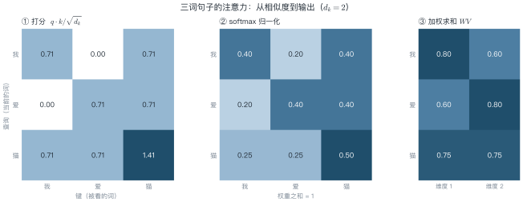
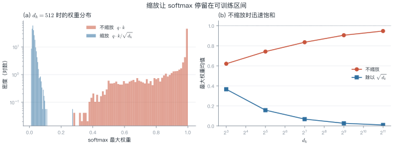
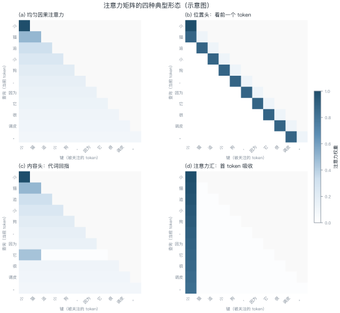
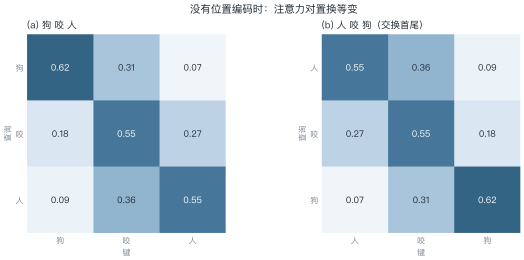
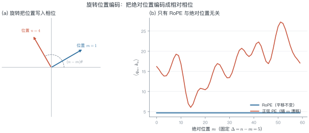
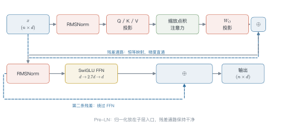

# 第 4 讲　注意力机制完全拆解

!!! abstract "本讲位置"
    第三部分的开篇。前置知识：第 3 讲的 seq2seq 与加性注意力。本讲把 Transformer 的核心部件拆到零件级别，第 5 讲再用它搭出完整的 block。

!!! info "📅 事实核查至 2026-11"
    本讲的历史事实（Vaswani et al., 2017；Su et al., 2021）均已核对原始论文，无 2024 年后的时效性陈述。

## 学习目标

学完本讲，你应该能够：

1. 写出缩放点积注意力的完整公式，并用三行方差推导解释 $\sqrt{d_k}$ 的来历；
2. 说明多头注意力与单头在**参数量、计算量**上的等价关系，以及它为什么不是"简单的并行"；
3. 证明不加位置编码时注意力对置换等变，并推导 RoPE 的相对位置性质；
4. 独立实现一个数值稳定、mask 正确的注意力模块，与 PyTorch 输出对齐到 $10^{-6}$。

---

## 0 直觉：一次可微的查字典

想象你在图书馆找资料。

你脑子里有一个**问题**——这是 query。每本书的书脊上有一行**标签**——这是 key。书里真正的内容是 **value**。

传统检索是**硬匹配**：按标签排序，取出最相关的那一本。这个操作不可微，没法端到端训练。

注意力做的事情只有一点差别：**它不取一本，而是按匹配度把所有书都翻一遍，然后加权汇总**。

$$\text{输出} = \sum_{i} \underbrace{\text{匹配度}(q, k_i)}_{\text{权重}} \cdot v_i$$

权重经过 softmax 归一化，于是"取哪一本"变成了"各看多少"。整个操作对 $q$、$k$、$v$ 都可微，梯度可以一路回传。

这就是注意力的全部直觉。剩下的问题都是工程细节：匹配度怎么算、权重会不会太尖、多个头怎么分工、顺序信息从哪来。

!!! note "一句话总结"
    注意力 = **用相似度做软寻址**。它替代的不是"记忆"，而是"检索"。

---

## 1 形式化：Q、K、V 为什么是三个

设输入序列为 $\boldsymbol{X} \in \R^{n \times d}$（$n$ 个 token，每个 $d$ 维）。我们引入三个可学习的投影矩阵：

$$\boldsymbol{Q} = \boldsymbol{X}\boldsymbol{W}_Q,\quad
\boldsymbol{K} = \boldsymbol{X}\boldsymbol{W}_K,\quad
\boldsymbol{V} = \boldsymbol{X}\boldsymbol{W}_V,
\qquad \boldsymbol{W}_Q,\boldsymbol{W}_K \in \R^{d\times d_k},\ \boldsymbol{W}_V \in \R^{d\times d_v}$$

于是缩放点积注意力（scaled dot-product attention）定义为

$$
\attn(\boldsymbol{Q},\boldsymbol{K},\boldsymbol{V})
= \softmax\!\left(\frac{\boldsymbol{Q}\boldsymbol{K}^{\top}}{\sqrt{d_k}}\right)\boldsymbol{V}
\tag{L4.1}
$$

其中 softmax 按**行**归一化，$\boldsymbol{Q}\boldsymbol{K}^\top \in \R^{n\times n}$ 的第 $(i,j)$ 个元素是第 $i$ 个查询与第 $j$ 个键的相似度。

**为什么必须是三个投影，而不是一个？**

假设令 $\boldsymbol{W}_Q=\boldsymbol{W}_K=\boldsymbol{W}_V=\boldsymbol{I}$，则

$$\attn = \softmax\!\left(\frac{\boldsymbol{X}\boldsymbol{X}^{\top}}{\sqrt{d}}\right)\boldsymbol{X}$$

此时"我该关注谁"和"我该取出什么"被迫共用同一个表示：一个 token 的向量既决定它被别人关注的程度，又决定它被取出时的内容。这两件事在语义上是正交的——代词"它"应该高度关注"小猫"，但"它"这个 token 本身并不携带"小猫"的内容。

解耦之后，模型可以学到一个专门的**匹配子空间**（$\boldsymbol{W}_Q,\boldsymbol{W}_K$）和一个专门的**内容子空间**（$\boldsymbol{W}_V$）。这是注意力表达力的来源。

!!! tip "维度约定"
    本讲义统一用 $d$ 表示模型宽度（$\dmodel$），$d_k=d_v=d/h$ 表示单头维度，$h$ 表示头数，$n$ 表示序列长度。记住这四个符号，后面所有复杂度分析都围绕它们展开。

---

### 例 4.1　三词句子的注意力手算

公式看完还是虚的。我们用一个能算完的例子，把 (L4.1) 的三步走一遍。

句子只有三个词：**我 / 爱 / 猫**。取 $d_k=2$，并假设投影后的查询、键、值恰好相同（只为手算方便，真实模型里三者由不同矩阵得到）：

| token | $\boldsymbol{q}_i=\boldsymbol{k}_i=\boldsymbol{v}_i$ |
|---|---|
| 我 | $(1,\ 0)$ |
| 爱 | $(0,\ 1)$ |
| 猫 | $(1,\ 1)$ |

**第一步：打分。** 先算点积，再除以 $\sqrt{2}\approx1.41$：

| 查询 ＼ 键 | 我 | 爱 | 猫 |
|---|---|---|---|
| **我** | 0.71 | 0.00 | 0.71 |
| **爱** | 0.00 | 0.71 | 0.71 |
| **猫** | 0.71 | 0.71 | **1.41** |

"猫"和自己的点积是 $1\times1+1\times1=2$，除以 1.41 得 1.41，是整张表里最大的分数。

**第二步：softmax。** 每一行独立归一化。以第一行为例：

$$
\frac{e^{0.71}}{e^{0.71}+e^{0}+e^{0.71}}
=\frac{2.03}{2.03+1+2.03}=0.40
$$

三行都算完：

| 查询 ＼ 键 | 我 | 爱 | 猫 |
|---|---|---|---|
| **我** | 0.40 | 0.20 | 0.40 |
| **爱** | 0.20 | 0.40 | 0.40 |
| **猫** | 0.25 | 0.25 | **0.50** |

**第三步：加权求和。** 还是看第一行：

$$
\boldsymbol{o}_1=0.40\cdot(1,0)+0.20\cdot(0,1)+0.40\cdot(1,1)=(0.80,\ 0.60)
$$

三行合起来就是输出矩阵：

| | 维度 1 | 维度 2 |
|---|---|---|
| **我** | 0.80 | 0.60 |
| **爱** | 0.60 | 0.80 |
| **猫** | 0.75 | 0.75 |

<figure markdown="span">
  { width="100%" }
  <figcaption>图 L4-1　同一个例子的三步：① 相似度打分 → ② 按行 softmax → ③ 用权重对值加权求和。格子里是实际数值。</figcaption>
</figure>

!!! tip "从这个例子里能读出三件事"
    1. **每行加起来都是 1**：softmax 按行归一化，不是按列。所以每个查询"分配出去"的关注度总量固定。
    2. **分数大不等于权重压倒性**：1.41 的最高分只换来 0.50 的权重，因为 softmax 会把差距压平——这正是 §2 讨论尺度问题的原因。
    3. **输出是加权平均，不是选择**：$\boldsymbol{o}_1$ 同时混入了三个词的信息，没有任何一个权重等于 1。

## 2 缩放因子：一个方差论证

公式 (L4.1) 里那个 $\sqrt{d_k}$ 不是装饰。它是这一节要证明的唯一结论。

### 2.1 推导

假设 $\boldsymbol{q},\boldsymbol{k}\in\R^{d_k}$ 的每个分量独立同分布，均值 0、方差 1。这是 LayerNorm 之后激活的合理近似。

点积展开：

$$\boldsymbol{q}\cdot\boldsymbol{k}=\sum_{i=1}^{d_k} q_i k_i$$

期望：

$$\E[\boldsymbol{q}\cdot\boldsymbol{k}]=\sum_{i=1}^{d_k}\E[q_i]\E[k_i]=0$$

方差（各项独立、均值为零，交叉项消失）：

$$
\Var(\boldsymbol{q}\cdot\boldsymbol{k})
=\sum_{i=1}^{d_k}\Var(q_i k_i)
=\sum_{i=1}^{d_k}\E[q_i^2]\E[k_i^2]
=\sum_{i=1}^{d_k} 1 = d_k
\tag{L4.2}
$$

所以点积的**标准差是 $\sqrt{d_k}$**。$d_k=128$ 时标准差约 11.3，$d_k=4096$ 时约 64。

### 2.2 不缩放会发生什么

softmax 对输入的尺度极其敏感。当 logits 的标准差达到几十，最大值与其余值的差距会被指数放大，输出退化成近似 one-hot：

$$\softmax(\boldsymbol{z}) \approx (1, 0, \dots, 0)$$

此时 softmax 的雅可比矩阵 $\partial p_i/\partial z_j = p_i(\delta_{ij}-p_j)$ 几乎全为零——**梯度消失**。模型不是"学得慢"，而是**根本学不动**。

除以 $\sqrt{d_k}$ 之后，由 (L4.2)，缩放后点积的方差为 $d_k/d_k=1$，与维度无关。softmax 始终工作在"温和"区间。

<figure markdown="span">
  { width="100%" }
  <figcaption>图 L4-2　缩放对 softmax 的影响。(a) $d_k=512$ 时最大权重的分布：不缩放几乎必然饱和到 1；(b) 最大权重均值随 $d_k$ 的变化，缩放后稳定在低值区。</figcaption>
</figure>

!!! warning "常见误解：$\sqrt{d_k}$ 是"温度"吗"
    可以这么理解，但要小心。除以 $\sqrt{d_k}$ 的目的是**让 logits 的方差与维度无关**，而不是调节"创造性"。推理时调 temperature 是在这个基础上再乘一个系数，两者作用位置相同、目的不同。

### 2.3 数值稳定的 softmax

实现时不能直接算 $e^{z_i}$：$z_i$ 稍大就溢出。标准做法是先减去每行最大值：

$$\softmax(\boldsymbol{z})_i=\frac{e^{z_i-m}}{\sum_j e^{z_j-m}},\qquad m=\max_j z_j$$

**为什么减一个常数不改变结果**：分子分母同乘 $e^{-m}$，约分即得。减去 $m$ 后最大的指数项是 $e^0=1$，不会上溢。

这一步在数学上平凡，在工程上是生死线。第 8 节会讲一个更隐蔽的坑：整行被 mask 时会发生什么。

---

## 3 多头注意力：子空间分解，不是简单并行

单个注意力头只能学**一种**匹配模式。但语言里的依赖关系是多种并存的：前一个词、句首、主谓一致、指代、标点边界……

多头注意力（multi-head attention）把 $d$ 维空间切成 $h$ 份，每份独立做一次注意力，最后拼接投影：

$$
\begin{aligned}
\text{head}_i &= \attn(\boldsymbol{X}\boldsymbol{W}_Q^{(i)},\ \boldsymbol{X}\boldsymbol{W}_K^{(i)},\ \boldsymbol{X}\boldsymbol{W}_V^{(i)})\\
\attn_{\text{multi}} &= \big[\text{head}_1;\dots;\text{head}_h\big]\boldsymbol{W}_O
\end{aligned}
\tag{L4.3}
$$

其中 $\boldsymbol{W}_Q^{(i)},\boldsymbol{W}_K^{(i)},\boldsymbol{W}_V^{(i)}\in\R^{d\times d/h}$，$\boldsymbol{W}_O\in\R^{d\times d}$。

### 3.1 参数与计算量核算

设 $d=512$，$h=8$，于是 $d_k=64$。

| 方案 | 每个投影矩阵 | 三个投影合计 | 输出投影 |
|---|---|---|---|
| 单头（$d_k=512$） | $512\times512=262{,}144$ | $786{,}432$ | $262{,}144$ |
| 多头（$h=8$，$d_k=64$） | $512\times64=32{,}768$ | $786{,}432$ | $262{,}144$ |

**参数量完全相同，计算量也完全相同。**

那多头的意义在哪？在于**低秩约束**。单头在 $d$ 维空间里直接算一个 $n\times n$ 的相似度矩阵；多头则是 $h$ 个 $d/h$ 维子空间里的 $n\times n$ 矩阵，各自独立归一化、独立加权。

这带来两个实际后果：

1. **每个头被迫专注一种关系**。$d/h$ 维空间装不下所有模式，低秩瓶颈起到正则化作用。
2. **权重分布不同**。softmax 在各自的子空间内归一化，因此一个头可以"只看前一个词"，另一个头可以"只看句首"，互不干扰。单头里这些模式会互相竞争同一份概率质量。

$\boldsymbol{W}_O$ 也不是可有可无的：它把各头输出混合回 $d$ 维。没有它，各头只能简单拼接，维度间无法交互。

<figure markdown="span">
  { width="100%" }
  <figcaption>图 L4-3　注意力矩阵的四种典型形态（按模式手工构造的示意图）。(a) 均匀因果；(b) 位置头关注前一个 token；(c) 内容头让代词"它"回指"小猫"；(d) 注意力汇：大量权重堆在首 token 上。</figcaption>
</figure>

### 3.2 为什么有效：可解释性证据

Michel et al. (2019) 做了一个很说明问题的实验：训练后逐个头剪枝，发现**大部分头可以删掉而性能几乎不变**，但少数关键头一旦删除，模型立刻崩溃。

这说明头之间存在明确分工，且重要性高度不均。后续的注意力可视化研究进一步发现：

- 浅层多为**位置头**（关注相邻 token）与**句法头**（关注依存关系）；
- 中层出现**指代头**与**实体头**；
- 深层趋向**语义聚合**，注意力分布变平。

图 L4-3(d) 展示的"注意力汇"（attention sink）是另一个反复出现的现象：无论输入是什么，第一个 token 总会吸收大量注意力。StreamingLLM 正是利用这一点，保留首 token 的 KV 就能支持无限长流式输入。

!!! tip "从多头到 GQA"
    既然键值可以共享，何必每个头都存一份？**多查询注意力**（MQA）让所有头共享一组 K/V，**分组查询注意力**（GQA）让每组头共享一组。这是第 13 讲推理优化的伏笔：GQA 把 KV cache 直接缩小 $h/h_{kv}$ 倍。

---

## 4 位置编码：打破置换等变

### 4.1 没有位置编码会怎样

**命题**：若注意力中不含任何位置信息，则它对输入序列的置换等变。

设 $\boldsymbol{P}$ 为置换矩阵（$\boldsymbol{P}^\top\boldsymbol{P}=\boldsymbol{I}$），输入变为 $\boldsymbol{P}\boldsymbol{X}$。则

$$
\begin{aligned}
\attn(\boldsymbol{P}\boldsymbol{X})
&=\softmax\!\left(\frac{\boldsymbol{P}\boldsymbol{X}\boldsymbol{W}_Q\boldsymbol{W}_K^\top\boldsymbol{X}^\top\boldsymbol{P}^\top}{\sqrt{d_k}}\right)\boldsymbol{P}\boldsymbol{X}\boldsymbol{W}_V\\
&=\boldsymbol{P}\,\softmax\!\left(\frac{\boldsymbol{X}\boldsymbol{W}_Q\boldsymbol{W}_K^\top\boldsymbol{X}^\top}{\sqrt{d_k}}\right)\boldsymbol{P}^\top\boldsymbol{P}\boldsymbol{X}\boldsymbol{W}_V\\
&=\boldsymbol{P}\,\attn(\boldsymbol{X})
\end{aligned}
\tag{L4.4}
$$

第二步用了 softmax 按行归一化的性质：同时置换行和列，等价于先算再置换。

结论：输出只是跟着输入一起被置换。模型**无法区分**"狗咬人"和"人咬狗"。

### 例 4.2　"狗咬人"与"人咬狗"

把 3 个词的注意力权重矩阵画出来，交换首尾两个词，看矩阵怎么变。

设原句"狗咬人"的权重矩阵为 $\boldsymbol{W}$。交换第 1、3 个词得到"人咬狗"，相当于左乘右乘同一个置换矩阵：

$$
\boldsymbol{W}'=\boldsymbol{P}\,\boldsymbol{W}\,\boldsymbol{P}^{\top}
$$

<figure markdown="span">
  { width="100%" }
  <figcaption>图 L4-4　交换首尾两个词后，注意力权重矩阵只是行列重排：0.62 从左上角移到右下角，0.07 从右上角移到左下角，数值一个没变。</figcaption>
</figure>

逐格对照：0.62 从左上角跑到右下角，0.07 从右上角跑到左下角，**每个数字都没变，只是换了位置**。

这正是 (L4.4) 的直观含义：输入变了，但模型"看到"的仍是同一张表，输出也只是跟着换位置。没有位置编码，它无从知道谁是主语、谁是宾语。

!!! note "加了位置编码之后会怎样"
    $\boldsymbol{q}_{\text{狗}}$ 与 $\boldsymbol{q}_{\text{人}}$ 的相位不同，两句话的权重矩阵不再互为置换。模型才第一次有了区分语序的依据。

### 4.2 四代方案

| 方案 | 代表 | 做法 | 外推性 | 代价 |
|---|---|---|---|---|
| 正弦绝对位置 | 原版 Transformer | 用不同频率的 sin/cos 加到嵌入上 | 差 | 无 |
| 学习式绝对位置 | BERT、GPT-2 | 每个位置一个可训练向量 | 无（长度固定） | 参数 $n_{\max}\times d$ |
| 相对位置偏置 | T5、ALiBi | 在 logits 上加 $b(i-j)$ | 较好 | 少量参数或无参数 |
| 旋转位置编码 | RoPE（LLaMA 系） | 旋转 Q/K 的相位 | 好（可外推） | 无额外参数 |

ALiBi 的做法特别简洁：直接在注意力 logits 上加 $-m\cdot|i-j|$，$m$ 是每个头固定的斜率。距离越远惩罚越大，天然鼓励局部关注，外推表现意外地好。

但今天的主流是 RoPE。原因值得单独推导。

### 4.3 RoPE：把位置写进相位

**核心想法**：不改变向量的模长，只旋转它的相位；让旋转角度随位置线性增长，于是两个向量的内积只依赖它们的**相对**位移。

把 $d$ 维向量两两分组，看成 $d/2$ 个二维平面。第 $i$ 组的旋转角为

$$\theta_i = m\cdot\omega_i,\qquad \omega_i = 10000^{-2i/d}$$

位置 $m$ 对应的旋转矩阵是分块对角阵：

$$\boldsymbol{R}_m=\operatorname{diag}\big(\boldsymbol{R}(m\omega_0),\ \boldsymbol{R}(m\omega_1),\ \dots,\ \boldsymbol{R}(m\omega_{d/2-1})\big),\qquad
\boldsymbol{R}(\theta)=\begin{pmatrix}\cos\theta & -\sin\theta\\ \sin\theta & \cos\theta\end{pmatrix}$$

对查询和键分别施加旋转：$\tilde{\boldsymbol{q}}_m=\boldsymbol{R}_m\boldsymbol{q}$，$\tilde{\boldsymbol{k}}_n=\boldsymbol{R}_n\boldsymbol{k}$。

**关键性质**：旋转矩阵是正交的，且角度可加，

$$\boldsymbol{R}_m^\top\boldsymbol{R}_n=\boldsymbol{R}_{-m}\boldsymbol{R}_{n}=\boldsymbol{R}_{n-m}$$

于是

$$
\langle \tilde{\boldsymbol{q}}_m,\tilde{\boldsymbol{k}}_n\rangle
=\boldsymbol{q}^\top\boldsymbol{R}_m^\top\boldsymbol{R}_n\boldsymbol{k}
=\boldsymbol{q}^\top\boldsymbol{R}_{n-m}\boldsymbol{k}
\tag{L4.5}
$$

**内积只依赖 $n-m$**。这就是 RoPE 相对位置性质的完整证明——只有两行。

<figure markdown="span">
  { width="100%" }
  <figcaption>图 L4-5　RoPE 的几何含义。(a) 位置 $m$、$n$ 的向量各自旋转 $m\theta$、$n\theta$，内积只由夹角差决定；(b) 固定 $\Delta=5$，RoPE 的内积不随绝对位置变化，而"正弦位置相加"会持续漂移。</figcaption>
</figure>

三个值得记住的推论：

1. **不改变模长**：$\|\boldsymbol{R}_m\boldsymbol{q}\|=\|\boldsymbol{q}\|$，数值稳定。
2. **无额外参数**：位置信息完全由固定的频率决定。
3. **可作用于 KV cache**：旋转在写入缓存前完成，之后无需重算。

至于频率设计，$\omega_i$ 从 $1$ 衰减到 $10000^{-1}$，对应波长从 $2\pi$ 到 $2\pi\times10^4$。高维（$i$ 大）的旋转极慢，负责长程粗定位；低维旋转快，负责局部精细位置。这种"多尺度"结构是 RoPE 能外推的物理直觉。

!!! warning "RoPE 不是万能的"
    训练长度之外，高频维度会"转圈"导致混叠，性能仍会下降。位置插值（PI）、NTK-aware 缩放、YaRN 都是对这个问题的补救，详见第 12 讲。

---

## 5 掩码：三种 mask 不要混

### 5.1 因果掩码

自回归生成要求位置 $t$ 只能看到 $\le t$ 的信息。做法是在 softmax 之前把上三角置为负无穷：

$$\text{scores}_{ij}=\begin{cases}\boldsymbol{q}_i\cdot\boldsymbol{k}_j/\sqrt{d_k}, & j\le i\\ -\infty, & j>i\end{cases}$$

训练时一次前向算完整序列（teacher forcing），推理时每步只算新 token——这是**训练并行、推理串行**的根本原因，也是 KV cache 存在的理由。

### 5.2 填充掩码

批处理时序列长度不一，需要把 padding 位置屏蔽掉。注意它和因果掩码的**形状不同**：

| 掩码 | 形状 | 作用维度 |
|---|---|---|
| 因果掩码 | $n\times n$ | 每个查询屏蔽未来的键 |
| 填充掩码 | $1\times n$ 或 $b\times 1\times 1\times n$ | 屏蔽所有查询对 padding 键的注意力 |

两者需要**按位与**合并，而不是相加。

### 5.3 NaN 陷阱

如果用 $-\infty$ 做 mask，且某一行的**所有**位置都被 mask（例如整句都是 padding），softmax 会变成 $\frac{0}{0}$，输出 NaN。

两种解法：

- 用有限大负数，如 $-10^9$ 或 `torch.finfo(dtype).min`；
- 或在 softmax 前加保护，把全 mask 行的 logits 置零。

!!! danger "这个 bug 极难查"
    NaN 会沿着梯度传播，污染整个 batch，但你看到的报错往往在几百步之后。**在写 attention 的第一天就养成用有限大负数的习惯。**

---

## 6 一个 block 到底算了什么

### 6.1 数据流

<figure markdown="span">
  { width="100%" }
  <figcaption>图 L4-6　Pre-LN Transformer block 的数据流。两条残差通路分别绕过注意力和 FFN，保证梯度有直通路径。</figcaption>
</figure>

现代大模型普遍采用 **Pre-LN**：归一化放在子层输入端，残差通路保持"干净"。原版 Transformer 的 Post-LN 在深层会梯度爆炸，需要 warmup 才能训起来。

### 6.2 参数核算：以 LLaMA-7B 为例

设 $d=4096$，$L=32$ 层，$h=32$，$d_{\text{ff}}=11008$，词表 32000。

**每层注意力**：四个 $d\times d$ 矩阵

$$4\times 4096^2 \approx 67.1\text{M}$$

**每层 FFN**（SwiGLU 有三个矩阵：gate、up、down）：

$$3\times 4096\times 11008 \approx 135.3\text{M}$$

**每层合计**约 $202.4$M，32 层约 $6.48$B，加上词嵌入 $32000\times4096\approx131$M，总计约 **6.7B**——这正是 LLaMA-7B 的实际参数量。

**每 token 前向 FLOPs** 约 $2N \approx 13.4$ GFLOPs；训练时含反向与重计算，约 $6N \approx 40$ GFLOPs。

**KV cache**（fp16，上下文 4096）：

$$2\times L\times d\times n\times 2\text{ bytes}
=2\times32\times4096\times4096\times2 \approx 2.1\text{ GB}$$

注意这一项随上下文长度**线性**增长，与参数量无关。一个 7B 模型跑 128K 上下文，仅 KV cache 就要 67GB——比模型本身大一个数量级。这是第 13 讲所有优化的起点。

### 6.3 复杂度

| 项 | 时间 | 显存 |
|---|---|---|
| 注意力打分 | $O(n^2 d)$ | $O(n^2)$（可优化到 $O(n)$） |
| 线性投影 | $O(n d^2)$ | $O(nd)$ |
| FFN | $O(n d\, d_{\text{ff}})$ | $O(nd_{\text{ff}})$ |

$n$ 与 $d$ 的相对大小决定瓶颈：短序列时 FFN 主导，长序列时 $n^2$ 项主导。粗略的分界点是 $n\approx d$。

---

## 7 动手实现

下面是完整实现，30 行，无第三方依赖（除 PyTorch）：

```python
import math
import torch
import torch.nn.functional as F


def scaled_dot_product_attention(q, k, v, causal=True, pad_mask=None):
    """q, k, v: (B, H, N, D)。返回 (输出, 注意力权重)。"""
    d_k = q.size(-1)
    scores = q @ k.transpose(-2, -1) / math.sqrt(d_k)   # (B,H,N,N)

    if causal:
        n = scores.size(-1)
        # 上三角为 True 的位置要屏蔽；用有限大负数，避免 NaN
        mask = torch.triu(torch.ones(n, n, dtype=torch.bool, device=q.device), diagonal=1)
        scores = scores.masked_fill(mask, torch.finfo(scores.dtype).min)

    if pad_mask is not None:
        # pad_mask: (B, N)，True 表示是 padding
        scores = scores.masked_fill(pad_mask[:, None, None, :], torch.finfo(scores.dtype).min)

    attn = F.softmax(scores, dim=-1)
    return attn @ v, attn
```

与 PyTorch 官方实现对齐（Lab 1 会完整跑这个测试）：

```python
torch.manual_seed(0)
q, k, v = (torch.randn(2, 4, 16, 32, dtype=torch.float64) for _ in range(3))

out, _ = scaled_dot_product_attention(q, k, v)
ref = F.scaled_dot_product_attention(q, k, v, is_causal=True)

print((out - ref).abs().max().item())   # 期望 < 1e-12（float64）
```

!!! tip "为什么用 float64 测"
    float32 下 softmax 的实现顺序差异会带来 $10^{-7}$ 量级的误差，掩盖真正的 bug。对齐测试一律用 float64，确认逻辑正确后再回到 bf16 跑性能。

---

## 8 工程坑清单

这些是实际写模型时最容易踩的八个坑，按出现频率排序。

1. **用 $-\infty$ 做 mask** → 整行被 mask 时 NaN。用 `finfo.min`。
2. **忘记除以 $\sqrt{d_k}$** → 训练 loss 一开始就平，梯度极小。
3. **多头 reshape 顺序错**：正确顺序是 `(B, N, H, D) → (B, H, N, D)`，转置时把 head 维和 seq 维搞混是最常见的静默 bug。
4. **因果掩码方向反了**：`triu(diagonal=1)` 屏蔽未来，`tril` 屏蔽过去。写反了模型仍能训练，只是效果莫名其妙地差。
5. **padding mask 形状广播错**：`(B,N)` 要扩成 `(B,1,1,N)`，否则会按最后一维广播成完全错误的形状。
6. **bf16 下 logits 溢出**：bf16 动态范围大但精度低，累加顺序不当会掉点。注意 `finfo.min` 在 bf16 下约 $-3.4\times10^{38}$，参与减法仍安全。
7. **GQA 用 `repeat` 而不是 `expand`**：`repeat` 会真实复制 KV，显存翻倍；`expand` 只改 stride。
8. **FlashAttention 的数值差异**：在线 softmax 改变了求和顺序，与朴素实现有 $10^{-3}$ 量级差异，属于正常现象，不要拿它当 bug 查。

---

## 9 论文与延伸

| 年份 | 论文 | 一句话贡献 |
|---|---|---|
| 2014 | [Bahdanau et al., Neural Machine Translation by Jointly Learning to Align and Translate](https://arxiv.org/abs/1409.0473) | 加性注意力的起点 |
| 2017 | [Vaswani et al., Attention Is All You Need](https://arxiv.org/abs/1706.03762) | 缩放点积 + 多头 + 正弦位置 |
| 2019 | [Michel et al., Are Sixteen Heads Really Better than One?](https://arxiv.org/abs/1905.10650) | 头剪枝实验，证明分工不均 |
| 2019 | [Shazeer, Fast Transformer Decoding: One Write-Head is All You Need](https://arxiv.org/abs/1911.02150) | MQA，KV cache 优化的起点 |
| 2021 | [Su et al., RoFormer: Enhanced Transformer with Rotary Position Embedding](https://arxiv.org/abs/2104.09864) | RoPE |
| 2021 | [Geva et al., Transformer Feed-Forward Layers Are Key-Value Memories](https://arxiv.org/abs/2012.14913) | FFN 的记忆解释 |
| 2022 | [Dao et al., FlashAttention](https://arxiv.org/abs/2205.14135) | IO 感知的精确注意力 |
| 2023 | [Ainslie et al., GQA](https://arxiv.org/abs/2305.13245) | 分组查询注意力 |
| 2023 | [Xiao et al., Efficient Streaming Language Models with Attention Sinks](https://arxiv.org/abs/2309.17453) | 注意力汇与流式推理 |

---

## 10 习题

**🟢 概念题**

1. 如果把 $h$ 从 8 增到 16（保持 $d$ 不变），参数量、计算量、单头维度各如何变化？为什么说"多头不是免费午餐"？
2. 因果掩码在训练和推理时的形状分别是什么？为什么推理时不需要 $n\times n$ 的掩码？

**🟡 推导题**

3. 证明：若 $q_i,k_i$ 独立且 $\E[q_i]=\mu_q,\E[k_i]=\mu_k$，则 $\Var(\boldsymbol{q}\cdot\boldsymbol{k})=d_k(\sigma_q^2\sigma_k^2+\mu_q^2\sigma_k^2+\mu_k^2\sigma_q^2)$。均值不为零时，缩放因子还应该是 $\sqrt{d_k}$ 吗？
4. 推导 softmax 的雅可比矩阵，并说明为什么 $p\to$ one-hot 时梯度消失。给出"梯度最大"时 $p$ 的取值。

**🔴 实现题**

5. 实现 RoPE 的 `rotate_half` 版本，验证与"逐对旋转"版本数值一致；再验证 (L4.5) 的相对位置性质。
6. 用纯 NumPy 实现一个 4 层、4 头的迷你 Transformer block，输入随机序列，前向跑通并与 PyTorch 对齐（提示：注意 LayerNorm 的 epsilon 和 PyTorch 默认值一致）。

---

## 11 本讲小结

<div class="cheatsheet" markdown>

**一张图记住注意力**

$$\attn(\boldsymbol{Q},\boldsymbol{K},\boldsymbol{V})=\softmax\!\left(\frac{\boldsymbol{Q}\boldsymbol{K}^\top}{\sqrt{d_k}}\right)\boldsymbol{V}$$

**四个关键数字**

- $\sqrt{d_k}$：让 logits 方差恒为 1，防止 softmax 饱和
- 多头参数量 = 单头参数量：$h\times(d\times d/h)=d^2$
- KV cache = $2\cdot L\cdot d\cdot n\cdot$ 字节数：随 $n$ 线性增长
- 每 token 前向 FLOPs ≈ $2N$

**三个易错点**

- mask 用 $-\infty$ → NaN；用 `finfo.min`
- 多头 reshape 顺序：`(B,N,H,D) → (B,H,N,D)`
- RoPE 的内积只依赖 $n-m$，这是它能外推的根本原因

**一句话**

> 注意力的本质是**可微的软检索**；$\sqrt{d_k}$ 管数值稳定，多头管子空间分工，位置编码管顺序，掩码管因果性。

</div>
