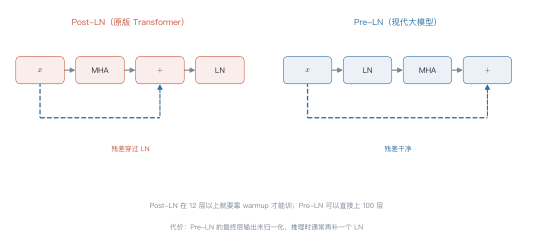
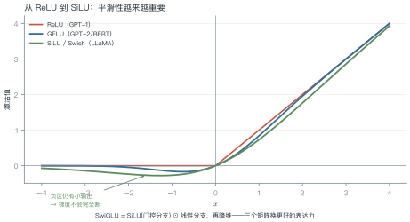
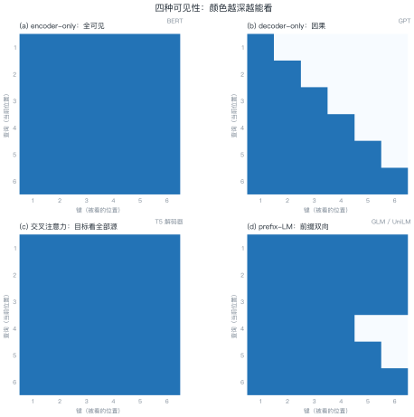
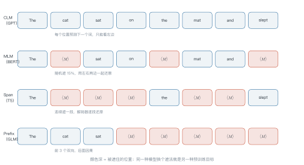

# 第 5 讲　Block 与三大范式

!!! abstract "本讲位置"
    第 4 讲拆开了注意力这个零件，本讲把它装成整机：一个 block 里还有什么、三种架构差在哪、预训练目标怎么选。

!!! info "📅 事实核查至 2026-11"
    本讲涉及的 Pre-LN（Xiong et al., 2020）、RMSNorm（Zhang & Sennrich, 2019）、SwiGLU（Shazeer, 2020）均已核对原文。

## 学习目标

学完本讲，你应该能够：

1. 画出 Pre-LN block 的完整数据流，说明它为什么比 Post-LN 好训；
2. 写出 RMSNorm 与 SwiGLU 的公式，并解释各自的取舍；
3. 根据 mask 矩阵判断一个模型属于哪种范式；
4. 手算一个 block 的参数量、激活显存与 MLM 的遮罩分配。

---

## 0 直觉：一个 block 干两件事

Transformer 的一个 block 只做两件事：

1. **看上下文**——注意力层，让每个位置从别的位置取信息；
2. **自己想想**——前馈网络（feed-forward network，FFN），对取回来的信息做非线性变换。

其余部件（残差、归一化）都是为了让这两件事在几十层堆叠后仍然训得动。

!!! note "一句话总结"
    Block = **通信（注意力）+ 计算（FFN）**，残差保证信号直通，归一化保证数值稳定。

---

## 1 Block 内部

### 1.1 Pre-LN 与 Post-LN

原版 Transformer 是 Post-LN：先做子层，再相加，最后归一化。现代大模型几乎都用 Pre-LN：先归一化，再做子层，最后相加。

<figure markdown="span">
  { width="100%" }
  <figcaption>图 L5-1　读图要点：注意虚线（残差）。Post-LN 的残差要穿过 LN 才能回到主干，Pre-LN 的残差是一条干净的直线。<b>深层网络里，这条直线就是梯度的生命线</b>。</figcaption>
</figure>

**为什么 Pre-LN 更好训**：Post-LN 的梯度回传必须穿过每一层的 LayerNorm，而 LN 的雅可比矩阵会随深度放大或衰减；层数一多，梯度就失控。Pre-LN 把归一化挪到支路上，主干始终保持恒等映射。

代价是：Pre-LN 的最后一层输出没有归一化，推理时通常要补一个 final LN。

### 1.2 RMSNorm：去掉均值

LayerNorm 做两件事：减均值、除标准差。RMSNorm 只做后一半：

$$
\operatorname{RMSNorm}(x)=\frac{x}{\sqrt{\frac{1}{d}\sum_{i=1}^{d}x_i^2+\epsilon}}\odot\gamma
\tag{5.1}
$$

**为什么可以去掉减均值？** 因为后续的线性层本身有偏置，均值信息可以被吸收；而减均值需要额外一次全维求和，在千亿参数规模上是实打实的开销。实践中 RMSNorm 效果与 LayerNorm 相当，速度更快。

### 1.3 SwiGLU：三个矩阵换表达力

标准 FFN 是两个矩阵（升维再降维）。SwiGLU 用三个：

$$
\operatorname{FFN}(x)=\boldsymbol{W}_{\text{down}}\Big(\operatorname{SiLU}(\boldsymbol{W}_{\text{gate}}x)\odot\boldsymbol{W}_{\text{up}}x\Big)
\tag{5.2}
$$

门控分支 $\operatorname{SiLU}(\cdot)$ 起到"软开关"的作用：它决定每个维度放行多少信息。

<figure markdown="span">
  { width="100%" }
  <figcaption>图 L5-4　读图要点：SiLU 在负区仍有小输出，梯度不会完全断掉；ReLU 在负区直接归零。<b>门控需要这种"软"的激活</b>，否则退化成硬开关。</figcaption>
</figure>

**参数怎么配平**：SwiGLU 有三个矩阵，若保持与标准 FFN（$4d^2$）相同的参数量，需要

$$3\cdot d\cdot d_{\text{ff}}=4d^2\ \Longrightarrow\ d_{\text{ff}}\approx\tfrac{4}{3}d$$

LLaMA 取 $d_{\text{ff}}=11008$（$d=4096$），比 $4/3d\approx5461$ 大不少——它选择了"多花参数换效果"。

### 1.4 这三个部件是怎么来的

它们都不是 Transformer 原创，而是从别处搬来的成熟方案：

- **残差连接**来自 ResNet（2015）。没有它，20 层以上的网络就训不动；Transformer 把它当成默认配置。
- **LayerNorm** 来自批量归一化的替代方案。BatchNorm 依赖 batch 统计量，序列任务里 batch 内长度不一、推理时 batch=1，统计量不可靠；LayerNorm 对每个样本单独归一化，天然适配变长输入。
- **激活函数**的演进是"越来越平滑"：ReLU（2010）→ GELU（2016）→ SiLU/Swish（2017）。平滑意味着更好的梯度性质，代价是多一点计算。

理解这条脉络比记住公式有用：**Transformer 的创新只有注意力，其余都是工程上最稳的选择**。

### 例 5.1　手算一个 block 的开销

设 $d=4096$，$d_{\text{ff}}=11008$，$h=32$，序列长度 $n=2048$，batch $=1$，bf16。

**参数量（每层）：**

| 部件 | 算式 | 参数 |
|---|---|---|
| 注意力（4 个 $d\times d$） | $4\times4096^2$ | $67.1$M |
| SwiGLU（3 个 $d\times d_{\text{ff}}$） | $3\times4096\times11008$ | $135.3$M |
| 合计 | | $202.4$M |

32 层约 $6.5$B，加词表约 $6.7$B——正是 LLaMA-7B。

**激活显存（单层）：**

注意力打分矩阵的形状是 $h\times n\times n$：

$$32\times2048\times2048\times2\ \text{B}=268\ \text{MB}$$

32 层全存下来就是 $8.6$ GB——**这还没算 FFN 的中间激活**。这就是为什么训练必须用激活重计算（第 14 讲）。

!!! tip "从这个例子里能读出三件事"
    1. **FFN 占了三分之二的参数**：稠密模型里"记忆"主要存在 FFN 里；
    2. **激活显存与 $n^2$ 成正比**：序列翻倍，激活翻四倍，比参数涨得还快；
    3. **这就是长上下文训练贵的原因**：不是算力不够，是显存放不下。

---

一个 block 的零件就这些。把它们按不同的可见性组合起来，就得到三种架构——

## 2 三大范式：mask 决定一切

### 2.1 一张图看懂

<figure markdown="span">
  { width="100%" }
  <figcaption>图 L5-2　读图要点：颜色越深表示"能看见"。encoder 全可见；decoder 只能看左下三角；prefix-LM 的前缀部分双向、后缀部分因果。<b>架构的差别，本质就是 mask 的差别</b>。</figcaption>
</figure>

### 例 5.2　手算因果掩码的可见比例

$n=4$ 时，$4\times4=16$ 个格子，可见的是下三角：

$$\frac{4\times5/2}{16}=\frac{10}{16}=62.5\%$$

$n=2048$ 时：

$$\frac{2048\times2049/2}{2048^2}=\frac{2\,098\,176}{4\,194\,304}\approx50.02\%$$

**结论**：序列越长，因果掩码浪费的计算越接近一半——这是"训练时一半的注意力分数被 mask 掉"的量化说法。

### 2.2 三种架构的取舍

| 范式 | 代表 | 强项 | 弱项 |
|---|---|---|---|
| encoder-only | BERT | 理解类任务（分类、抽取） | 不能直接生成 |
| decoder-only | GPT / LLaMA | 生成、零样本迁移、scaling 友好 | 理解类任务要额外包装 |
| encoder-decoder | T5 | 输入输出差异大的任务（翻译） | 结构复杂，参数利用率低 |

**为什么 decoder-only 赢了？** 三个原因：

1. **训练目标与推理一致**：都是"预测下一个词"，没有训练-推理鸿沟；
2. **可以无监督地利用一切文本**：不需要构造输入输出对；
3. **scaling 最省心**：结构简单，超参少，规模上去就是涨点。

---

## 3 预训练目标

### 3.1 四种目标

<figure markdown="span">
  { width="100%" }
  <figcaption>图 L5-3　读图要点：同一串 token，换一种"遮法"就是另一种预训练目标。CLM 全因果；MLM 随机遮点；span corruption 遮连续段；prefix-LM 前双向后因果。</figcaption>
</figure>

| 目标 | 遮什么 | 可见性 | 代表 |
|---|---|---|---|
| CLM | 不遮，预测下一个 | 因果 | GPT |
| MLM | 随机 15% 的单点 | 双向 | BERT |
| Span corruption | 连续片段 | 编码器双向 | T5 |
| Prefix-LM | 后缀 | 前缀双向 | GLM / UniLM |

### 例 5.3　手算 MLM 的遮罩分配

一段 1000 token 的文本，按 BERT 的规则：

1. 随机选 15% 的位置：$1000\times0.15=150$ 个；
2. 这 150 个里，**80% 换成 `[MASK]`**：$120$ 个；
3. **10% 换成随机词**：$15$ 个；
4. **10% 保持不变**：$15$ 个。

**为什么不是全部换成 `[MASK]`？** 因为推理时根本没有 `[MASK]` 这个 token。全遮会让模型只在"看到 `[MASK]`"时才会做题，产生训练-推理不匹配。留 10% 原词、10% 随机词，逼模型对**每个位置**都保持判断力。

损失只在这 150 个位置上计算，其余 850 个位置不贡献梯度。

!!! tip "从这个例子里能读出三件事"
    1. **有效监督信号只有 15%**：MLM 的样本效率比 CLM 低得多（CLM 每个位置都有信号）；
    2. **80/10/10 是经验规则**：后来的 RoBERTa 试过动态遮罩，效果更好；
    3. **这正是 decoder-only 胜出的原因之一**：每个 token 都能贡献损失。

---

### 3.2 目标与架构必须匹配

预训练目标和架构不是随便配的，它们互相约束：

| 目标 | 必须的可见性 | 因此只能用 |
|---|---|---|
| CLM | 因果 | decoder-only |
| MLM | 双向 | encoder-only |
| Span corruption | 编码器双向 + 解码器因果 | encoder-decoder |
| Prefix-LM | 前缀双向 + 后缀因果 | 单一模型（自定义 mask） |

**一个常见误解**：以为 BERT 不能生成是因为"没训好"。其实不是——它的 mask 让每个位置都能看到右边，训练时模型学会了"抄答案"。推理时没有答案可抄，自然生成不出来。

反过来，decoder-only 模型做理解任务要额外包装（比如把分类改写成"下一个词是正面还是负面"），本质是在**用生成的方式模拟判别**。

## 4 参数量与 FLOPs 的通用算法

任何 Transformer 都能用三个式子估算：

$$
\underbrace{N\approx 12\,L\,d^2}_{\text{每层约 }12d^2}\quad
\underbrace{C_{\text{train}}\approx 6ND}_{\text{训练}}\quad
\underbrace{C_{\text{infer}}\approx 2NT}_{\text{推理}}
\tag{5.3}
$$

其中 $12d^2$ 的来历：注意力 4 个矩阵（$4d^2$）+ FFN 若为 $8d^2$（$d_{\text{ff}}=4d$，两个矩阵），合计 $12d^2$。用 SwiGLU 会略高一些。

**验算**：$L=32$、$d=4096$ → $12\times32\times4096^2\approx6.4$B，与 LLaMA-7B 的 6.7B 吻合。

### 4.1 三个规模的开销对照

用 (5.3) 把三个典型规模摊开看（$L$ 为层数，$d$ 为宽度）：

| 规模 | $L$ | $d$ | 参数（$12Ld^2$） | 训练算力（$D=20N$） | KV cache / 4k 上下文 |
|---|---|---|---|---|---|
| 1.5B | 24 | 2048 | 1.2B | $1.4\times10^{20}$ | 0.4 GB |
| 7B | 32 | 4096 | 6.4B | $7.7\times10^{20}$ | 2.1 GB |
| 70B | 80 | 8192 | 64B | $7.7\times10^{22}$ | 21 GB |

三列数字的增长速度完全不同：

- **参数**随 $Ld^2$ 增长，从 7B 到 70B 是 10 倍；
- **训练算力**随 $N^2$ 增长，是 100 倍；
- **KV cache** 随 $Ld$ 增长，是 20 倍。

这就是为什么 70B 模型不是"7B 的十倍贵"，而是"百倍贵"——**算力吃的是参数的平方**。

```python
import torch
import torch.nn as nn


class RMSNorm(nn.Module):
    def __init__(self, d, eps=1e-6):
        super().__init__()
        self.g = nn.Parameter(torch.ones(d))
        self.eps = eps

    def forward(self, x):
        rms = x.pow(2).mean(-1, keepdim=True).add(self.eps).rsqrt()
        return x * rms * self.g


class SwiGLU(nn.Module):
    def __init__(self, d, d_ff):
        super().__init__()
        self.gate = nn.Linear(d, d_ff, bias=False)
        self.up = nn.Linear(d, d_ff, bias=False)
        self.down = nn.Linear(d_ff, d, bias=False)

    def forward(self, x):
        return self.down(torch.nn.functional.silu(self.gate(x)) * self.up(x))


class Block(nn.Module):
    """Pre-LN：归一化在子层入口，残差是干净直线"""

    def __init__(self, d=4096, h=32, d_ff=11008):
        super().__init__()
        self.ln1 = RMSNorm(d)
        self.attn = nn.MultiheadAttention(d, h, batch_first=True)
        self.ln2 = RMSNorm(d)
        self.ffn = SwiGLU(d, d_ff)

    def forward(self, x):
        x = x + self.attn(self.ln1(x), self.ln1(x), self.ln1(x), need_weights=False)[0]
        return x + self.ffn(self.ln2(x))
```

---

## 5 工程要点与坑

1. **LN 的 eps 别乱改**：默认 $10^{-5}$ 或 $10^{-6}$，改了会让训练初期不稳。
2. **Pre-LN 要补 final norm**：否则最后一层输出尺度不受控。
3. **SwiGLU 的 $d_{\text{ff}}$ 要对齐到 128 的倍数**：GPU 上更高效。
4. **attention 的 `need_weights=False`**：默认返回权重会多一次显存拷贝。
5. **mask 的 dtype 要匹配**：bf16 下用 `finfo.min`，不要用 `-inf`。
6. **encoder-decoder 的交叉注意力**：query 来自解码器，key/value 来自编码器，mask 只用 padding。

7. **别在同一层里混用两种归一化**：LN 与 RMSNorm 的数值行为不同，混用会让调参失去参照。
8. **FFN 的宽度比深度更划算**：同样参数预算下，加宽 $d_{\text{ff}}$ 通常比多加一层收益大。

---

## 6 论文与延伸

| 年份 | 论文 | 一句话贡献 |
|---|---|---|
| 2019 | [Zhang & Sennrich, Root Mean Square Layer Normalization](https://arxiv.org/abs/1910.07467) | RMSNorm |
| 2020 | [Xiong et al., On Layer Normalization in the Transformer Architecture](https://arxiv.org/abs/2002.04745) | 系统比较 Pre-LN / Post-LN |
| 2020 | [Shazeer, GLU Variants Improve Transformer](https://arxiv.org/abs/2002.05202) | SwiGLU |
| 2018 | [BERT](https://arxiv.org/abs/1810.04805) | encoder-only + MLM |
| 2019 | [T5](https://arxiv.org/abs/1910.10683) | encoder-decoder + span corruption |
| 2019 | [Radford et al., GPT-2](https://openai.com/research/better-language-models) | decoder-only + CLM |
| 2021 | [GLM: General Language Model Pretraining](https://arxiv.org/abs/2103.10360) | prefix-LM |

---

## 7 习题

**🟢 概念题**

1. Pre-LN 与 Post-LN 的残差通路差在哪？为什么这个差别在深层网络上很致命？
2. 为什么 decoder-only 最终成为主流？给出三条理由。

**🟡 推导题**

3. 用 (5.3) 估算 $L=80$、$d=8192$ 的模型参数量，并与 70B 级模型对照。
4. 推导 (5.2) 中 SwiGLU 与标准 FFN 参数量相等时的 $d_{\text{ff}}$。

**🔴 实现题**

5. 用上面的 `Block` 类搭一个 4 层小模型，在随机数据上跑通前向，打印参数量并与 (5.3) 对照。
6. 实现三种 mask（causal / padding / prefix），验证例 5.2 的可见比例。

---

## 8 本讲小结

<div class="cheatsheet" markdown>

**三个部件**

- Pre-LN：残差干净，深层可训
- RMSNorm：省掉减均值，速度换效果
- SwiGLU：三个矩阵，门控增强表达力

**一个判据**

> 看 mask 就知道是哪种范式：全可见 = encoder，下三角 = decoder，前缀双向 = prefix-LM。

**两个数字**

- 每层参数 $\approx 12d^2$
- 因果掩码浪费约一半的注意力计算

</div>

---

## 来源

- Pre-LN、RMSNorm、SwiGLU 的结论核对自原文，链接见 §6，核查日期 2026-11。
