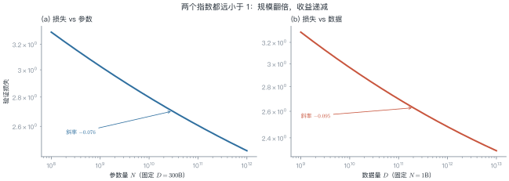
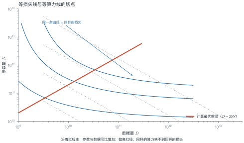
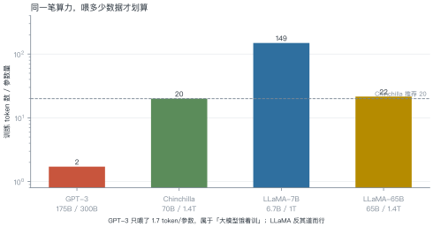
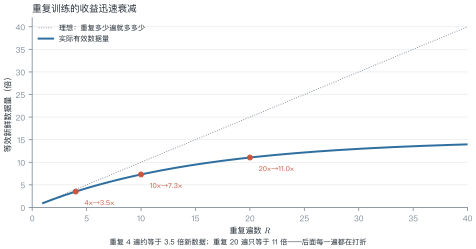

# 第 6 讲　Scaling Laws

!!! abstract "本讲位置"
    第 5 讲讲完了一个 block 长什么样，本讲回答"该堆多大"。这是全书唯一一个能用两个指数预测未来的地方——也是所有训练预算决策的依据。

!!! info "📅 事实核查至 2026-11"
    Kaplan (2020)、Chinchilla (2022)、重复训练 (2023)、μP (2022) 的结论均已核对原文。

## 学习目标

学完本讲，你应该能够：

1. 写出损失关于参数量与数据量的幂律形式，并说明两个指数的含义；
2. 用拉格朗日乘子推出 Chinchilla 的计算最优配比 $N\propto C^{0.5}$；
3. 解释为什么 LLaMA 要"超额喂数据"，并用算力账算清临界点；
4. 估算重复训练的有效数据量。

---

## 0 直觉：一笔钱怎么花

假设你有 $10^{23}$ FLOPs 的预算。两个选择：

- 训一个 175B 的模型，只喂 300B token；
- 训一个 70B 的模型，喂 1.4T token。

**同样的算力，哪个损失更低？** 2022 年之前大家默认选前者（大就是好），Chinchilla 证明了后者更优。

这个问题可以写成约束优化：

$$\min_{N,D}\ L(N,D)\quad\text{s.t.}\quad 6ND=C$$

!!! note "一句话总结"
    Scaling law 把"该多大"变成一个可解的优化问题：**损失随规模幂律下降，约束是算力，解出来参数与数据应同比增加**。

---

## 1 两条幂律

### 1.1 函数形式

Kaplan 等人发现，验证损失可以写成：

$$
L(N,D)=\left(\frac{N_c}{N}\right)^{\alpha_N}
+\left(\frac{D_c}{D}\right)^{\alpha_D}+L_\infty
\tag{6.1}
$$

- 第一项：模型太小的惩罚；
- 第二项：数据太少的惩罚；
- $L_\infty$：不可约损失（irreducible loss），即数据本身的熵，再怎么堆规模也降不下去。

<figure markdown="span">
  { width="100%" }
  <figcaption>图 L6-1　读图要点：两个坐标轴都是对数刻度，所以幂律表现为直线。斜率就是指数——<b>0.076 意味着参数翻十倍，损失只降约 16%</b>。</figcaption>
</figure>

### 1.2 怎么拟合

方法很朴素：**固定一个变量，扫另一个**。

1. 固定 $D$，训 5–6 个不同 $N$ 的模型，记录损失；
2. 在 log-log 坐标上做线性回归，得到 $\alpha_N$ 与 $N_c$；
3. 反过来固定 $N$ 扫 $D$，得到 $\alpha_D$ 与 $D_c$。

难点在于 $L_\infty$ 是未知常数，不能直接线性化——实践中用非线性最小二乘，或先估一个 $L_\infty$ 再拟合。

### 1.3 幂律为什么会成立

没有严格证明，但有几个有说服力的直觉：

- **高维空间里的"容量"是幂次的**：参数增加时，模型能区分的模式数按多项式增长，而不是指数增长，所以损失下降是幂律而不是指数。
- **语言本身是重尾的**：少数模式出现极多、多数模式极罕见。模型先学会高频模式（收益大），再啃长尾（收益小），合起来就是一条幂律。
- **误差可以分解**：模型误差 ≈ 容量不足 + 数据不足 + 噪声。前两项各是一条幂律，第三项是常数 $L_\infty$。

这三条都不是定理，但能解释为什么幂律在**跨越四个数量级**的范围内都相当稳。

### 例 6.1　给定算力，怎么分配

预算 $C=10^{23}$ FLOPs，用 Chinchilla 的结论 $D=20N$。

**第一步，代入约束：**

$$C=6ND=6N\cdot20N=120N^2$$

**第二步，解出 $N$：**

$$N=\sqrt{\frac{10^{23}}{120}}=\sqrt{8.33\times10^{20}}\approx2.89\times10^{10}$$

**第三步，算 $D$：**

$$D=20N\approx5.77\times10^{11}$$

**验算**：$6\times2.89\times10^{10}\times5.77\times10^{11}=1.0\times10^{23}$ ✓

也就是说，$10^{23}$ 的预算应该训一个 **29B 模型、喂 577B token**，而不是 175B 只喂 300B。

!!! tip "从这个例子里能读出三件事"
    1. **参数与数据同比增加**：$N\propto C^{0.5}$、$D\propto C^{0.5}$，两者比例恒定；
    2. **Chinchilla 之前所有模型都训练不足**：GPT-3 的 $D/N$ 只有 1.7，Chinchilla 建议 20；
    3. **这个结论有前提**：它只优化"训练算力"，没考虑推理成本——这正是 LLaMA 反着来的原因。

!!! note "20 这个数字有多可靠"
    不同论文拟合出的 $D/N$ 在 15–25 之间浮动，取决于语料质量、分词器与损失定义。把它当"数量级"用（十几到二十几），不要当常数用。真正的决策应该基于自己数据上的一次小规模拟合。

---

## 2 推导：为什么是 $C^{0.5}$

把 (6.1) 里与 $N$、$D$ 有关的两项记作 $A N^{-\alpha}+B D^{-\beta}$，在约束 $6ND=C$ 下求极值。

用拉格朗日乘子：

$$\mathcal{L}=A N^{-\alpha}+B D^{-\beta}+\lambda(6ND-C)$$

对 $N$ 与 $D$ 分别求导置零：

$$-\alpha A N^{-\alpha-1}+\lambda\cdot6D=0,\qquad
-\beta B D^{-\beta-1}+\lambda\cdot6N=0$$

两式相除消去 $\lambda$：

$$\frac{\alpha A N^{-\alpha-1}}{\beta B D^{-\beta-1}}=\frac{D}{N}
\quad\Longrightarrow\quad
N^{\alpha}D^{\beta}\ \text{为常数}
\tag{6.2}
$$

若近似取 $\alpha\approx\beta$（实测两者接近），则 $N\propto D$，结合 $6ND=C$ 就得到

$$N^\star\propto C^{0.5},\qquad D^\star\propto C^{0.5}
\tag{6.3}$$

<figure markdown="span">
  { width="100%" }
  <figcaption>图 L6-2　读图要点：蓝色曲线是等损失线，点线是等算力线。<b>切点连起来就是红线</b>——沿红线走，参数与数据同比增加；偏离红线，同样的算力换不到同样的损失。</figcaption>
</figure>

---

## 3 现实偏差：为什么 LLaMA 反着来

<figure markdown="span">
  { width="100%" }
  <figcaption>图 L6-3　读图要点：纵轴是"每参数配多少 token"。GPT-3 只有 1.7，Chinchilla 建议 20，LLaMA 直接拉到 150。<b>这不是算错了，是优化目标变了</b>。</figcaption>
</figure>

Chinchilla 只优化训练成本。但一个模型训完是要**服务**的——服务成本随调用量线性增长（第 1 讲图 L1-2）。

**小模型 + 多数据**的好处：训练多花一点，推理永久便宜。

### 例 6.2　算清临界点

比较两个方案：

| | 13B（Chinchilla 配比） | 7B（超额训练） |
|---|---|---|
| 数据量 | 260B | 1T |
| 训练 FLOPs（$6ND$） | $2.03\times10^{22}$ | $4.20\times10^{22}$ |
| 推理 1T token（$2NT$） | $2.60\times10^{22}$ | $1.40\times10^{22}$ |

**训练多花的算力：**

$$4.20\times10^{22}-2.03\times10^{22}=2.17\times10^{22}$$

**每服务一个 token 省下的算力：**

$$2\times(13\times10^{9}-7\times10^{9})=1.2\times10^{10}$$

**临界服务量：**

$$\frac{2.17\times10^{22}}{1.2\times10^{10}}\approx1.8\times10^{12}\ \text{token}$$

**结论**：只要这个模型累计服务超过 1.8T token，7B 方案就更划算。对任何有真实流量的产品，这个量级几个月就到了。

!!! tip "从这个例子里能读出三件事"
    1. **Scaling law 的结论依赖优化目标**：只优化训练，选大模型；优化总成本，选小模型多喂数据；
    2. **临界点是可以算的**，不用凭感觉；
    3. **这解释了 LLaMA 系列的设计**：7B/13B 都喂了 1T 以上，专为"部署友好"设计。

---

## 4 数据受限时代

<figure markdown="span">
  { width="100%" }
  <figcaption>图 L6-4　读图要点：虚线是"重复几遍就等于几倍新数据"的理想情况，实线是实际。重复 4 遍约等于 3.5 倍，重复 20 遍只有 11 倍——<b>每一遍都在打折</b>。</figcaption>
</figure>

高质量语料是有限的。按 Chinchilla 的配比，训一个 70B 模型需要 1.4T token，而互联网上高质量的中英文文本可能只有几万亿——很快就用完了。

经验公式（Muennighoff et al., 2023）：

$$
D_{\text{eff}}=R^{*}\left(1-e^{-R/R^{*}}\right),\qquad R^{*}\approx15
\tag{6.4}
$$

其中 $R$ 是重复遍数，$R^*$ 是"重复到第几遍开始明显不值"。

### 例 6.3　重复训练值不值

| 重复遍数 | 有效数据（倍） | 相当于多花算力买到的收益 |
|---|---|---|
| 1 | 0.97 | 基准 |
| 4 | 3.51 | 3.5× |
| 10 | 7.29 | 7.3× |
| 20 | 11.0 | 11× |
| 40 | 13.9 | 14× |

**结论**：重复 4 遍以内几乎不亏，20 遍之后基本是白烧算力。

---

数据快用完时，除了重复训练，还有一个办法：**换更省的架构**（MoE、稀疏化，第 11 讲）。但在那之前，先把超参迁移搞定——

### 4.1 数据从哪来

"高质量数据快用完了"这句话需要拆开看：

| 来源 | 量级 | 问题 |
|---|---|---|
| Common Crawl 原始网页 | 数十万亿 token | 噪声极大，清洗后剩 10%–20% |
| 书籍 / 论文 / 代码 | 数万亿 token | 质量高但版权敏感 |
| 合成数据 | 无上限 | 会放大教师模型的偏差，且有"模型自噬"风险 |

三条应对路线：

1. **更好的清洗**：去重、质量分类器、按教育价值打分——同样的原始数据能榨出 2–3 倍有效 token；
2. **合成数据**：用强模型生成教科书式内容，但必须配比真实数据，否则会退化；
3. **重复训练**：就是上面那条饱和曲线，4 遍以内几乎不亏。

## 5 超参迁移：μP

换模型宽度时，学习率不能照搬。**最大更新参数化（μP，maximal update parametrization）** 给出了缩放规则：

- 学习率 $\propto 1/\text{width}$；
- 初始化方差 $\propto 1/\text{width}$；
- 输出层缩放 $\propto 1/\text{width}$。

这样在 1B 上调好的超参，可以直接用到 70B，不必重扫。对训练成本来说，这是实打实的节省——**一次超参搜索可能烧掉几十万美元**。

### 5.1 小团队怎么用 scaling law

没有千卡集群也能用这套方法。标准做法是**用小模型预测大模型**：

1. 在 $10^7$–$10^9$ 参数区间训 5–6 个模型，每个只需几小时；
2. 拟合出指数，外推到目标规模；
3. 用外推结果决定"值不值得训"，而不是先烧钱再后悔。

这个流程的价值不在预测精度（外推总会偏），而在于**排序**：它能告诉你"70B 比 13B 好多少"，即使绝对值估不准，相对差距通常靠得住。

一个经验：外推超过两个数量级，误差会明显变大，此时应把它当"趋势判断"而不是"预算依据"。

```python
# 需要 scipy：uv pip install scipy
import numpy as np
from scipy.optimize import curve_fit


def law(x, a, alpha, c):
    """L = a * x^(-alpha) + c"""
    return a * np.power(x, -alpha) + c


# 假设扫了 5 个规模，得到损失
N = np.array([1e8, 3e8, 1e9, 3e9, 1e10])
L = np.array([2.42, 2.21, 2.05, 1.93, 1.84])

popt, _ = curve_fit(law, N, L, p0=[2.0, 0.07, 1.6], maxfev=20000)
print(f"alpha={popt[1]:.3f}, L_inf={popt[2]:.2f}")

# 外推 10 倍规模
print(f"预测 N=1e11 的损失: {law(1e11, *popt):.3f}")
```

---

## 6 工程要点与坑

1. **幂律只在中段成立**：太小（<$10^7$）或太大（接近 $L_\infty$）都会偏离。
2. **数据质量比数量重要**：同样的 token 数，清洗过的语料能抵几倍原始数据。
3. **$D/N$ 不是教条**：20 是"训练最优"，不是"总成本最优"，要按服务量算。
4. **拟合至少 5 个点**：3 个点拟合出的指数不可信，外推会离谱。
5. **换架构要重拟合**：MoE、长上下文模型的指数与稠密模型不同。
6. **别忽略不可约损失**：$L_\infty$ 决定了天花板，再堆规模也突破不了。

7. **数据配比要跟着架构变**：MoE 的"有效参数量"比总参数小，$D/N$ 应按激活参数算。
8. **别用验证损失当唯一指标**：下游任务的收益常常比损失下降更快饱和。

---

## 7 论文与延伸

| 年份 | 论文 | 一句话贡献 |
|---|---|---|
| 2020 | [Kaplan et al., Scaling Laws for Neural Language Models](https://arxiv.org/abs/2001.08361) | 幂律形式与指数 |
| 2022 | [Hoffmann et al., Training Compute-Optimal LLMs (Chinchilla)](https://arxiv.org/abs/2203.15556) | 参数与数据同比扩展 |
| 2022 | [Yang et al., Tensor Programs V (μP)](https://arxiv.org/abs/2203.03466) | 超参随宽度迁移 |
| 2023 | [Muennighoff et al., Scaling Data-Constrained Language Models](https://arxiv.org/abs/2305.16264) | 重复训练的饱和曲线 |
| 2023 | [Schaeffer et al., Are Emergent Abilities a Mirage?](https://arxiv.org/abs/2304.15004) | 涌现与度量的关系 |

---

## 8 习题

**🟢 概念题**

1. 为什么 Chinchilla 之前的模型普遍"训练不足"？
2. $D/N=20$ 是普适的吗？什么情况下应该偏离？

**🟡 推导题**

3. 从 (6.1) 与约束 $6ND=C$ 出发，推导 $N^\star\propto C^{0.5}$，并说明当 $\alpha\ne\beta$ 时指数是多少。
4. 用例 6.2 的方法，算 70B vs 13B 的临界服务量。

**🔴 实现题**

5. 用上面的拟合代码，构造 5 组 $(N, L)$ 数据，验证指数估计的稳定性（加噪声重跑 10 次）。
6. 实现 (6.4)，画出 $R^*=15$ 与 $R^*=30$ 两条曲线并解释差异。

---

## 9 本讲小结

<div class="cheatsheet" markdown>

**一个公式**

$$L(N,D)=\left(\frac{N_c}{N}\right)^{\alpha_N}+\left(\frac{D_c}{D}\right)^{\alpha_D}+L_\infty$$

**两个结论**

- 计算最优：$N\propto C^{0.5}$、$D\propto C^{0.5}$，配比约 20 token/参数
- 总成本最优：推理量大时，小模型多喂数据更划算

**一个数字**

重复训练 $R^*\approx15$ 遍后，收益基本饱和。

</div>

---

## 来源

- Kaplan、Chinchilla、μP、重复训练的公式与指数核对自原文，链接见 §7，核查日期 2026-11。
