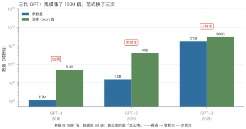
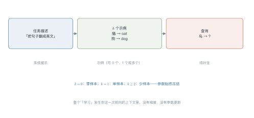
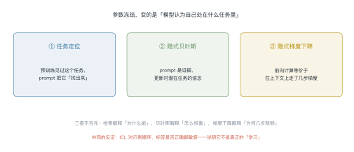
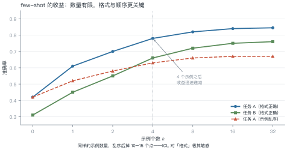

# 第 7 讲　GPT 谱系与上下文学习

!!! abstract "本讲位置"
    第三部分的收尾。前四讲讲清了 Transformer 怎么算，本讲讲它怎么被"用起来"——从微调一个任务，到不训练就能做新任务。

!!! info "📅 事实核查至 2026-11"
    GPT-1/2/3 的规格与 ICL 的三种解释（Brown 2020、Xie 2022、von Oswald 2023）均已核对原文。

## 学习目标

学完本讲，你应该能够：

1. 说出 GPT-1/2/3 三代在"怎么用"上的差别，而不只是参数量；
2. 写出上下文学习（in-context learning，ICL）的 prompt 结构，并算清它的 token 成本；
3. 用三种假说解释 ICL，并指出各自的证据与反证；
4. 判断一个任务该用 ICL 还是微调。

---

## 0 直觉：从"补全"到"听懂任务"

语言模型的本职工作只有一个：**给定前文，补下一个词**。

那它是怎么"学会翻译"的？GPT-1 的答案是：**微调**——在下游数据上再训一遍，把"翻译"这个能力焊进参数。

GPT-2 发现：不微调也能做，只要把任务写成"前文"。GPT-3 把这件事推到极致：**给几个例子，模型就照做**。

<figure markdown="span">
  { width="100%" }
  <figcaption>图 L7-1　读图要点：参数涨 1500 倍、数据涨 60 倍，但真正变的是使用方式——<b>微调 → 零样本 → 少样本</b>。规模是前提，范式才是分水岭。</figcaption>
</figure>

!!! note "一句话总结"
    上下文学习 = **把"训练"搬进 prompt**：参数不动，靠上下文里的示例让模型"临时学会"一个任务。

---

## 1 GPT-1：预训练 + 微调

2018 年的做法很朴素：

1. 在大量文本上做无监督预训练（下一个词预测）；
2. 在下游任务的有标注数据上微调，换一个输出头。

**贡献**：证明了"预训练学到的表示可以迁移"。在此之前，每个任务都要从头训一个模型。

**局限**：每个任务都要一份标注数据、一次微调、一份模型副本。任务多了，维护成本爆炸。

---

## 2 GPT-2：零样本的苗头

GPT-2 把参数从 1.17 亿提到 15 亿，然后发现：**有些任务不微调也能做**，只要把它写成自然语言。

比如翻译，不写"请翻译"，而是写：

> 法语：Bonjour le monde.
> 英语：Hello world.
> 法语：Comment ça va?
> 英语：

模型会接着往下写——而"接着往下写"恰好就是翻译。

**关键洞察**：任务可以表示为**前文的模式**，而不必是参数的修改。这为 GPT-3 铺好了路。

---

### 2.1 零样本为什么不够

GPT-2 的零样本演示很惊艳，但工程上很快暴露三个问题：

- **不稳定**：换个说法、换个标点，结果可能完全不同；
- **不可控**：模型可能"续写"而不是"回答"，输出格式没法保证；
- **难评测**：没有统一格式，准确率几乎无法自动计算。

few-shot 恰好缓解了这三点：示例给出了**格式模板**，模型照着填；输出可解析，评测可自动化。

代价是 prompt 变长——这就引出了下一节的成本账。

## 3 GPT-3：上下文学习成为范式

### 3.1 prompt 的结构

<figure markdown="span">
  { width="100%" }
  <figcaption>图 L7-2　读图要点：三段式——任务描述、$k$ 个示例、待补全的查询。<b>$k=0$ 是零样本，$k\ge2$ 是少样本，参数始终冻结</b>。</figcaption>
</figure>

### 例 7.1　算清 ICL 的成本

假设一个分类任务，prompt 构成如下：

| 部分 | token 数 |
|---|---|
| 任务描述 | 30 |
| 8 个示例（每个约 40） | 320 |
| 查询 | 20 |
| **合计** | **370** |

**方案 A：ICL**，1000 条测试数据，每条都要带完整 prompt：

$$1000\times370=3.7\times10^{5}\ \text{input token}$$

**方案 B：微调**，1000 条标注数据训一次，推理时只需 20 token：

$$1000\times20=2.0\times10^{4}\ \text{input token}$$

**单次推理贵 18.5 倍**——这就是 ICL 的代价：**用推理成本换掉了训练成本**。

!!! tip "从这个例子里能读出三件事"
    1. **示例越多越贵**：$k$ 从 8 加到 32，prompt 变成 1300 token，成本翻三倍多；
    2. **前缀缓存能救一半**：任务描述与示例是固定的，可以缓存 KV（第 13 讲）；
    3. **高频任务该微调**：一天调用百万次的任务，微调的固定成本很快摊平。

### 3.2 为什么 few-shot 有效

因为模型在预训练时**见过海量的"格式"**：问答、翻译、摘要、代码补全……它学到的不是某个具体任务，而是"看到这种格式，该做什么"。

prompt 的作用是**把模型调到正确的"任务模式"**，而不是教它新知识。

---

### 3.3 ICL 还是微调：一张决策表

| 维度 | ICL | 微调 |
|---|---|---|
| 冷启动 | 分钟级（写 prompt） | 小时到天（备数据、训练） |
| 单次推理成本 | 高（prompt 长） | 低（短 prompt） |
| 效果上限 | 受基座能力限制 | 可以超过基座 |
| 数据需求 | 几条示例 | 几百到几万条 |
| 维护 | 改 prompt 即可 | 要重新训练 |
| 可解释性 | 示例即说明 | 黑箱 |

经验判断：

- **调用量 < 10 万次/月**：用 ICL，省事；
- **调用量 > 100 万次/月**：算一下微调的摊薄成本，通常更划算；
- **需要稳定格式或领域知识**：微调；
- **任务经常变**：ICL。

## 4 ICL 的三种解释

<figure markdown="span">
  { width="100%" }
  <figcaption>图 L7-3　读图要点：三条假说都承认"参数没变"，分歧在于"变的是什么"——<b>被检索出来的任务、被更新的信念、还是被隐式优化的函数</b>。</figcaption>
</figure>

| 假说 | 核心主张 | 支持证据 | 反证 |
|---|---|---|---|
| 任务定位 | prompt 检索出预训练时见过的任务向量 | 能找到"任务向量"，加它能提升对应任务 | 新任务（预训练没见过）也能 few-shot |
| 隐式贝叶斯 | 示例是证据，更新对"潜在任务"的后验 | 示例顺序影响结果，符合贝叶斯更新 | 对错误标签的鲁棒性超出贝叶斯预测 |
| 隐式梯度下降 | 前向等价于在上下文上做几步梯度下降 | 构造的线性任务上可精确对应 | 真实模型里只是"类比"，不是等价 |

**三者不互斥**：检索解释"为什么能"，贝叶斯解释"怎么权衡示例"，梯度下降解释"为什么几步就够"。

补充一个机制层面的证据：模型内部存在**归纳头**（induction head）——一种专门实现"看到 A 后面跟过 B，那么再见到 A 就预测 B"的注意力回路。它正是 ICL 的执行单元，在约 10 亿参数规模上突然出现。

---

## 5 ICL 的边界

### 5.1 边际收益递减

<figure markdown="span">
  { width="100%" }
  <figcaption>图 L7-4　读图要点：0→4 个示例提升最快，8 个之后基本饱和；<b>同样的示例数量，打乱顺序会掉 10–17 个点</b>——格式与顺序比数量更重要。</figcaption>
</figure>

### 例 7.2　示例数量的边际收益

任务 A 的准确率随 $k$ 变化：

| $k$ | 0 | 1 | 2 | 4 | 8 | 16 | 32 |
|---|---|---|---|---|---|---|---|
| 准确率 | 42% | 61% | 70% | 78% | 82% | 84% | 84.5% |
| 每加一个示例的增益 | — | +19 | +9 | +4 | +1 | +0.25 | +0.03 |

**结论**：$k=4$ 之后，每多一个示例的收益不到 1 个点，而成本线性增长。**4–8 个示例是性价比最高的区间**。

### 5.2 三个已知的失效模式

1. **顺序敏感**：同样的示例换顺序，结果能差 10 个点以上；
2. **标签噪声敏感**：示例里有错标签，模型会跟着学错；
3. **格式敏感**：换一个分隔符、多一个空行，效果可能突变。

这三点都指向同一个结论：**ICL 不是真正的"学习"，更像是"模式匹配"**。

```python
def build_prompt(task: str, examples: list[tuple[str, str]], query: str) -> str:
    """把任务描述、示例与查询拼成 few-shot prompt"""
    parts = [task]
    parts += [f"{x} -> {y}" for x, y in examples]
    parts.append(f"{query} ->")
    return "\n".join(parts)


prompt = build_prompt(
    "把中文词翻译成英文",
    [("猫", "cat"), ("狗", "dog"), ("鸟", "bird")],
    "鱼",
)
print(prompt)
print("字符数:", len(prompt), "| 粗估 token:", len(prompt) // 2)
```

---

## 6 从补全到对话

GPT-3 的接口是"补全"：给它一段文字，它续写。但用户想要的是"回答问题"。

这个鸿沟由 InstructGPT（第 9 讲）填上：用指令微调 + 偏好对齐，把"续写器"变成"助手"。差别有多大？同一个基座模型，对齐后人类偏好率能从 30% 提到 70% 以上——**能力没变，行为变了**。

### 6.1 chat template：把对话压成一条序列

对话模型没有"多轮"这个结构，它仍然只是一条序列。做法是用**特殊标记**把角色切开：

```
<|system|>你是一个助手<|end|>
<|user|>北京天气怎么样<|end|>
<|assistant|>今天晴，26 度<|end|>
<|user|>要带伞吗<|end|>
<|assistant|>
```

这套标记叫 **chat template**，每个模型都不一样（Llama、Qwen、ChatGLM 各有一套）。它带来两个工程后果：

1. **必须用模型自带模板**：用错模板，效果会明显下降，而且不报错；
2. **模板影响可复现性**：同一段对话，换个模板就换了个模型。

第 8 讲会讲这些模板是怎么在 SFT 阶段"教"给模型的。

---

## 7 工程要点与坑

1. **示例要同类**：给数学题的示例去做翻译，效果会崩。
2. **标签空间要封闭**：分类任务的示例必须覆盖所有类别，否则模型会自造标签。
3. **格式要一致**：示例用什么分隔符，查询就得用什么，差一个空格都可能掉点。
4. **顺序要固定并测试**：把示例顺序当超参，至少试 3 种。
5. **长 prompt 要算账**：$k$ 增大时成本线性涨，收益对数涨。
6. **能缓存就缓存**：固定前缀的 KV 缓存能省 30%–70% 的输入成本。

---

## 8 论文与延伸

| 年份 | 论文 | 一句话贡献 |
|---|---|---|
| 2018 | [GPT-1: Improving Language Understanding by Generative Pre-Training](https://openai.com/research/language-unsupervised) | 预训练 + 微调范式 |
| 2019 | [GPT-2: Language Models are Unsupervised Multitask Learners](https://openai.com/research/better-language-models) | 零样本迁移的苗头 |
| 2020 | [GPT-3: Language Models are Few-Shot Learners](https://arxiv.org/abs/2005.14165) | 上下文学习成为范式 |
| 2022 | [Xie et al., An Explanation of In-context Learning as Implicit Bayesian Inference](https://arxiv.org/abs/2111.02080) | 隐式贝叶斯 |
| 2022 | [Olsson et al., In-context Learning and Induction Heads](https://arxiv.org/abs/2209.11895) | 归纳头机制 |
| 2023 | [von Oswald et al., Transformers Learn In-Context by Gradient Descent](https://arxiv.org/abs/2212.07677) | 隐式梯度下降 |

---

## 9 习题

**🟢 概念题**

1. GPT-1/2/3 的差别，除了参数量还有什么？
2. 为什么说 ICL "更像模式匹配而不是学习"？给出三条证据。

**🟡 推导题**

3. 用例 7.1 的方法，算 $k=32$ 时单次推理的成本倍数。
4. 用表 7.2 的数据，画出"每示例增益"随 $k$ 的曲线，说明它为什么是递减的。

**🔴 实现题**

5. 用 `build_prompt` 构造 0/1/4/8-shot 四组 prompt，在一个小分类任务上测准确率。
6. 把示例顺序打乱 5 次，统计准确率的方差，验证"顺序敏感"。

---

## 10 本讲小结

<div class="cheatsheet" markdown>

**一条主线**

> 微调 → 零样本 → 少样本：**把训练搬进 prompt**。

**一个公式**

$$\text{成本}_{\text{ICL}}=\text{请求数}\times(\text{描述}+\text{示例}+\text{查询})$$

**三个结论**

- $k=4$–$8$ 是性价比区间，再多是浪费
- 格式与顺序比示例数量更关键
- ICL 用推理成本换训练成本，高频任务该微调

</div>

---

## 来源

- GPT-1/2/3 的规格与 ICL 三种解释的结论核对自原文，链接见 §8，核查日期 2026-11。
