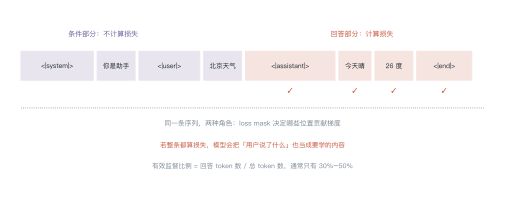
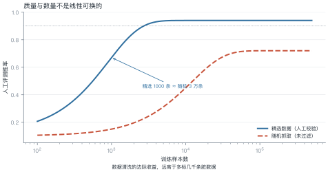
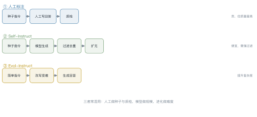
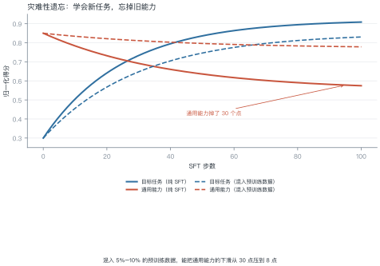

# 第 8 讲　指令微调与数据工程

!!! abstract "本讲位置"
    第四部分的开篇。第 7 讲说"模型会补全"，本讲解决"怎么让它听话"——用少量高质量数据把基座模型变成助手。第 9 讲接着讲怎么让它"说得更好"。

!!! info "📅 事实核查至 2026-11"
    LIMA（2023）、Self-Instruct（2022）、Evol-Instruct（2023）的结论均已核对原文。

## 学习目标

学完本讲，你应该能够：

1. 写出 SFT 样本的序列结构，说明 loss mask 为什么只覆盖回答部分；
2. 解释"1000 条精选胜过 5 万条随机"的原因，并算清两者的成本差；
3. 说出三种指令数据构造方式的适用场景；
4. 判断微调后是否发生了灾难性遗忘，并给出缓解方案。

---

## 0 直觉：从"会说话"到"听话"

基座模型是一个"续写器"：给它半句话，它往下写。但用户要的是"回答问题"。

差别在哪？举个具体例子。输入：

> 中国的首都是

基座模型会续写："北京，是一座有着三千年历史的古都……"——它在**接着写文章**。

而助手应该回答："北京。"——它在**回应请求**。

同一个模型，同样的知识，行为完全不同。**SFT（supervised fine-tuning，监督微调）做的就是这件事：用少量"指令–回答"对，把续写器改造成助手。**

!!! note "一句话总结"
    SFT 不教新知识，它教**什么时候该以什么格式输出**。数据量小、质量高，是它的特点。

---

## 1 SFT 的本质

### 1.1 一条样本长什么样

对话被拼成一条序列，用特殊标记切分角色：

```
<|system|>你是助手<|end|>
<|user|>北京天气怎么样<|end|>
<|assistant|>今天晴，26 度<|end|>
```

### 1.2 loss mask：只学回答

<figure markdown="span">
  { width="100%" }
  <figcaption>图 L8-1　读图要点：灰色是条件（system + user），红色是回答。只有红色位置的 token 计算交叉熵——<b>模型要学的是"该说什么"，不是"用户说了什么"</b>。</figcaption>
</figure>

如果不做 mask，模型会把用户的问题也当成要预测的内容，等于在学"如何提问"，反而干扰了"如何回答"。

### 例 8.1　算一下有效监督比例

上面那条对话，token 拆解：

| 段 | token 数 | 算损失？ |
|---|---|---|
| `<|system|>` + "你是助手" | 7 | 否 |
| `<|user|>` + "北京天气怎么样" | 8 | 否 |
| `<|assistant|>` + "今天晴，26 度" + `<|end|>` | 11 | **是** |
| 合计 | 26 | — |

有效监督比例：

$$\frac{11}{26}\approx42\%$$

也就是说，**一条 26 token 的样本，只有 11 个位置在产生梯度**。

!!! tip "从这个例子里能读出三件事"
    1. **有效监督比例通常只有 30%–50%**：长 system prompt 会进一步稀释；
    2. **所以 SFT 的样本效率不高**：1 万条对话实际只有几千条"有效训练信号"；
    3. **这也是为什么 SFT 数据要精**：信号本来就少，再掺噪声就白训了。

### 1.3 为什么 SFT 能改变行为

从学习理论看，SFT 是**行为克隆**（behavior cloning）：给定状态（对话历史），模仿专家的动作（下一句话）。

这解释了两个现象：

- **少量数据就够**：行为空间比知识空间小得多，"怎么回答"的模式有限；
- **会继承专家的缺点**：专家啰嗦，模型就啰嗦；专家回避问题，模型也回避。

还有一个隐患叫**分布偏移**：训练时模型看到的是专家的历史，推理时看到的是自己的历史。一旦某一步走偏，后续输入就落在训练分布之外，错误会累积——这正是第 17 讲 agent 误差累积的同一个道理。

---

## 2 质量 vs 数量

<figure markdown="span">
  { width="100%" }
  <figcaption>图 L8-2　读图要点：精选数据 1000 条就到 80% 胜率，随机数据要 3 万条才勉强追平，而且上限更低。<b>质量与数量不是线性可换的</b>。</figcaption>
</figure>

LIMA（2023）的结论很反直觉：**1000 条精心挑选的指令数据，SFT 出来的模型在人类评测中能和用几万条数据训练的模型打平**。

原因是 SFT 学的不是知识，而是**格式与行为模式**。模式是有限的：如何开场、如何分点、如何拒绝、如何承认不知道。几千条覆盖够了，再多就是重复。

### 例 8.2　成本对比

| | 精选 1000 条 | 随机 5 万条 |
|---|---|---|
| 每条 token | 300 | 300 |
| 总 token | $3\times10^{5}$ | $1.5\times10^{7}$ |
| 训练算力（相对） | 1× | 50× |
| 人工评测胜率 | 82% | 62% |
| 标注成本 | 高（每条要审） | 低（抓取即可） |

**结论**：50 倍的算力换来 20 个点的**下降**。数据质量不是"锦上添花"，而是决定上限的东西。

### 2.3 多少条才够

这个问题没有统一答案，但有一个粗略的经验区间：

| 目标 | 数据量 | 说明 |
|---|---|---|
| 改格式 / 学模板 | 200–1000 条 | 模式有限，几条就够 |
| 学一类任务 | 2000–10000 条 | 覆盖输入多样性 |
| 学领域知识 | 10000 条以上 | 知识密度高，需要量 |
| 改风格 / 人格 | 500–3000 条 | 风格一致比数量重要 |

**判断够不够的方法**：把数据分成两半，各训一个模型，比较效果。如果两个模型差不多，说明数据已经饱和；如果差距大，说明还需要更多。

这比"猜一个数字"可靠得多，成本也不高。

---

## 3 数据从哪来

<figure markdown="span">
  { width="100%" }
  <figcaption>图 L8-3　读图要点：三条流水线的差别在"谁写回答"——人、模型、还是模型改写。人工贵而准，模型便宜但要过滤，进化法专门提升难度。</figcaption>
</figure>

| 方式 | 做法 | 优点 | 风险 |
|---|---|---|---|
| **人工标注** | 标注员按指令写回答 | 质量最高、可控 | 贵、慢、标注员偏好不一致 |
| **Self-Instruct** | 种子指令 → 模型生成 → 过滤 | 便宜、可扩到百万级 | 会继承教师模型的偏差与错误 |
| **Evol-Instruct** | 把简单指令改写成更难的 | 提升复杂度与深度 | 改写可能失真、脱离实际需求 |
| **蒸馏** | 用强模型的输出当标签 | 效果接近教师 | 法律与伦理问题、能力上限被教师锁死 |

实践中通常**混用**：人工写 1000 条种子与评测集，模型扩到 10 万条，再用规则 + 模型双重过滤。

---

### 3.1 比数量更重要的是任务分布

一个常见误区：以为数据越多越好，于是把某一类任务（比如问答）堆到几万条。

实际效果取决于**任务类型的覆盖度**。一个可用的配比参考：

| 任务类型 | 占比 | 作用 |
|---|---|---|
| 开放问答 | 30% | 基础知识与表达 |
| 指令跟随（格式化输出） | 20% | 结构化能力 |
| 推理与数学 | 15% | 逻辑 |
| 代码 | 10% | 程序能力 |
| 拒绝与安全 | 10% | 边界 |
| 闲聊与角色 | 15% | 交互自然度 |

配比没有标准答案，但**长尾任务不能为零**——某一类缺失，模型在该类上会明显退化。

## 4 灾难性遗忘

<figure markdown="span">
  { width="100%" }
  <figcaption>图 L8-4　读图要点：实线是纯 SFT——目标任务涨到 90%，通用能力掉到 58%。虚线混入了预训练数据，通用能力只掉 8 个点，代价是目标任务涨得慢一点。</figcaption>
</figure>

**为什么会有遗忘**：SFT 数据的分布很窄（都是问答格式），模型参数被拉向这个窄分布，原本的通用能力被"覆盖"。

**三种缓解手段**：

1. **混入预训练数据**：最直接，通常混 5%–10%；
2. **用 LoRA**：只更新低秩增量，主干不动（第 15 讲）；
3. **控制步数**：早停，别把 SFT 数据训太多轮。

**怎么发现遗忘**：在 SFT 前后各跑一遍通用能力评测（如 MMLU、代码生成、长文本摘要），对比掉点幅度。经验阈值是**下降超过 5 个点就要警惕**。

不要只跑一个基准：不同能力退化的速度不一样，代码能力往往掉得最快，因为它对格式最敏感。

### 例 8.3　混入多少合适

SFT 数据 1 万条，每条 500 token，共 $5\times10^{6}$ token。

若混入 8% 的预训练数据：

$$5\times10^{6}\times\frac{0.08}{0.92}\approx4.3\times10^{5}\ \text{token}$$

代价是训练量增加约 8.7%，收益是通用能力下滑从 30 个点降到 8 个点。**这笔买卖几乎总是划算的**。

---

## 5 怎么知道微调有效

三个层次，缺一不可：

| 层次 | 做法 | 能发现什么 |
|---|---|---|
| **格式** | 抽样 20 条看输出 | 模板错、角色错、截断 |
| **任务** | 留出集上的准确率/胜率 | 是否真的学会了 |
| **通用** | 跑 3–5 个通用 benchmark | 是否遗忘了 |

最常见的错误是**只看任务指标**：任务涨了 5 个点，通用能力掉了 20 个点，上线后用户立刻感知到"变笨了"。

### 5.1 评测集怎么造

SFT 的评测集必须**与训练集严格分离**，而且要覆盖训练时的任务类型。三个实操建议：

1. **每条至少两人独立打分**，分歧大的样本单独讨论——单人打分的噪声常比模型差异还大；
2. **用成对比较而不是绝对分**："A 比 B 好"比"A 得 8 分"稳定得多（这正是第 9 讲偏好数据的来源）；
3. **留一份"从未见过"的隐藏集**：调参时看不到，最后只跑一次。

### 5.2 数据质量检查清单

上线前过一遍这七条，能挡掉大部分低级问题：

| 检查项 | 做法 | 常见问题 |
|---|---|---|
| **格式一致** | 随机抽 20 条渲染 | 模板混用、角色标记不统一 |
| **回答完整** | 检查是否被截断 | 生成时超长被砍，只剩半句 |
| **无模板污染** | 搜"作为 AI"等套话 | 蒸馏数据里带着教师的口头禅 |
| **标签正确** | 人工复核 5% | 合成数据的错误答案被当成正例 |
| **去重** | 相似度 > 0.95 的合并 | 同一问题重复几十遍，模型死记 |
| **难度分布** | 统计回答长度与推理步数 | 全是简单题，学不到复杂任务 |
| **安全样本** | 检查拒答是否合理 | 过度拒答被当成"安全"正例 |

**最容易被忽略的是"难度分布"**：一批全是简单问答的数据，训出来的模型遇到复杂指令就崩。建议至少保留 20% 需要多步推理的样本。

```python
IGNORE = -100


def build_sft_sample(turns, encode):
    """把多轮对话拼成 (input_ids, labels)，只对 assistant 部分算损失"""
    input_ids, labels = [], []
    for role, text in turns:
        ids = encode(f"<|{role}|>{text}<|end|>")
        input_ids += ids
        labels += ids if role == "assistant" else [IGNORE] * len(ids)
    return input_ids, labels


# 玩具编码器：用字符数代替 token 数
encode = lambda s: list(range(len(s)))

ids, labels = build_sft_sample(
    [("system", "你是助手"), ("user", "北京天气怎么样"), ("assistant", "今天晴，26 度")],
    encode,
)
valid = sum(1 for x in labels if x != IGNORE)
print(f"总 token {len(ids)}，参与损失 {valid}，占比 {valid/len(ids):.0%}")
```

---

## 6 工程要点与坑

1. **模板必须与推理一致**：训练用什么模板，推理就得用什么，错一个标记就掉点。
2. **`<|end|>` 要算损失**：它是"该停了"的信号，不算损失模型学不会停。
3. **长度要截断但别截断回答**：优先截 system，其次截历史，最后才截当前回答。
4. **多轮对话要保留历史**：只训最后一轮会让模型丢失上下文能力。
5. **学习率比预训练小 1–2 个数量级**：典型 $1\times10^{-5}$。
6. **只训 2–3 轮**：SFT 数据少，多轮必然过拟合。

7. **别用训练集当评测集**：SFT 数据少，模型几轮就背下来了，训练损失几乎必然下降。
8. **保存中间 checkpoint**：SFT 的最优点常常不在最后一轮，靠通用指标早停。

---

## 7 论文与延伸

| 年份 | 论文 | 一句话贡献 |
|---|---|---|
| 2021 | [FLAN: Finetuned Language Models Are Zero-Shot Learners](https://arxiv.org/abs/2109.01652) | 指令微调的早期证据 |
| 2022 | [Self-Instruct](https://arxiv.org/abs/2212.10560) | 用模型生成指令数据 |
| 2023 | [LIMA: Less Is More for Alignment](https://arxiv.org/abs/2305.11206) | 1000 条精选数据的威力 |
| 2023 | [Evol-Instruct / WizardLM](https://arxiv.org/abs/2304.12244) | 指令进化 |
| 2023 | [Zhou et al., LIMIT: How Abilities in LLMs are Affected by Supervised Fine-tuning Data Composition](https://arxiv.org/abs/2312.05934) | 数据配比与遗忘 |

---

## 8 习题

**🟢 概念题**

1. 为什么 SFT 只需要几千条数据，而预训练需要万亿 token？
2. loss mask 如果去掉，会发生什么？给出两种具体后果。

**🟡 推导题**

3. 用例 8.1 的方法，算一条含 500 token system prompt 的样本的有效监督比例。
4. 用图 L8-2 的曲线，估算"精选 2000 条"与"随机多少条"等效。

**🔴 实现题**

5. 实现 `build_sft_sample`，在真实 tokenizer 上跑通，统计有效监督比例。
6. 用同一批 SFT 数据分别训 1 轮和 3 轮，比较任务指标与通用指标的变化。

---

## 9 本讲小结

<div class="cheatsheet" markdown>

**一个机制**

> loss mask：只有 assistant 的 token 算损失，有效监督比例通常 30%–50%。

**一个结论**

> 1000 条精选 ≈ 3 万条随机。SFT 学的是格式与行为，不是知识。

**三个数字**

- 学习率 $1\times10^{-5}$，训 2–3 轮
- 混入 5%–10% 预训练数据防遗忘
- 评测三层：格式、任务、通用

</div>

---

## 来源

- LIMA、Self-Instruct、Evol-Instruct 的结论核对自原文，链接见 §7，核查日期 2026-11。
