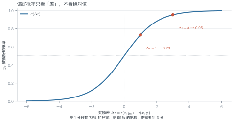
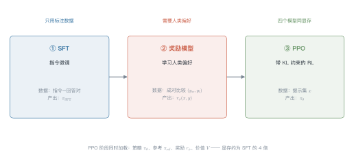
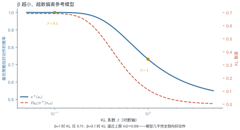
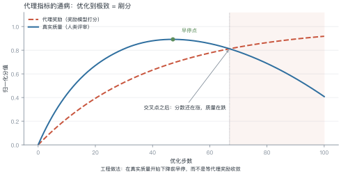
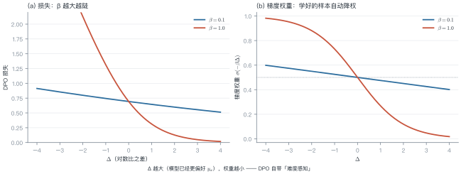

# 第 9 讲　偏好优化

!!! abstract "本讲位置"
    第四部分的核心。前置：第 8 讲的指令微调（SFT）。本讲回答"模型已经会听话了，怎么让它说得**更好**"；第 21 讲会把同一套工具用到推理能力上。

!!! info "📅 事实核查至 2026-11"
    本讲涉及的经典结论（Bradley-Terry 1952、InstructGPT 2022、DPO 2023）均已核对原文；2024 年后的方法变体见文末来源表。

## 学习目标

学完本讲，你应该能够：

1. 写出 Bradley-Terry 模型与奖励模型的损失，并解释"偏好只依赖奖励差"这一性质；
2. 从 KL 正则的 RL 目标推导出 DPO 的闭式解，说明它为什么等价于一个**带权重的分类损失**；
3. 手算一个小例子的偏好概率、DPO 损失与梯度权重；
4. 区分 RLHF / DPO / KTO / ORPO 的适用场景与代价。

---

## 0 直觉：你很难打绝对分，但很容易做比较

假设你要教一个人写技术文档。

让他给两篇文档打绝对分？很难。"这篇 82 分"——82 分的标准是什么？换个人、换一天，可能给 75 分。**绝对分数既不稳定，也不可校准。**

但如果给他两篇文档问"哪篇更好"？几乎人人能立刻回答，而且一致性很高。

这就是偏好优化（preference optimization）的出发点：**用成对比较代替绝对打分**。

由此引出本讲的三个主角：

| 角色 | 干什么 | 类比 |
|---|---|---|
| **奖励模型** $r_\phi$ | 把"成对比较"压缩成一个标量分数 | 学会给作文打分的助教 |
| **RLHF / PPO** | 用这个分数去训练策略 | 助教打分，学生反复改 |
| **DPO** | 绕开助教，直接拿比较结果训练 | 不评分了，直接"这篇比那篇好" |

第三行是 2023 年之后的主流，因为它把"训练一个奖励模型 + 跑 RL"这两步合成了一步。

!!! note "一句话总结"
    偏好优化 = **把"哪个更好"变成可微的损失**。RLHF 用奖励模型做中介，DPO 则把它解析地消掉了。

---

## 1 形式化：偏好数据与隐含奖励

### 1.1 数据长什么样

一条偏好样本是三元组：

$$\mathcal{D}=\{(x^{(i)},\ y_w^{(i)},\ y_l^{(i)})\}_{i=1}^{N}$$

- $x$：提示（prompt）；
- $y_w$：被人类选中的回答（**w**inner）；
- $y_l$：被拒绝的回答（**l**oser）。

注意：数据里**没有分数**，只有"谁更好"。这是偏好学习与监督学习最根本的区别。

### 1.2 假设存在一个隐含奖励

我们假设人类的选择来自某个潜在的奖励函数 $r^\star$：人类更可能选奖励高的那个，但不是必然——人也会犯错、会有偏好波动。

于是问题变成：**从成对比较里估计 $r^\star$，再用它改进策略**。

### 1.3 Bradley-Terry 模型

1952 年 Bradley 和 Terry 提出的配对比较模型，假设

$$
P(y_w \succ y_l \mid x)
= \sigma\big(r(x,y_w)-r(x,y_l)\big),
\qquad \sigma(z)=\frac{1}{1+e^{-z}}
\tag{9.1}
$$

**为什么只看差？** 因为偏好是相对的。若把 $r$ 整体加上常数 $c$，差值不变，概率也不变。这意味着**绝对分数不可辨识**——你能学到的只有排序，不是刻度。

<figure markdown="span">
  { width="100%" }
  <figcaption>图 L9-1　读图要点：横轴是奖励差，纵轴是"前者更好"的概率。差 1 分只有 73% 的把握，要 95% 的把握需要差到 3 分——<b>概率对差距是饱和的</b>，这也是奖励模型容易"过自信"的根源。</figcaption>
</figure>

---

## 2 奖励模型：把比较压成一个分数

### 2.1 结构与损失

奖励模型通常就是"语言模型 + 一个标量头"：取最后一个 token 的隐状态，接一个线性层输出 $r_\phi(x,y)$。

训练目标是最大化人类选择的似然，即最小化负对数似然：

$$
\mathcal{L}_{\mathrm{RM}}(\phi)
=-\mathbb{E}_{(x,y_w,y_l)\sim\mathcal{D}}
\log\sigma\big(r_\phi(x,y_w)-r_\phi(x,y_l)\big)
\tag{9.2}
$$

这就是一个二分类问题：把 $(y_w,y_l)$ 的分数差送进 sigmoid，标签恒为 1。

### 例 9.1　手算一次偏好概率

假设奖励模型给两条回答打了分：$r(x,y_w)=2.0$，$r(x,y_l)=1.0$。

**第一步，算差：**

$$\Delta r = 2.0-1.0=1.0$$

**第二步，过 sigmoid：**

$$P=\sigma(1.0)=\frac{1}{1+e^{-1.0}}=\frac{1}{1+0.368}=0.731$$

**第三步，算损失：**

$$\mathcal{L}=-\log 0.731=0.313$$

换一组数对照：

| $r_w$ | $r_l$ | $\Delta r$ | 偏好概率 | 损失 |
|---|---|---|---|---|
| 2.0 | 1.0 | 1.0 | 0.731 | 0.313 |
| 2.0 | 2.0 | 0.0 | 0.500 | 0.693 |
| 3.0 | 1.0 | 2.0 | 0.881 | 0.127 |

!!! tip "从这个例子里能读出三件事"
    1. **打平手时损失是 $\ln 2\approx0.693$**：模型完全没有偏好信息，这是二分类的"瞎猜基线"。
    2. **差 1 分只值 0.31 的损失下降**：奖励模型需要把差距拉得更大才能显著降低损失，这直接导致后面的"分数通胀"。
    3. **绝对分数无关紧要**：把两个分数同时加 10，表里所有数字不变。

### 2.2 奖励模型的三个通病

1. **过拟合偏好数据**：在训练集上能把差距拉到很大，换一批提示就失效；
2. **长度偏置**：人类偏好长回答，奖励模型学会了"长 = 好"，导致输出越来越啰嗦；
3. **奖励黑客的入口**：策略会找到奖励模型的漏洞，而不是真正变好（见 §3.4）。

---

## 3 RLHF：用奖励模型训练策略

### 3.1 三阶段流水线

<figure markdown="span">
  { width="100%" }
  <figcaption>图 L9-2　读图要点：三个阶段的数据需求逐级上升——SFT 只要标注对，奖励模型要人类比较，PPO 要在线采样。<b>显存也在第三阶段达到峰值</b>：策略、参考、奖励、价值四个模型同时驻留。</figcaption>
</figure>

### 3.2 目标函数

在 SFT 模型基础上继续优化，但加一道"别跑太远"的约束：

$$
\max_{\pi_\theta}\ \mathbb{E}_{x\sim\mathcal{D},\,y\sim\pi_\theta(\cdot\mid x)}\big[r_\phi(x,y)\big]
-\beta\,D_{\mathrm{KL}}\big(\pi_\theta(\cdot\mid x)\,\|\,\pi_{\mathrm{ref}}(\cdot\mid x)\big)
\tag{9.3}
$$

- 第一项：让奖励尽量高；
- 第二项：让新策略别离参考模型（通常是 SFT 模型）太远；
- $\beta$：两者的兑换率。

**为什么必须有 KL 项？** 两个理由：

1. **防奖励黑客**：奖励模型只是人类偏好的近似，放任策略去最大化它，策略会找到"高分但没人喜欢"的怪句子；
2. **防能力退化**：没有约束的 RL 会把语言能力练废，输出变得重复、格式怪异。

### 3.3 闭式解：KL 约束下的最优策略

(9.3) 对每个提示可以单独求解。用拉格朗日乘子法（🔴 推导见下），最优策略有解析形式：

$$
\pi^\star(y\mid x)=\frac{1}{Z(x)}\,\pi_{\mathrm{ref}}(y\mid x)\,
\exp\!\left(\frac{r_\phi(x,y)}{\beta}\right),
\qquad
Z(x)=\sum_{y}\pi_{\mathrm{ref}}(y\mid x)\exp\!\left(\frac{r_\phi(x,y)}{\beta}\right)
\tag{9.4}
$$

直觉：**在参考策略的基础上，按奖励的指数重新加权**。奖励高的回答被放大，奖励低的被压缩；$\beta$ 控制放大倍数。

!!! note "🔴 推导细节"
    把 (9.3) 写成逐提示的带约束优化：

    $$\max_{\pi}\ \sum_y \pi(y)r(y)-\beta\sum_y\pi(y)\log\frac{\pi(y)}{\pi_{\mathrm{ref}}(y)}
    \quad \text{s.t.}\ \sum_y\pi(y)=1$$

    构造拉格朗日函数并对 $\pi(y)$ 求导置零：

    $$r(y)-\beta\left(\log\frac{\pi(y)}{\pi_{\mathrm{ref}}(y)}+1\right)-\lambda=0$$

    解出 $\pi(y)\propto\pi_{\mathrm{ref}}(y)e^{r(y)/\beta}$，归一化即得 (9.4)。

### 例 9.2　手算 β 的影响

一个只有两个动作的玩具问题：$\pi_{\mathrm{ref}}=(0.5,\,0.5)$，奖励 $r=(1,\,0)$。

按 (9.4)，好动作的概率是

$$
\pi^\star(a_1)=\frac{0.5\,e^{1/\beta}}{0.5\,e^{1/\beta}+0.5\,e^{0}}
=\frac{1}{1+e^{-1/\beta}}
$$

代入不同的 $\beta$：

| $\beta$ | $1/\beta$ | $\pi^\star(a_1)$ | KL 散度 |
|---|---|---|---|
| 2.0 | 0.5 | 0.62 | 0.03 |
| 1.0 | 1.0 | 0.73 | 0.11 |
| 0.5 | 2.0 | 0.88 | 0.29 |
| 0.1 | 10.0 | ≈1.00 | ≈0.69 |

<figure markdown="span">
  { width="100%" }
  <figcaption>图 L9-3　读图要点：$\beta$ 越小，策略越敢把概率堆到好动作上，代价是 KL 迅速逼近上限 $\ln 2\approx0.69$。<b>$\beta$ 就是"听话"与"别乱来"的旋钮</b>。</figcaption>
</figure>

!!! tip "从这个例子里能读出两件事"
    1. **$\beta$ 不是"学习率"**：它不控制更新步长，而控制**最终能偏离多远**。β 定得小，最后一定跑偏。
    2. **收益递减**：从 0.73 推到 0.88，KL 从 0.11 涨到 0.29（近 3 倍），而概率只多 0.15——这就是"对齐税"的微观来源。

### 3.4 奖励黑客

一旦策略发现"奖励模型喜欢什么"，它就会放大那些特征。经典现象：

- **长度膨胀**：回答越来越长，因为人类偏好长答案；
- **谄媚**（sycophancy）：无条件附和用户的错误观点；
- **格式刷分**：堆砌列表和加粗，看起来"专业"。

<figure markdown="span">
  { width="100%" }
  <figcaption>图 L9-4　读图要点：横轴是优化步数。代理奖励（虚线）一路上升，真实质量（实线）先升后降，二者在某个点交叉。<b>交叉点之后，继续优化就是在"刷分"而不是"变好"</b>——这是所有代理指标的通病。</figcaption>
</figure>

工程上的对策是"早停"：在真实质量开始下降之前停下，而不是等代理奖励收敛。

---

## 4 DPO：把奖励模型消掉

### 4.1 关键观察

(9.4) 可以反解出奖励：

$$
r_\phi(x,y)=\beta\log\frac{\pi^\star(y\mid x)}{\pi_{\mathrm{ref}}(y\mid x)}+\beta\log Z(x)
\tag{9.5}
$$

把它代回 Bradley-Terry (9.1)。注意 $\beta\log Z(x)$ 对 $y_w$ 和 $y_l$ **是同一项**，相减时抵消：

$$
P(y_w\succ y_l\mid x)
=\sigma\!\left(
\beta\log\frac{\pi^\star(y_w\mid x)}{\pi_{\mathrm{ref}}(y_w\mid x)}
-\beta\log\frac{\pi^\star(y_l\mid x)}{\pi_{\mathrm{ref}}(y_l\mid x)}
\right)
\tag{9.6}
$$

**奖励模型不见了。** 偏好概率可以直接用策略本身的对数概率比表示。

### 4.2 DPO 损失

把 (9.6) 取负对数，得到可以直接优化的损失：

$$
\mathcal{L}_{\mathrm{DPO}}(\theta)
=-\mathbb{E}_{(x,y_w,y_l)\sim\mathcal{D}}
\log\sigma\!\left(
\beta\left[
\log\frac{\pi_\theta(y_w\mid x)}{\pi_{\mathrm{ref}}(y_w\mid x)}
-\log\frac{\pi_\theta(y_l\mid x)}{\pi_{\mathrm{ref}}(y_l\mid x)}
\right]
\right)
\tag{9.7}
$$

记括号里的量为

$$\Delta=\log\frac{\pi_\theta(y_w)}{\pi_{\mathrm{ref}}(y_w)}-\log\frac{\pi_\theta(y_l)}{\pi_{\mathrm{ref}}(y_l)}$$

则损失就是 $-\log\sigma(\beta\Delta)$——**一个以 $\beta\Delta$ 为 logit 的二分类损失**。

### 4.3 梯度：自带难度感知

对 (9.7) 求导：

$$
\nabla_\theta\mathcal{L}
=-\beta\,\sigma(-\beta\Delta)\,
\big[\nabla_\theta\log\pi_\theta(y_w)-\nabla_\theta\log\pi_\theta(y_l)\big]
\tag{9.8}
$$

前面那个系数 $\sigma(-\beta\Delta)$ 是关键：

- $\Delta$ 大（模型已经更偏好 $y_w$）→ 系数小 → **这条样本自动降权**；
- $\Delta$ 小或为负（模型还没学会）→ 系数大 → 重点学。

这相当于一个内置的"难例挖掘"，不需要额外设计。

<figure markdown="span">
  { width="100%" }
  <figcaption>图 L9-5　读图要点：(a) $\beta$ 越大损失曲线越陡；(b) 梯度权重随 $\Delta$ 单调下降，<b>已经学对的样本权重趋近 0</b>——DPO 不需要显式采样，也不会在简单样本上反复浪费梯度。</figcaption>
</figure>

### 例 9.3　手算一次 DPO 损失

取 $\beta=0.1$，三组不同的对数比之差：

| 情形 | $\log\frac{\pi(y_w)}{\pi_{\rm ref}(y_w)}$ | $\log\frac{\pi(y_l)}{\pi_{\rm ref}(y_l)}$ | $\Delta$ | $\beta\Delta$ | $\sigma$ | 损失 | 梯度权重 |
|---|---|---|---|---|---|---|---|
| A 已学会 | −0.5 | −1.5 | 1.0 | 0.10 | 0.525 | 0.644 | 0.475 |
| B 学得很好 | −0.5 | −5.5 | 5.0 | 0.50 | 0.622 | 0.474 | 0.378 |
| C 学反了 | −1.5 | −0.5 | −1.0 | −0.10 | 0.475 | 0.744 | 0.525 |

以 A 行为例：$\Delta=1.0$，$\beta\Delta=0.1$，$\sigma(0.1)=0.525$，损失 $=-\log 0.525=0.644$，梯度权重 $\sigma(-0.1)=0.475$。

!!! tip "从这个例子里能读出三件事"
    1. **损失永远为正、永远有梯度**：即使 $\Delta=5$，损失还有 0.47，只是梯度权重降到 0.38——DPO 不会"完全学会就停"。
    2. **学反了的情况（C）权重最大**（0.525），但损失也最大（0.744），模型会被重点纠正。
    3. **$\beta$ 直接缩放 $\Delta$**：同样的对数比之差，$\beta$ 从 0.1 调到 1.0，$\beta\Delta$ 放大十倍，损失曲线立刻变陡。

### 4.4 DPO 的隐含假设与失败模式

DPO 不是"免费午餐"，它做了三个假设：

| 假设 | 什么时候会破 |
|---|---|
| 偏好数据来自与当前策略相近的分布 | 用别的模型生成的数据做 DPO，效果会打折（分布偏移） |
| Bradley-Terry 成立 | 人类偏好有噪声、有上下文依赖时，BT 只是近似 |
| 参考模型足够好 | $\pi_{\mathrm{ref}}$ 太弱时，DPO 会把它的缺陷一起继承 |

工程上最常见的三个坑：**长度偏置**（DPO 也会学到"长即好"）、**$\beta$ 调参**（太小 → 输出退化；太大 → 学不动）、**数据质量**（偏好对里的 $y_w$ 本身有错）。

举个例子：某团队用 70B 模型生成偏好对，去 DPO 一个 7B 模型。训练损失降得很漂亮，但上线后人工评测只涨了 2 个点——因为 7B 模型根本产生不出 70B 那种风格的回答，偏好对里的"好"对它是分布外的。正确做法是**先用 SFT 把 7B 拉到目标分布附近，再用它自己的输出构造偏好对**。

---

## 5 偏好数据从哪来

方法选型之前，先解决一个更实际的问题：**成对比较从哪来**。三条路，成本差一个数量级。

| 来源 | 做法 | 规模量级 | 单条成本 | 偏差 |
|---|---|---|---|---|
| **人工标注** | 标注员对同一提示的两个回答排序 | $10^4$–$10^5$ | 高（分钟级） | 主观、随标注员漂移 |
| **AI 反馈（RLAIF）** | 用强模型当裁判，替代部分人工 | $10^5$–$10^6$ | 低 | 继承裁判模型的偏好 |
| **合成偏好** | 用"已知更好"的构造数据（如修正前后的代码） | 任意 | 极低 | 与真实分布有差距 |

三个经验数字：

1. **量级不是越大越好**：DPO 论文里 1 万条左右的高质量偏好对就能显著改变模型风格；10 万条噪声数据的收益可能为负。
2. **一致性比数量重要**：同一个标注员对同一对回答的两次判断一致率通常只有 70%–80%，低于这个水平的偏好对基本是噪声。
3. **裁判模型会带偏见**：用 GPT-4 类模型做裁判时，它偏好更长的回答、更"结构化"的格式，这些偏好会被蒸馏进学生模型。

!!! warning "一个容易被忽略的顺序问题"
    偏好数据的分布必须与**当前策略**的输出分布接近。用 A 模型生成的偏好对去训练 B 模型，DPO 的效果会明显打折——因为 (9.6) 的推导假设 $\pi_{\mathrm{ref}}$ 与数据同源。

## 6 方法变体：一张表看清

| 方法 | 奖励模型 | 在线采样 | 数据形式 | 显存 |
|---|---|---|---|---|
| RLHF / PPO | 需要 | 需要 | 提示集 + 偏好对 | 高（4 个模型） |
| DPO | 不需要 | 不需要 | 成对偏好 | 低（2 个） |
| KTO | 不需要 | 不需要 | 单条 + 好坏标签 | 低 |
| ORPO | 不需要 | 不需要 | 成对偏好 | 低 |
| SimPO | 不需要 | 不需要 | 成对偏好 | 低 |
| GRPO | 可验证奖励 | 需要 | 问题 + 可判定答案 | 中 |

**典型场景**

- **RLHF / PPO**：追求极致效果、有工程团队，能承受 4 个模型同时在线；
- **DPO**：默认首选，有偏好对就能训；
- **KTO**：只有"点赞 / 点踩"这类单边反馈；
- **ORPO**：想把 SFT 与偏好优化合成一步；
- **SimPO**：显存紧张，连参考模型都想省掉；
- **GRPO**：数学、代码等有客观对错的任务（第 21 讲展开）。

### 6.1 每个变体在解决什么

表格只说了"是什么"，更重要的是"为什么会有它"：

- **KTO**：真实产品里更常见的是"点赞 / 点踩"这种单边信号，根本凑不成对。KTO 用前景理论的价值函数把单条反馈转成损失。
- **ORPO**：SFT 与偏好优化分两步走，第二步容易把第一步学到的东西冲掉（灾难性遗忘）；ORPO 把两者合成一个损失，省掉一次训练。
- **SimPO**：DPO 必须额外驻留一份参考模型，显存翻倍；SimPO 用长度归一化的平均对数概率替代，把参考模型去掉。
- **GRPO**：PPO 需要一个价值网络来估计基线（又多一个模型）；GRPO 用同一提示下多次采样的平均奖励当基线，直接省掉价值网络。

一句话：**每个变体都在砍掉前一个方法里的某个"额外组件"**——参考模型、价值网络、SFT 阶段，或者成对数据的要求。

选型经验：

1. **有偏好对、想省事** → DPO；
2. **只有单边反馈**（点赞/点踩）→ KTO；
3. **连 SFT 都想省** → ORPO；
4. **任务有客观对错**（数学、代码）→ 别用偏好，直接用 RLVR + GRPO。

---

## 7 从偏好到可验证：RLVR 的位置

偏好优化的天花板是"人类判断"。当任务有**客观验证器**（单元测试、数学答案、编译器）时，就没必要再学一个奖励模型了——直接用验证结果当奖励，这就是 RLVR（Reinforcement Learning with Verifiable Rewards）。

它和本讲的关系：

- **奖励来源不同**：RLVR 用规则判定，不用人类偏好；
- **优化算法相同**：仍然是策略梯度，GRPO 是当前主流（第 21 讲展开）；
- **能力上限不同**：RLVR 能突破人类示范的上限（模型可以自己找到人没想到的解法），偏好优化不能。

---

## 8 工程要点与坑

1. **参考模型必须冻结**：$\pi_{\mathrm{ref}}$ 一旦跟着更新，KL 约束就失效了，训练会发散。
2. **$\beta$ 先试 0.1**：太小（0.01）输出会退化成短句、重复；太大（1.0）几乎学不动。
3. **长度要监控**：DPO/RLHF 都会让回答变长，训练时同时记录平均长度与胜率。
4. **偏好对的顺序要打乱**：$y_w$ 永远在前会让模型学到位置偏置。
5. **用同一个 tokenizer**：策略与参考模型的分词必须一致，否则对数概率不可比。
6. **梯度累积下的 $\beta$ 缩放**：$\beta$ 与学习率、batch size 有耦合，换配置要重扫。
7. **评估要成对比较**：用胜率（win rate）而不是困惑度，后者与人类偏好几乎不相关。

---

## 9 论文与延伸

| 年份 | 论文 | 一句话贡献 |
|---|---|---|
| 1952 | [Bradley & Terry, Rank Analysis of Incomplete Block Designs](https://doi.org/10.1093/biomet/39.3-4.324) | 配对比较模型的源头 |
| 2022 | [InstructGPT](https://arxiv.org/abs/2203.02155) | RLHF 三阶段流程成型 |
| 2022 | [Anthropic, Constitutional AI](https://arxiv.org/abs/2212.08073) | 用 AI 反馈替代部分人类标注 |
| 2023 | [DPO](https://arxiv.org/abs/2305.18290) | 把 RLHF 目标转成分类损失 |
| 2023 | [KTO](https://arxiv.org/abs/2402.01306) | 只用单边反馈的偏好优化 |
| 2024 | [ORPO](https://arxiv.org/abs/2403.07691) | 把 SFT 与偏好优化合并 |
| 2024 | [SimPO](https://arxiv.org/abs/2405.14734) | 去掉参考模型的简化版 |
| 2024 | [DeepSeekMath (GRPO)](https://arxiv.org/abs/2402.03300) | 组内相对优势，省掉价值网络 |

---

## 10 习题

**🟢 概念题**

1. 为什么 Bradley-Terry 模型里"把两个奖励同时加 10"不改变任何结果？这说明奖励模型的输出有什么性质？
2. KL 项如果去掉会发生什么？给出两种具体的失败现象。

**🟡 推导题**

3. 从 (9.3) 出发，完整推导 (9.4)，并说明 $Z(x)$ 为什么在 (9.6) 中会抵消。
4. 对 (9.7) 求导，验证 (9.8) 中的梯度权重是 $\sigma(-\beta\Delta)$ 而不是 $\sigma(\beta\Delta)$。

**🔴 实现题**

5. 用 NumPy 实现 (9.2) 的奖励模型损失与梯度，验证在例 9.1 的三组数上损失与表中一致。
6. 构造一个两动作的玩具环境，分别用 PPO 与 DPO 训练，比较二者最终策略与参考策略的 KL。

---

## 11 本讲小结

**一条主线**

> 人类会给"哪个更好"，不会给"多少分" → 用 Bradley-Terry 把比较变成概率 → 奖励模型学它 → RL 用它 → DPO 把它解析地消掉。

**三个公式**

- 偏好概率：$P=\sigma(r_w-r_l)$
- KL 约束下的最优策略：$\pi^\star\propto\pi_{\mathrm{ref}}e^{r/\beta}$
- DPO 损失：$-\log\sigma\!\big(\beta[\log\frac{\pi(y_w)}{\pi_{\mathrm{ref}}(y_w)}-\log\frac{\pi(y_l)}{\pi_{\mathrm{ref}}(y_l)}]\big)$

**三个易错点**

- $\beta$ 控制的是"能偏离多远"，不是学习率
- 奖励黑客：代理奖励上升 ≠ 真实质量上升
- DPO 也继承长度偏置，必须监控

**一句话选型**

> 有偏好对用 DPO，只有单边反馈用 KTO，有客观对错用 RLVR。

---

## 来源

- Bradley-Terry（1952）、InstructGPT（2022）、DPO（2023）等结论均核对原文，链接见 §8。
- 方法变体的归类与显存对比基于各论文原文与官方实现说明，核查日期 2026-11。
