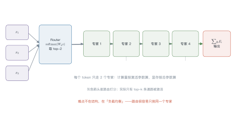
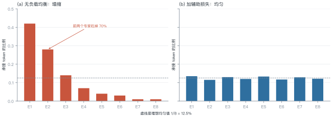
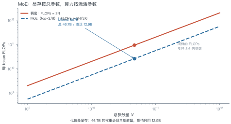
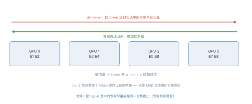

# 第 11 讲　MoE 与稀疏化

!!! abstract "本讲位置"
    第五部分的开篇。第 6 讲说"参数和数据要同比增加"，但算力有限——MoE 给出另一条路：**让参数变多，让每个 token 只算一小部分**。

!!! info "📅 事实核查至 2026-11"
    Switch Transformer（2021）、GShard、Mixtral（2024）、DeepSeekMoE 与 DeepSeek-V3（2024）均已核对原文。

## 学习目标

学完本讲，你应该能够：

1. 写出 MoE 层的输出公式，手算一次 top-k 路由；
2. 解释路由塌缩，并算出负载均衡损失的数值；
3. 区分"总参数"与"激活参数"，说明 MoE 省的是算力而不是显存；
4. 说出 DeepSeek 的三项改进各自解决什么问题。

---

## 0 直觉：一群专家，每次只叫几个

稠密模型的每一层，所有参数都参与每个 token 的计算。想让模型"记得更多"，只能加参数——但算力也跟着涨。

MoE 换个思路：**准备很多个专家（每个都是一个小 FFN），每个 token 只挑其中 k 个来算**。

类比一家医院：挂号台（router）看一眼病人，把他分到两个科室（top-2 专家），两个科室各出一份意见，加权合并成诊断。

- 医院总共有 8 个科室（总参数大 → 知识多）；
- 每个病人只看 2 个（激活参数小 → 算得快）。

!!! note "一句话总结"
    MoE = **稀疏激活的 FFN 集合**：参数量按总参数算，计算量和显存带宽按激活参数算。

具体一点：Mixtral 8×7B 与一个 46.7B 的稠密模型参数一样多，但前者每个 token 只算 12.9B 的部分。在同样的显存预算下，MoE 的"知识容量"接近稠密模型，速度却接近 13B 模型。

代价是**训练更难**：路由是离散选择，梯度只能通过被选中的专家回传，未选中的专家这一步完全没学到东西。这让 MoE 对学习率、初始化、数据顺序都更敏感。

---

## 1 结构

<figure markdown="span">
  { width="100%" }
  <figcaption>图 L11-1　读图要点：token 先过 router 得到一组权重，只激活 top-k 个专家（图里只画了两条绿线），再按权重加权求和。<b>难点不在结构，在负载均衡</b>。</figcaption>
</figure>

$$
y=\sum_{i\in\mathrm{TopK}}g_i(x)\,E_i(x),
\qquad
g_i(x)=\frac{\exp\big((W_g x)_i\big)}{\sum_{j\in\mathrm{TopK}}\exp\big((W_g x)_j\big)}
\tag{11.1}
$$

注意分母只对 top-k 求和——这叫**重归一化**，保证权重和为 1。

### 例 11.1　手算一次 top-2 路由

4 个专家，router 输出 logits $=[2.0,\ 1.0,\ 0.5,\ 0.1]$，取 top-2。

**第一步，softmax：**

$$e^{2.0}=7.39,\quad e^{1.0}=2.72,\quad e^{0.5}=1.65,\quad e^{0.1}=1.11$$

总和 $=12.86$，得到 $[0.575,\ 0.211,\ 0.128,\ 0.086]$。

**第二步，取 top-2：** 专家 1（0.575）与专家 2（0.211）。

**第三步，重归一化：**

$$g_1=\frac{0.575}{0.575+0.211}=0.731,\qquad
g_2=\frac{0.211}{0.786}=0.269$$

**第四步，加权输出：** $y=0.731\,E_1(x)+0.269\,E_2(x)$。

!!! tip "从这个例子里能读出三件事"
    1. **只有 2/4 的专家参与计算**：算力省一半；
    2. **权重和为 1**：重归一化保证了这一点，否则输出尺度会随 top-k 变化；
    3. **router 本身很便宜**：一个小线性层，参数量可以忽略。

---

## 2 负载均衡

<figure markdown="span">
  { width="100%" }
  <figcaption>图 L11-2　读图要点：不加约束时，前两个专家吃掉 70% 的 token，其余几乎闲置；加辅助损失后回到接近均匀的 12.5%。<b>塌缩一旦发生，等于白养了六个专家</b>。</figcaption>
</figure>

**为什么塌缩**：router 的梯度会自我强化——某个专家一旦被多选，它学得更快，于是被选得更多，形成正反馈。

**辅助损失**（load balancing loss）：

$$
\mathcal{L}_{\text{aux}}=N\sum_{i=1}^{N}f_i\,P_i,
\qquad
f_i=\frac{\#\{\text{路由到 }i\text{ 的 token}\}}{\#\text{token}},
\quad
P_i=\frac{1}{T}\sum_{t}g_i(x_t)
\tag{11.2}
$$

- $f_i$：实际分配比例；
- $P_i$：router 给出的平均概率；
- 均匀时取最小值 1，越不均匀越大。

### 例 11.2　算一次辅助损失

4 个专家，$f=[0.50,\ 0.30,\ 0.15,\ 0.05]$，$P=[0.45,\ 0.30,\ 0.15,\ 0.10]$。

$$
\mathcal{L}_{\text{aux}}=4\times(0.5\times0.45+0.3\times0.3+0.15\times0.15+0.05\times0.1)
=4\times0.3425=1.37
$$

对照均匀情形（$f_i=P_i=0.25$）：

$$\mathcal{L}_{\text{aux}}=4\times4\times0.0625=1.0$$

**1.37 vs 1.0**：差值 0.37 就是"不均匀的惩罚"。这个值乘上系数（通常 $10^{-2}$）后加进总损失。

### 2.1 容量因子与 token 丢弃

实际实现里，每个专家能接的 token 数有上限：

$$\text{capacity}=\frac{\text{tokens per batch}}{N}\times\text{capacity factor}$$

容量因子取 1.0 时，超出容量的 token 被直接丢弃（不经过这个专家）。这会损失信息，但保证了计算图的形状固定——GPU 上必须如此。

三个经验值：

- **训练**：1.25 左右，容忍一点不均衡；
- **推理**：1.0 甚至更小，优先保证延迟；
- **丢弃率监控**：超过 5% 就该调大容量或改路由。

---

## 3 参数与计算解耦

<figure markdown="span">
  { width="100%" }
  <figcaption>图 L11-3　读图要点：同样的算力，MoE 能挂 3.6 倍参数。但<b>显存要装下全部权重</b>——这是 MoE 的代价，不是免费午餐。</figcaption>
</figure>

以 Mixtral 8×7B 为例：

| 指标 | 数值 |
|---|---|
| 总参数 | 46.7B |
| 激活参数（top-2/8） | 12.9B |
| 每 token FLOPs | $\approx 2\times12.9$B |
| 显存（bf16） | $\approx 93$ GB |

**结论**：MoE 省的是算力和带宽，不是显存。**部署 MoE 的瓶颈往往在显存，不在算力**。

---

## 4 DeepSeek 的三项改进

| 改进 | 做法 | 解决什么 |
|---|---|---|
| **细粒度专家** | 把专家切得更小、更多（如 64 个小专家选 6 个） | 组合更灵活，同等激活参数下表达力更强 |
| **共享专家** | 留 1–2 个专家对所有 token 都激活 | 承载通用知识，减少专家间的冗余 |
| **无辅助损失均衡** | 用可学习的 bias 调整路由分数，不写进损失 | 避免辅助损失与主目标冲突 |

第三点值得展开：辅助损失会"污染"主任务梯度——模型可能为了均衡而牺牲效果。DeepSeek-V3 改成在路由 logits 上加一个**随负载动态调整的 bias**：某个专家太闲就加一点分，太忙就减一点。这样均衡是"外部调节"，不参与梯度。

### 4.1 MoE 的推理困境

MoE 在训练时很划算，推理时却有个尴尬：**批处理效率低**。

稠密模型里，一个 batch 的所有 token 走同一条计算路径，GPU 利用率高。MoE 里不同 token 走不同专家，一个 batch 被切得七零八落——每个专家只分到一小批 token，矩阵乘法的规模变小，利用率下降。

后果是：**理论算力省 3.6 倍，实测吞吐可能只省 1.5 倍**。所以 MoE 在"高并发、大 batch"的云端服务里优势明显，在"低延迟、单请求"的边缘场景反而不划算。

---

## 5 专家并行

<figure markdown="span">
  { width="100%" }
  <figcaption>图 L11-4　读图要点：专家分散在不同 GPU 上，token 要先 all-to-all 发过去，算完再发回来。<b>通信量 ∝ token 数 × top-k</b>，这是 MoE 训练慢的主要原因。</figcaption>
</figure>

三个实现层面的关键参数：

- **容量因子**（capacity factor）：每个专家最多收多少 token，超出就丢弃（token dropping）；
- **专家并行度**：多少张卡分摊专家；
- **all-to-all 带宽**：跨机通信是瓶颈，通常要求 NVLink/IB。

### 5.1 为什么 MoE 训练不稳定

三个来源：

1. **路由方差大**：早期 router 接近随机，token 分配剧烈波动，损失曲线抖动；
2. **专家冷启动**：某个专家一开始没被选中，就永远学不到东西，形成"死专家"；
3. **梯度尺度不一**：不同专家承接的 token 数不同，梯度量级差异大。

对策是**热身期用均匀路由**（强制 round-robin），等 router 有了基本判断再放开；同时监控每个专家的承接量，出现"死专家"就重置它的参数。

```python
import torch
import torch.nn.functional as F


def moe_forward(x, gate, experts, top_k=2):
    """x: (T, d)；gate: 线性层；experts: 专家列表"""
    logits = gate(x)                                  # (T, N)
    probs = logits.softmax(-1)
    top_p, top_i = probs.topk(top_k, dim=-1)          # (T, k)
    weights = top_p / top_p.sum(-1, keepdim=True)     # 重归一化

    out = torch.zeros_like(x)
    for slot in range(top_k):
        idx = top_i[:, slot]
        for e, expert in enumerate(experts):
            mask = idx == e
            if mask.any():
                out[mask] += weights[mask, slot, None] * expert(x[mask])
    return out


def load_balance_loss(logits, top_i, num_experts):
    """式 (11.2)：均匀时取最小值 1"""
    t = logits.size(0)
    f = torch.bincount(top_i.flatten(), minlength=num_experts).float() / (t * top_i.size(1))
    p = logits.softmax(-1).mean(0)
    return num_experts * (f * p).sum()
```

---

## 6 工程要点与坑

1. **别只看总参数**：宣传的"671B"是总参数，实际激活可能只有 37B，按激活参数算成本。
2. **容量因子调小会丢 token**：丢的是信息，不是噪声，通常设在 1.0–1.25。
3. **辅助损失系数要小**：$10^{-2}$ 量级，大了会明显掉点。
4. **专家并行需要高带宽**：跨机 all-to-all 会让吞吐掉一半以上。
5. **微调 MoE 要小心**：冻结 router 只训专家，容易失衡；全放开又容易塌缩。
6. **推理时批处理效率低**：不同 token 走不同专家，GPU 利用率不如稠密模型。

---

## 7 论文与延伸

| 年份 | 论文 | 一句话贡献 |
|---|---|---|
| 2020 | [GShard](https://arxiv.org/abs/2006.16668) | 大规模 MoE 的工程范式 |
| 2021 | [Switch Transformer](https://arxiv.org/abs/2101.03961) | top-1 路由 + 辅助损失 |
| 2022 | [ST-MoE](https://arxiv.org/abs/2202.08906) | 容量因子与稳定性 |
| 2024 | [Mixtral of Experts](https://arxiv.org/abs/2401.04088) | 开源 MoE 追平更大稠密模型 |
| 2024 | [DeepSeekMoE](https://arxiv.org/abs/2401.06066) | 细粒度 + 共享专家 |
| 2024 | [DeepSeek-V3](https://arxiv.org/abs/2412.19437) | 无辅助损失的负载均衡 |

---

## 8 习题

**🟢 概念题**

1. 为什么说 MoE 省算力但不省显存？
2. 路由塌缩为什么是正反馈？给出打破它的两种方法。

**🟡 推导题**

3. 用式 (11.1) 证明重归一化后权重和为 1，并说明不重归一化会怎样。
4. 用式 (11.2) 算：$N=8$、$f=[0.4,0.2,0.15,0.1,0.05,0.05,0.03,0.02]$、$P$ 与 $f$ 相同时的辅助损失。

**🔴 实现题**

5. 跑通上面的 `moe_forward`，统计每个专家实际承接的 token 数，观察是否塌缩。
6. 给 router 加一个可学习 bias（DeepSeek 式），实现无辅助损失的均衡，并与辅助损失方案对比。

---

## 9 本讲小结

<div class="cheatsheet" markdown>

**一个公式**

$$y=\sum_{i\in\mathrm{TopK}}g_i(x)E_i(x)$$

**两个数字**

- Mixtral 8×7B：总 46.7B / 激活 12.9B，省 3.6 倍算力
- 辅助损失：均匀时 1.0，塌缩时明显大于 1

**三个改进**

细粒度专家 · 共享专家 · 无辅助损失均衡

**一句话**

> MoE 用稀疏性换容量：显存按总参数付，算力按激活参数付。

</div>

---

## 来源

- Switch、Mixtral、DeepSeekMoE、DeepSeek-V3 的结论核对自原文，链接见 §7，核查日期 2026-11。
