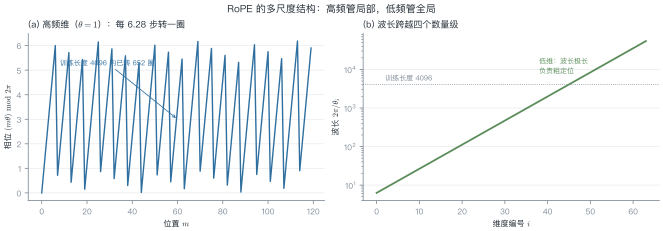
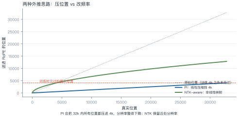
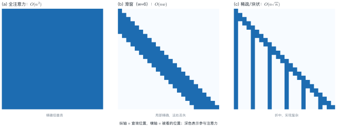
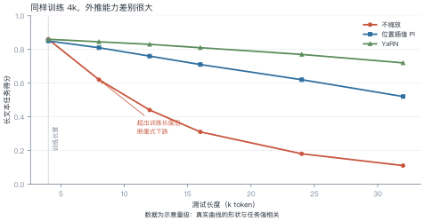

# 第 12 讲　长上下文

!!! abstract "本讲位置"
    第 11 讲让参数变多而算力不变，本讲解决另一个维度：**让模型一次能读更多**。这既涉及位置编码的数学，也涉及显存与算力的工程账。

!!! info "📅 事实核查至 2026-11"
    PI（Chen et al., 2023）、NTK-aware（bloc97, 2023）、YaRN（Peng et al., 2023）、RULER（Hsieh et al., 2024）均已核对原文。

## 学习目标

学完本讲，你应该能够：

1. 解释 RoPE 外推失败的原因（相位混叠），并算出某维度转了多少圈；
2. 写出 PI 与 NTK-aware 的缩放公式，说明两者差别；
3. 说出三种注意力近似各自的复杂度与代价；
4. 判断一个"128K 上下文"的宣传值有多少可信度。

---

## 0 直觉：窗口是工作内存

上下文窗口就是模型的工作内存。窗口越大，能一次处理的东西越多：整本书、整个代码仓库、几百页合同。

但"能装下"不等于"能用好"。三个层次要分开：

| 层次 | 含义 | 检验方式 |
|---|---|---|
| **能装** | 显存放得下 | 跑得动，不 OOM |
| **能读** | 信息真的被注意到 | needle-in-haystack |
| **能用** | 能基于全文推理 | RULER 等多跳任务 |

厂商宣传的"128K"通常只保证第一层。

!!! note "一句话总结"
    长上下文 = **位置编码的外推能力 × 注意力近似的取舍 × 显存的预算**，三者缺一不可。

---

## 1 为什么外推难

<figure markdown="span">
  { width="100%" }
  <figcaption>图 L12-1　读图要点：左图是最高频维度的相位，每 6.28 个位置转一圈；右图是各维度的波长，跨越四个数量级。<b>高频维度负责局部、低频负责全局</b>，外推时两者坏的方式不同。</figcaption>
</figure>

RoPE 把位置写进相位：第 $i$ 维的角频率是

$$\theta_i=10000^{-2i/d}
\tag{12.1}$$

### 例 12.1　算一下转了多少圈

$d=128$ 时，第 0 维的 $\theta_0=1$ rad/位置。

在训练长度 4096 内，它转过的圈数：

$$\frac{4096}{2\pi}\approx 652\ \text{圈}$$

第 63 维（最低频）的 $\theta_{63}=10000^{-126/128}\approx1.04\times10^{-4}$，波长

$$\frac{2\pi}{\theta_{63}}\approx 6.0\times10^{4}$$

**也就是说**：训练时模型见过"第 0 维转过 652 圈"的所有相位组合；一旦推到 32K，第 0 维要转 5093 圈，中间那些相位**从未在训练中出现过**——模型的注意力分数在这里是"外推"，不是"插值"。

!!! tip "从这个例子里能读出三件事"
    1. **高频维度最先坏**：它转得最快，超出训练长度后相位完全不可预测；
    2. **低频维度反而安全**：波长 6 万，32K 还不到半个周期；
    3. **外推失败是"局部先崩"**：所以需要分频段处理（YaRN 的思路）。

### 1.1 位置之外还有两个问题

位置编码只是外推困难的一半。另外两个与它无关：

- **中间遗忘**（lost in the middle）：把关键信息放在长文档的中段，模型召回率明显低于放在开头或结尾。这与位置编码无关，是注意力分布的固有偏置。
- **注意力稀释**：序列越长，softmax 把权重摊得越薄，单个位置分到的注意力越少。128K 时每个 token 平均只能分到 $1/128000$ 的权重。

所以"外推成功"不等于"长文本任务成功"——后者还要解决信息在长序列中的可达性。

---

## 2 三种外推方法

<figure markdown="span">
  { width="100%" }
  <figcaption>图 L12-2　读图要点：PI 把真实位置线性压进训练范围（蓝线），所有位置的分辨率一起下降；NTK-aware 改的是频率（绿线），近处分辨率基本保留。</figcaption>
</figure>

### 2.1 位置插值（PI）

把位置除以缩放因子 $s=L_{\text{new}}/L_{\text{train}}$：

$$m'=\frac{m}{s}
\tag{12.2}
$$

$s=8$ 时，32K 的位置被压到 4K 以内，模型看到的位置都在训练范围内。

**代价**：位置分辨率整体下降 8 倍，相近的两个位置变得更难区分。

### 2.2 NTK-aware 缩放

不压位置，而是放大 base：

$$\text{base}'=\text{base}\cdot s^{\frac{d}{d-2}}
\tag{12.3}
$$

$d=128$、$s=8$ 时：

$$\text{base}'=10000\times8^{128/126}\approx 8.3\times10^{4}$$

**为什么这样更好**：放大 base 只让低频维度变慢（波长变长），高频维度几乎不变——**保住了局部分辨率**。

### 2.3 YaRN：分频段处理

把维度按频率分成三段：

| 频段 | 处理 | 理由 |
|---|---|---|
| 高频（前 1/3） | 不缩放 | 负责局部，必须保持 |
| 中频 | 线性 ramp 过渡 | 避免突变 |
| 低频（后 1/3） | 按 PI 插值 | 波长本来就很长，压缩影响小 |

再配一个温度系数修正注意力熵。这是目前 32K–128K 外推的主流做法。

### 例 12.2　三个数值对照

训练长度 4096，目标 32768：

| 方法 | 缩放因子 | 实际改动 |
|---|---|---|
| PI | $s=8$ | 位置 $m\to m/8$ |
| NTK-aware | $s=8$ | $\text{base}:10^4\to8.3\times10^4$ |
| YaRN | $s=8$ | 高频不动、低频插值、温度修正 |

**三者都用同一个 $s$**，区别在"改哪里"：PI 改位置，NTK 改频率，YaRN 改一部分频率。

---

## 3 注意力近似

<figure markdown="span">
  { width="100%" }
  <figcaption>图 L12-3　读图要点：全注意力是 $O(n^2)$；滑窗只保留最近 $w$ 个位置，复杂度降到 $O(nw)$；稀疏/块状介于两者之间。<b>颜色越深表示参与注意力</b>。</figcaption>
</figure>

| 方案 | 复杂度 | 代价 |
|---|---|---|
| 全注意力 | $O(n^2)$ | 128K 时单层注意力就要几十 GB |
| 滑窗（Mistral） | $O(nw)$ | 远处信息只能靠多层间接传递 |
| 块状稀疏（Longformer） | $O(n\sqrt{n})$ | 实现复杂，硬件利用率低 |
| 线性注意力 / SSM（Mamba） | $O(n)$ | 表达力受限，长程检索弱 |

**工程现实**：主流仍是"全注意力 + 更好的位置编码 + KV cache 优化"，因为稀疏注意力的实际加速比常常达不到理论值。

---

## 4 效果与代价

<figure markdown="span">
  { width="100%" }
  <figcaption>图 L12-4　读图要点：同样训练 4K，不缩放在 8K 就断崖；PI 撑到 24K；YaRN 到 32K 仍保留七成。<b>外推能力不是"有或没有"，而是一条衰减曲线</b>。</figcaption>
</figure>

代价主要在两处：

1. **KV cache 线性增长**：128K 上下文的 KV cache 可达几十 GB（第 13 讲细算）；
2. **注意力计算 $O(n^2)$**：序列翻倍，注意力部分算力翻四倍。

所以"支持 128K"和"128K 下还能跑得动、跑得快"是两件事。

**KV cache 的粗略账**：以 7B 模型（32 层、$d=4096$）为例，fp16 下每个 token 的 KV 是

$$2\times32\times4096\times2\ \text{B}=512\ \text{KB}$$

128K 上下文就是 $128000\times512\ \text{KB}\approx 62\ \text{GB}$——**比模型权重（13 GB）大近五倍**。

这就是为什么长上下文服务必须配合 PagedAttention、KV 量化或 GQA：不解决显存，128K 只是纸面参数。

```python
import torch


def rope_scaled(x, positions, base=10000.0, method="pi", scale=8.0):
    """带外推的 RoPE：method ∈ {pi, ntk}"""
    d = x.shape[-1]
    if method == "ntk":
        base = base * scale ** (d / (d - 2))
        pos = positions.to(x.dtype)
    else:  # pi
        pos = positions.to(x.dtype) / scale

    omega = base ** (-torch.arange(0, d, 2, dtype=x.dtype) / d)
    ang = pos[:, None] * omega[None, :]
    cos, sin = ang.cos(), ang.sin()

    x1, x2 = x[..., 0::2], x[..., 1::2]
    out = torch.empty_like(x)
    out[..., 0::2] = x1 * cos - x2 * sin
    out[..., 1::2] = x1 * sin + x2 * cos
    return out


q = torch.randn(1, 32768, 128)
print(rope_scaled(q, torch.arange(32768), method="pi").shape)    # PI
print(rope_scaled(q, torch.arange(32768), method="ntk").shape)   # NTK-aware
```

---

## 5 怎么评测长上下文

| 测试 | 测什么 | 局限 |
|---|---|---|
| needle-in-haystack | 大海捞针：能不能找到一句话 | 只测"检索"，不测"推理" |
| RULER | 多跳、聚合、追踪 | 更接近真实使用 |
| 长文档 QA | 端到端任务 | 受数据质量影响大 |

**needle 测试的陷阱**：把一句无关紧要的话藏在 128K 里，模型能找到，不代表它能读懂 128K 的代码库。真正要看的是**多跳推理**：答案需要跨多个位置组合。

**实操建议**：自己测长上下文时，至少准备三类样本：

1. **单点检索**（needle）：一句话藏在随机文本里；
2. **多点聚合**：答案需要汇总分布在 10 个以上位置的信息；
3. **跨段推理**：答案在第 1 段与第 90 段之间做比较。

只测第一类，几乎必然高估真实能力。

---

## 6 工程要点与坑

1. **先确认"能读"再谈"能用"**：跑 needle 通过就上线，多半会翻车。
2. **外推要配微调**：PI/NTK 直接推理会有性能损失，用几千条长样本继续训一下能补回来。
3. **KV cache 是真正的瓶颈**：128K 时它比模型权重还大，必须配合 PagedAttention/量化。
4. **位置不是唯一问题**：注意力本身的"中间遗忘"（lost in the middle）与位置编码无关。
5. **别迷信宣传值**：厂商标的 128K 常指"能装下"，实际有效长度可能只有 32K。
6. **滑窗会丢远处信息**：需要跨文档引用的任务，滑窗模型会明显吃亏。

---

## 7 论文与延伸

| 年份 | 论文 | 一句话贡献 |
|---|---|---|
| 2021 | [RoFormer / RoPE](https://arxiv.org/abs/2104.09864) | 旋转位置编码 |
| 2023 | [Extending Context Window via Position Interpolation](https://arxiv.org/abs/2306.15595) | PI |
| 2023 | [YaRN: Efficient Context Window Extension](https://arxiv.org/abs/2309.00071) | 分频段外推 |
| 2023 | [Longformer](https://arxiv.org/abs/2004.05150) | 滑窗 + 全局 token |
| 2023 | [Mamba](https://arxiv.org/abs/2312.00752) | 线性复杂度状态空间模型 |
| 2024 | [RULER: What's the Real Context Size?](https://arxiv.org/abs/2404.06654) | 更真实的长上下文评测 |

---

## 8 习题

**🟢 概念题**

1. 为什么高频维度最先在外推时失效？
2. "能装下 / 能读 / 能用"三者的差别是什么？各用什么测？

**🟡 推导题**

3. 用 (12.1) 算出 $d=128$ 时第 32 维的波长，并判断它在 32K 内转了几圈。
4. 推导 NTK-aware 的 base 缩放指数 $d/(d-2)$ 的来历（提示：保持低频维度的相对分辨率）。

**🔴 实现题**

5. 用 `rope_scaled` 实现 PI 与 NTK，在随机数据上验证"内积只依赖相对位置"是否仍成立。
6. 构造一个 8K 的 needle 测试，比较 4K 训练模型在 PI / NTK 下的召回率。

---

## 9 本讲小结

<div class="cheatsheet" markdown>

**一个公式**

$$\theta_i=10000^{-2i/d},\qquad \lambda_i=2\pi/\theta_i$$

**三种外推**

PI 压位置 · NTK 改频率 · YaRN 分频段

**三个数字**

- 4K 训练、第 0 维转 652 圈
- $s=8$ 时 NTK 的 base 从 $10^4$ 涨到 $8.3\times10^4$
- 128K 的 KV cache 比模型权重还大

**一句话**

> 长上下文不是把窗口调大，是位置编码、注意力近似、显存预算三件事一起解决。

</div>

---

## 来源

- PI、NTK-aware、YaRN、RULER 的公式与结论核对自原文，链接见 §7，核查日期 2026-11。
