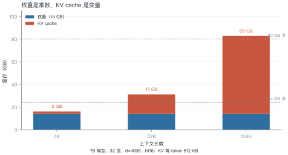
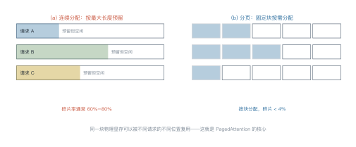
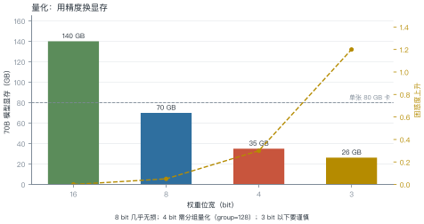
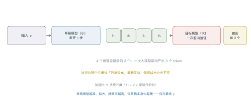

# 第 13 讲　推理系统

!!! abstract "本讲位置"
    第 12 讲把窗口撑大，本讲解决"撑大之后怎么跑得动"。推理系统是全书最工程的一讲：没有新模型结构，全是显存、带宽、调度的账。

!!! info "📅 事实核查至 2026-11"
    PagedAttention/vLLM（Kwon et al., 2023）、FlashAttention（Dao et al., 2022）、投机解码（Leviathan et al., 2023）均已核对原文。

## 学习目标

学完本讲，你应该能够：

1. 拆解推理显存的三块开销，并算出给定模型的 KV cache 大小；
2. 解释 PagedAttention 解决什么问题，碎片率从多少降到多少；
3. 说出量化的位宽选择与精度代价；
4. 用接受率与草稿代价算投机解码的期望加速比。

---

## 0 直觉：显存是唯一的硬约束

训练看算力，推理看**显存带宽与容量**。

原因很简单：生成一个 token 要把全部权重读一遍。70B 模型 bf16 是 140 GB，生成 100 个 token 就要读 14 TB 的数据——**瓶颈在内存带宽，不在计算**。

所以推理优化的核心问题永远是：**怎么少读一点、少存一点**。

!!! note "一句话总结"
    推理优化三件事：**省显存（量化、KV 压缩）、提吞吐（批处理、分页）、降延迟（投机解码）**。

---

## 1 显存账本

<figure markdown="span">
  { width="100%" }
  <figcaption>图 L13-1　读图要点：权重是常数（14 GB），KV cache 随上下文线性涨。4K 时总共 16 GB 还能塞进 24 GB 卡；128K 时 KV 就有 69 GB，<b>80 GB 卡也不够</b>。</figcaption>
</figure>

三块开销：

$$
\underbrace{N\times\text{字节数}}_{\text{权重}}
+\underbrace{2\cdot L\cdot d\cdot n\times\text{字节数}}_{\text{KV cache}}
+\underbrace{\text{激活}}_{\text{临时}}
\tag{13.1}
$$

### 例 13.1　7B 模型跑 4K 上下文

$N=7\times10^9$、$L=32$、$d=4096$、$n=4096$、bf16（2 字节）。

**权重：**

$$7\times10^9\times2\ \text{B}=14\ \text{GB}$$

**KV cache：**

$$2\times32\times4096\times4096\times2\ \text{B}=2.1\ \text{GB}$$

**激活（batch=1）：** 约 0.5 GB。

**合计约 16.6 GB**。24 GB 卡还剩 7 GB——只够放 3 条并发请求的 KV cache。

!!! tip "从这个例子里能读出三件事"
    1. **权重占大头，但它是常数**：模型定了就不变；
    2. **KV 决定并发数**：想同时服务 10 个用户，就得 10 份 KV；
    3. **长上下文直接吃掉并发**：128K 时单条请求的 KV 就 69 GB。

### 1.1 为什么激活通常可以忽略

训练时激活是显存大头（第 5 讲算过：单层注意力分数就 268 MB），但推理时不同：

- batch 通常很小（1–32），序列是逐步增长的；
- 每层算完就可以释放中间结果，不需要为反向传播保留。

所以推理的显存账基本只看两项：**权重 + KV cache**。这也是为什么量化权重和压缩 KV 是收益最高的两个方向。

---

## 2 KV cache 与 PagedAttention

<figure markdown="span">
  { width="100%" }
  <figcaption>图 L13-2　读图要点：连续分配要为每条请求预留最大长度，实际只用了一小半，碎片率 60%–80%；分页把 KV 切成固定块按需分配，碎片降到 4% 以下。</figcaption>
</figure>

**碎片问题**：请求长度事先未知。若按最大长度（如 4K）预留，短请求就浪费；若按实际长度分配，新请求进来又放不下。

PagedAttention 借鉴操作系统虚拟内存：**逻辑上连续，物理上分块**。每块存固定数量的 token（如 16 个），块表记录映射关系。

### 例 13.2　连续批处理带来多少吞吐

静态批处理：一次凑 8 条请求，等**最慢的那条**结束才换下一批。

假设 8 条请求的平均生成长度是 100 token，但方差很大（50–300）。批处理要等 300 那条，平均槽位利用率只有：

$$\frac{100}{300}\approx33\%$$

连续批处理：哪条结束就立刻补一条新的，利用率能到 85% 以上。

$$\text{吞吐提升}\approx\frac{0.85}{0.33}\approx2.6\ \text{倍}$$

**这就是 vLLM 相对 HuggingFace 默认实现快数倍的主要原因**——不是模型更快，是调度更满。

---

## 3 FlashAttention：省的是显存带宽

标准注意力要把 $n\times n$ 的分数矩阵写进显存再读出来。$n=8192$ 时，单层就是 $8192^2\times2\ \text{B}=134$ MB——32 层就是 4 GB，而且反复读写。

FlashAttention 的做法：**分块计算 + 在线 softmax**，把中间结果留在片上（SRAM），不落显存。

| | 标准 | FlashAttention |
|---|---|---|
| 显存 | $O(n^2)$ | $O(n)$ |
| 显存读写 | $O(n^2 d)$ | $O(n d^2 / M)$ |
| 数值结果 | 精确 | 精确（仅顺序不同） |

**注意**：它不改变计算量（仍是 $O(n^2d)$），只改变 IO。但在 GPU 上，IO 才是瓶颈，所以实测能快 2–4 倍。

### 3.1 连续批处理的实现要点

调度器要回答三个问题：

1. **什么时候加入新请求**：每次有请求结束就立刻补位，而不是等整批结束；
2. **显存不够时怎么办**：优先抢占（preempt）最长的那条，把它换出到 CPU 内存，稍后再换回来；
3. **怎么保证公平**：按到达顺序排队，避免长请求饿死短请求。

代价是**调度复杂度**：要维护块表、处理抢占、保证输出顺序。这也是 vLLM 这类框架真正的工程量所在——**分页只是数据结构，调度才是系统**。

---

## 4 量化

<figure markdown="span">
  { width="100%" }
  <figcaption>图 L13-3　读图要点：70B 模型 bf16 要 140 GB（两张卡），INT8 减半到 70 GB，INT4 只要 35 GB（一张卡）。<b>代价是困惑度上升，4 bit 需要分组量化才能压住</b>。</figcaption>
</figure>

| 位宽 | 70B 显存 | 困惑度上升 | 适用 |
|---|---|---|---|
| bf16 | 140 GB | 0 | 训练、高精度场景 |
| INT8 | 70 GB | +0.05 | 几乎无损，首选 |
| INT4 | 35 GB | +0.3 | 需分组（group=128） |
| INT3 | 26 GB | +1.2 | 实验性 |

**三种主流方法**：

- **GPTQ**：用 Hessian 近似逐层量化，一次完成；
- **AWQ**：按激活值的重要性保护少数通道；
- **GGUF**：llama.cpp 的格式，支持混合精度，CPU 推理友好。

**格式在换代**：2025 年之后，主流从整数（INT8/INT4）转向浮点——**FP8**（E4M3）几乎无损且被 Hopper 原生加速，**NVFP4**（16 元素共享一个 FP8 缩放因子）成为 4 bit 的新默认。与 INT4 的逐通道缩放相比，块级浮点缩放在激活分布不均时更稳。

### 例 13.3　量化的账

70B 模型：

$$140\ \text{GB}\ (\text{bf16}) \to 35\ \text{GB}\ (\text{INT4})$$

从"两张 80G 卡"变成"一张 48G 卡"，**硬件成本降一半以上**。

而困惑度只涨 0.3（相对 5.0 的基线是 6%）——对大多数应用可以接受。

---

## 5 投机解码

<figure markdown="span">
  { width="100%" }
  <figcaption>图 L13-4　读图要点：小模型串行草拟 4 个 token，大模型一次前向验证全部，接受最长正确前缀。<b>被拒的位置按残差分布重采样，输出分布与原模型完全一致</b>。</figcaption>
</figure>

**为什么能加速**：大模型生成一个 token 要一次前向；验证 4 个候选只要**同样一次**前向（并行算）。只要接受的 token 数大于 1，就赚了。

期望加速比：

$$
\text{speedup}=\frac{1+\alpha\gamma}{1+\gamma c}
\tag{13.2}
$$

- $\alpha$：接受率（草稿猜对的比例）；
- $\gamma$：草稿长度；
- $c$：草稿模型单步代价 / 大模型单步代价。

**取 $\alpha=0.7$、$\gamma=4$、$c=0.05$：**

$$\frac{1+2.8}{1+0.2}=3.17\ \text{倍}$$

**关键约束**：$\alpha$ 越高、$c$ 越小越划算。草稿模型太大，$c$ 上升；太小，$\alpha$ 下降——存在最优的草稿模型规模。

### 5.1 两种改进路线

| 路线 | 做法 | 代表 |
|---|---|---|
| 更好的草稿 | 用小模型或额外头生成候选 | Medusa（多头并行草稿） |
| 更好的树 | 一次生成树状候选，验证时选最长路径 | SpecInfer、EAGLE |

EAGLE 的思路值得一说：它不在 token 层面草拟，而是在**特征层面**外推——用目标模型倒数第二层的隐状态预测下一步，接受率比独立小模型高得多。

**共同点**：都要保证输出分布不变（无损），只是用不同方式提高"一次前向能确认几个 token"。

**2025–2026 的进展**：主流从"独立小模型草稿"转向 **EAGLE 系列**——草稿直接在目标模型的**特征层**自回归，接受率更高。EAGLE-3（2025）在 70B 级模型上实测 3–4 倍加速；vLLM 的 EAGLE 3.1（2026）又加了 FC 归一化与后归一化隐状态反馈，提升长上下文下的稳定性。

```python
def kv_cache_gb(n_layers: int, d: int, n_tokens: int, bytes_per: int = 2) -> float:
    """KV cache 大小（GB）"""
    return 2 * n_layers * d * n_tokens * bytes_per / 1e9


def spec_speedup(alpha: float, gamma: int, cost_ratio: float) -> float:
    """投机解码的期望加速比"""
    return (1 + alpha * gamma) / (1 + gamma * cost_ratio)


print(f"7B / 4K  : {kv_cache_gb(32, 4096, 4096):.1f} GB")
print(f"7B / 128K: {kv_cache_gb(32, 4096, 131072):.1f} GB")
print(f"投机解码（α=0.7, γ=4, c=0.05）: {spec_speedup(0.7, 4, 0.05):.2f}x")
```

---

## 6 工程要点与坑

1. **先算 KV 再选卡**：并发数 = 可用显存 / 单请求 KV，不是拍脑袋。
2. **量化从 INT8 起步**：几乎无损，先拿这个收益；不够再上 INT4。
3. **别忽略带宽**：推理是 memory-bound，算力利用率常年低于 20%。
4. **批处理要看尾延迟**：吞吐上去了，P99 可能变差——要按 SLA 调批大小。
5. **投机解码要看任务**：代码补全接受率高（3–4x），开放写作接受率低（1.3x）。
6. **KV 量化有风险**：KV cache 量化到 INT8 通常安全，INT4 会明显掉点。

---

## 7 论文与延伸

| 年份 | 论文 | 一句话贡献 |
|---|---|---|
| 2022 | [FlashAttention](https://arxiv.org/abs/2205.14135) | IO 感知的精确注意力 |
| 2022 | [GPTQ](https://arxiv.org/abs/2210.17323) | 一次性权重量化 |
| 2023 | [AWQ](https://arxiv.org/abs/2306.00978) | 激活感知量化 |
| 2023 | [vLLM / PagedAttention](https://arxiv.org/abs/2309.06180) | 分页管理 KV cache |
| 2023 | [Speculative Decoding](https://arxiv.org/abs/2211.17192) | 草稿 + 验证 |
| 2024 | [Medusa](https://arxiv.org/abs/2401.10774) | 多头草稿 |

---

## 8 习题

**🟢 概念题**

1. 为什么说推理是 memory-bound 而不是 compute-bound？
2. PagedAttention 解决的是"显存不够"还是"显存碎片"？两者有何区别？

**🟡 推导题**

3. 用 (13.1) 算：13B 模型（40 层、$d=5120$）跑 8K 上下文，KV cache 多大？24 GB 卡能并发几条？
4. 用 (13.2) 算：$\alpha=0.5$、$\gamma=6$、$c=0.1$ 时的加速比，并与 $\gamma=4$ 比较。

**🔴 实现题**

5. 用 `kv_cache_gb` 画一张"并发数 vs 上下文长度"的曲线（给定 80 GB 卡）。
6. 实现一个玩具版投机解码（两个小模型），统计接受率与实测加速比。

---

## 9 本讲小结

<div class="cheatsheet" markdown>

**一个公式**

$$2\cdot L\cdot d\cdot n\times\text{字节数}\ \text{（KV cache）}$$

**三个数字**

- 7B / 4K：权重 14 GB + KV 2.1 GB ≈ 16 GB
- 7B / 128K：KV 单独 69 GB
- 70B INT4：35 GB，一张卡搞定

**四个手段**

分页 · 批处理 · 量化 · 投机解码

**一句话**

> 推理优化不是让模型算得更快，是让显存少读一点、让 GPU 少等一会儿。

</div>

---

## 来源

- FlashAttention、PagedAttention、投机解码的公式与结论核对自原文，链接见 §7，核查日期 2026-11。
