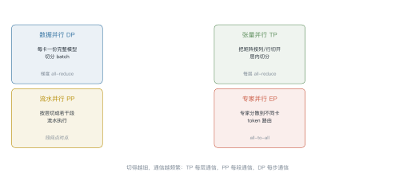
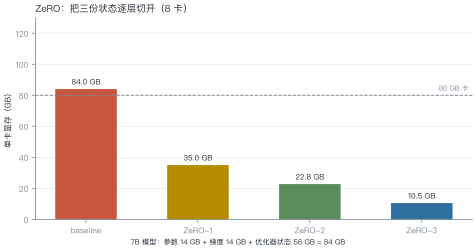
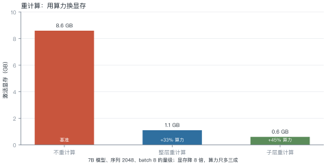
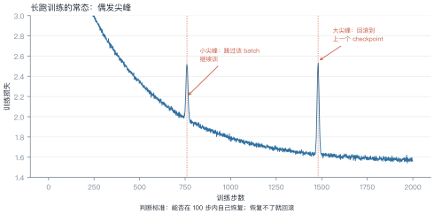

# 第 14 讲　训练系统

!!! abstract "本讲位置"
    第 13 讲管"怎么用"，本讲管"怎么训"。同样是显存与带宽的账，但训练多了一个反向传播，账要复杂一倍。

!!! info "📅 事实核查至 2026-11"
    ZeRO（Rajbhandari et al., 2020）、Megatron-LM（Shoeybi et al., 2019）、activation checkpointing（Chen et al., 2016）均已核对原文。

## 学习目标

学完本讲，你应该能够：

1. 说出四种并行各切什么、通信开销多大；
2. 用 ZeRO 三阶段算出单卡显存；
3. 解释重计算为什么"用算力换显存"，代价是多少；
4. 算 MFU，并判断一个训练任务是否跑得健康。

---

## 0 直觉：一张卡放不下

训练 7B 模型要多少显存？

| 项 | 大小 | 说明 |
|---|---|---|
| 参数（bf16） | 14 GB | 2 字节/参数 |
| 梯度（bf16） | 14 GB | 与参数同尺寸 |
| fp32 主权重 | 28 GB | 更新用，防止精度丢失 |
| Adam 一阶动量 | 28 GB | fp32 |
| Adam 二阶动量 | 28 GB | fp32 |
| **合计** | **112 GB** | 还没算激活 |

**一张 80 GB 卡放不下**。所以必须切——这就是并行策略存在的理由。

!!! note "一句话总结"
    训练系统 = **把 112 GB 的状态切到多张卡上，同时让通信开销可接受**。

---

## 1 四种并行

<figure markdown="span">
  { width="100%" }
  <figcaption>图 L14-1　读图要点：DP 切数据、TP 切层内矩阵、PP 切层、EP 切专家。<b>切得越细，通信越频繁</b>——TP 每层都要通信，DP 每步才通信一次。</figcaption>
</figure>

| 并行 | 切什么 | 通信时机 | 通信量 | 适用 |
|---|---|---|---|---|
| **DP** | batch | 每步一次 | $2N$（all-reduce 梯度） | 通用 |
| **TP** | 层内矩阵 | 每层两次 | $2\times$ 激活大小 | 单机内（NVLink） |
| **PP** | 层 | 每段一次 | 激活大小（点对点） | 跨机 |
| **EP** | 专家 | 每层 | token × top-k | MoE |

### 1.1 怎么选

一个实用的决策顺序：

1. **先看模型能不能放进单卡**：放得下就只用 DP；
2. **放不下就加 TP**：但 TP 度不超过单机 GPU 数（跨机会被带宽拖死）；
3. **还不够就上 PP**：按层切，跨机也能接受；
4. **MoE 模型加 EP**：专家天然可分。

经验值：**TP 度 ≤ 8**（一台机器内），**PP 度 ≤ 16**（再多流水气泡太大），其余用 DP 补。

### 例 14.1　通信量对比

7B 模型、8 卡、每卡 batch 4。

**DP**：每步 all-reduce 一次梯度，通信量

$$2\times7\times10^9\times2\ \text{B}=28\ \text{GB/步}$$

**TP（度 8）**：每层两次 all-reduce，每次激活大小 $4\times2048\times4096\times2\ \text{B}=67$ MB，32 层：

$$32\times2\times67\ \text{MB}=4.3\ \text{GB/步}$$

**结论**：TP 的通信量反而比 DP 小——因为切的是层内，数据量小。但 TP 的通信**更频繁**（每层都要同步），对延迟敏感，所以只能在 NVLink 域内做。

---

## 2 ZeRO：把三份状态切开

<figure markdown="span">
  { width="100%" }
  <figcaption>图 L14-2　读图要点：baseline 84 GB（不含激活）放不进 80 GB 卡；ZeRO-1 切优化器状态降到 35 GB；ZeRO-3 连参数一起切，降到 10.5 GB。<b>每切一层，通信量涨一截</b>。</figcaption>
</figure>

| 阶段 | 切什么 | 单卡显存（8 卡） | 额外通信 |
|---|---|---|---|
| baseline | 不切 | 84 GB | — |
| ZeRO-1 | 优化器状态 | 35 GB | 1× |
| ZeRO-2 | + 梯度 | 22.8 GB | 1× |
| ZeRO-3 | + 参数 | 10.5 GB | 1.5× |

### 例 14.2　算一遍

7B 模型，$N=7\times10^9$，8 卡。

**每参数字节数**：bf16 参数 2 + bf16 梯度 2 + fp32 主权重 4 + Adam $m$ 4 + Adam $v$ 4 = **16 字节**。

$$\text{总量}=7\times10^9\times16\ \text{B}=112\ \text{GB}$$

**ZeRO-1**（只切优化器状态 56 GB）：

$$14+14+\frac{56}{8}=35\ \text{GB}$$

**ZeRO-2**（再切梯度）：

$$14+\frac{14+56}{8}=22.75\ \text{GB}$$

**ZeRO-3**（连参数一起切）：

$$\frac{112}{8}=14\ \text{GB}\quad(\text{不含激活})$$

!!! tip "从这个例子里能读出三件事"
    1. **优化器状态是大头**（56/112 = 50%）：切它收益最大；
    2. **ZeRO-3 的代价是通信**：每次前向都要 all-gather 参数，通信量涨 1.5 倍；
    3. **切到 14 GB 后，激活反而成了瓶颈**——这才需要重计算。

### 2.1 FSDP 与 ZeRO 的关系

PyTorch 原生的 **FSDP**（fully sharded data parallel）本质上就是 ZeRO-3：参数、梯度、优化器状态都按卡分片，前向时临时 all-gather，用完立刻释放。

两者差别在工程细节：

- **ZeRO** 来自 DeepSpeed，配置项多，对混合并行支持更成熟；
- **FSDP** 是 PyTorch 一等公民，与 `torch.compile`、`DTensor` 集成更好。

选型建议：新项目优先 FSDP，需要极致调优再考虑 DeepSpeed。

---

## 3 重计算：用算力换显存

<figure markdown="span">
  { width="100%" }
  <figcaption>图 L14-3　读图要点：不重计算要存 8.6 GB 激活；整层重计算只存层边界，降到 1.1 GB，代价是多一次前向（+33% 算力）。<b>显存降 8 倍，算力只多三成</b>。</figcaption>
</figure>

**原理**：前向时不保存中间激活，反向需要时再算一遍。因为反向本身就要重算一部分，额外开销通常只有 30%–40%。

### 3.1 怎么实现

PyTorch 里一行就能开：

```python
from torch.utils.checkpoint import checkpoint

def forward_block(x, block):
    return checkpoint(block, x, use_reentrant=False)
```

注意两点：

- **只包住计算量大的部分**（注意力、FFN），包住整个模型反而更慢；
- **随机性要固定**：dropout 在重算时必须得到相同结果，否则前后不一致。

### 例 14.3　这笔买卖值不值

假设单卡显存 80 GB，模型状态占 35 GB（ZeRO-1），剩 45 GB 给激活。

- 不重计算：batch 只能开到 4；
- 重计算：激活降到 1/8，batch 能开到 32。

**吞吐**：大 batch 的 GPU 利用率更高，实测吞吐提升往往超过 33% 的算力损失——**净赚**。

**什么时候不划算**：模型很小、激活本来就不占地方时，重计算纯属浪费。

---

## 4 MFU：训练跑得健不健康

$$\text{MFU}=\frac{\text{实际吞吐（FLOPs/s）}}{\text{硬件峰值（FLOPs/s）}}
\tag{14.1}
$$

### 例 14.4　算一次 MFU

1024 张 A100，每张 bf16 峰值 312 TFLOPS，实测吞吐 $1.2\times10^{17}$ FLOPs/s。

$$\text{MFU}=\frac{1.2\times10^{17}}{1024\times3.12\times10^{14}}
=\frac{1.2\times10^{17}}{3.2\times10^{17}}=37.5\%$$

**怎么读这个数**：

| MFU | 含义 |
|---|---|
| < 30% | 有问题：通信瓶颈、数据加载慢、batch 太小 |
| 35%–45% | 正常水平 |
| > 50% | 优秀（需要精细调优） |

**为什么很难超过 50%**：训练里有大量非计算时间——all-reduce 等待、优化器更新、数据加载、checkpoint 写入。

### 4.1 为什么 MFU 上不去

四个常见瓶颈，按影响排序：

1. **通信等待**：TP/PP 的同步让 GPU 空转，占 20%–40%；
2. **数据加载**：预处理跟不上，GPU 等数据；
3. **小 batch**：矩阵乘法规模不够，无法填满 SM；
4. **优化器开销**：Adam 更新是逐元素操作，带宽受限。

排查顺序：先看 GPU 利用率曲线（是否周期性掉到 0），再看通信占比，最后看数据管道。

---

## 5 长跑稳定性

<figure markdown="span">
  { width="100%" }
  <figcaption>图 L14-4　读图要点：loss 偶发尖峰是常态。小尖峰跳过该 batch 继续；大尖峰（超过 2 倍）回滚到上一个 checkpoint，并降学习率。<b>判断标准是能否在 100 步内自己恢复</b>。</figcaption>
</figure>

**四个常见原因**：

| 原因 | 表现 | 对策 |
|---|---|---|
| 数据异常 | 某个 batch 后突然跳 | 跳过 + 过滤数据 |
| 学习率过高 | 周期性尖峰 | 降 lr 或加 warmup |
| fp16 溢出 | 出现 inf/nan | 换 bf16 或加 loss scaling |
| 梯度爆炸 | 尖峰后不恢复 | 梯度裁剪（norm ≤ 1.0） |

### 5.1 稳定性工程

三条实践：

1. **每 N 步存 checkpoint**：N 取 100–500，回滚成本可控；
2. **监控梯度范数**：正常应在 0.1–1.0 波动，突然上 10 就是信号；
3. **记录数据指纹**：尖峰出现时能定位到具体 batch。

### 5.2 长跑必然遇到硬件故障

按公开数据，千卡集群的日均故障率在 1%–3% 量级。一次 30 天的训练，**几乎必然遇到几次节点掉线**。

三个必备能力：

1. **自动重启**：检测到进程退出就重新拉起，从最近 checkpoint 恢复；
2. **弹性训练**：卡数变化后能继续（需要重新切分，复杂度高）；
3. **故障隔离**：把坏节点标记出来，调度器不再分配。

没有这三样，长跑训练的"有效训练时间"可能只有 70%。

---

## 6 工程要点与坑

1. **先算显存再选并行**：112 GB 的状态，8 卡 ZeRO-3 才够。
2. **TP 别跨机**：跨机 all-reduce 会让 TP 效率掉一半以上。
3. **PP 的气泡要算**：流水线空泡率约 $(P-1)/(M+P-1)$，$P$ 是段数、$M$ 是 micro-batch 数。
4. **bf16 优于 fp16**：动态范围大，几乎不需要 loss scaling。
5. **checkpoint 要异步写**：同步写会让 GPU 停几十秒。
6. **别忽视数据管道**：预处理 worker 不够，GPU 利用率会周期性掉到 0。

7. **弹性训练要慎用**：卡数变化会改变全局 batch，影响学习率调度。
8. **日志要带 step 与 timestamp**：出问题时能对齐多个 rank 的记录。

```python
def train_memory_gb(n_params: float, world: int, zero_stage: int = 3) -> float:
    """估算单卡显存（GB），不含激活。16 字节/参数 = bf16 参数+梯度 + fp32 主权重 + Adam m/v"""
    total = n_params * 16 / 1e9
    if zero_stage == 0:
        return total
    if zero_stage == 1:
        return n_params * (2 + 2) / 1e9 + n_params * 12 / 1e9 / world
    if zero_stage == 2:
        return n_params * 2 / 1e9 + n_params * 14 / 1e9 / world
    return total / world


for stage in (0, 1, 2, 3):
    print(f"ZeRO-{stage}: {train_memory_gb(7e9, 8, stage):.1f} GB/卡")
```

---

## 7 论文与延伸

| 年份 | 论文 | 一句话贡献 |
|---|---|---|
| 2019 | [Megatron-LM](https://arxiv.org/abs/1909.08053) | 张量并行的工程实现 |
| 2020 | [ZeRO](https://arxiv.org/abs/1910.02054) | 三阶段切分 |
| 2021 | [FSDP](https://arxiv.org/abs/2103.17249) | PyTorch 的分片数据并行 |
| 2022 | [Megatron-LM 的并行组合实践](https://arxiv.org/abs/2104.04473) | TP+PP+DP 的组合 |
| 2016 | [Training Deep Nets with Sublinear Memory Cost](https://arxiv.org/abs/1604.06174) | 重计算 |

---

## 8 习题

**🟢 概念题**

1. 为什么 TP 只能在单机内做？跨机会怎样？
2. ZeRO-3 为什么通信量比 ZeRO-1 大？

**🟡 推导题**

3. 用 16 字节/参数算：13B 模型在 8 卡 ZeRO-2 下的单卡显存。
4. 推导流水线气泡率 $(P-1)/(M+P-1)$，并说明为什么 micro-batch 越多气泡越小。

**🔴 实现题**

5. 用 `train_memory_gb` 画"单卡显存 vs 卡数"曲线（ZeRO-1/2/3 三条）。
6. 在小模型上测量开启重计算前后的吞吐与显存，验证"净赚"的结论。

---

## 9 本讲小结

<div class="cheatsheet" markdown>

**一个数字**

> 16 字节/参数 = bf16 参数 2 + 梯度 2 + fp32 主权重 4 + Adam m 4 + v 4

**四种并行**

DP 切数据 · TP 切层内 · PP 切层 · EP 切专家

**三个阶段**

ZeRO-1 切优化器 · ZeRO-2 加梯度 · ZeRO-3 加参数

**一句话**

> 训练系统的核心是把 112 GB 的状态切开，同时让通信别成为新瓶颈。

</div>

---

## 来源

- ZeRO、Megatron-LM、重计算的结论核对自原文，链接见 §7，核查日期 2026-11。
