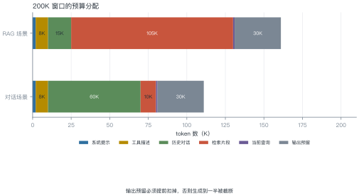
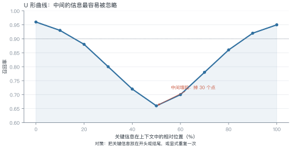
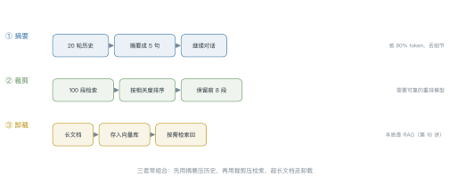
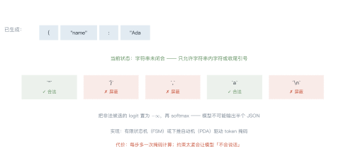

# 第 15 讲　上下文工程与结构化输出

!!! abstract "本讲位置"
    第六部分的开篇。前 14 讲都在讲模型本身，从这一讲开始讲"怎么用好它"。上下文工程是所有应用层技术的地基——RAG、Agent、多模态都建立在它之上。

!!! info "📅 事实核查至 2026-11"
    Lost in the Middle（Liu et al., 2023）、约束解码（Willard & Louf, 2023）、Function Calling 协议均已核对原文。

## 学习目标

学完本讲，你应该能够：

1. 给一次请求做 token 预算分配，并说明为什么要预留输出空间；
2. 解释 lost-in-the-middle 现象，并给出三种缓解手段；
3. 说出三种上下文压缩策略的适用场景；
4. 用状态机解释约束解码如何保证 JSON 合法。

---

## 0 直觉：窗口是预算，不是仓库

上下文窗口常被当成"能装多少装多少"的仓库。实际上它更像**预算**：

- 每一段内容都要花钱（token 计费）；
- 每一段内容都会稀释注意力（越长越难聚焦）；
- 输出也要占空间（生成到一半被截断是常见事故）。

**上下文工程**（context engineering）就是决定"这段窗口里该放什么、放多少、放哪里"。

!!! note "一句话总结"
    上下文工程 = **在有限窗口里做取舍**：什么该放、什么该压、什么该放到外面。

---

## 1 结构与预算

<figure markdown="span">
  { width="100%" }
  <figcaption>图 L15-1　读图要点：200K 窗口里，系统提示、工具描述、历史、检索、查询、输出预留各占一块。<b>输出预留必须提前扣掉</b>——否则生成到一半被截断，前面全白费。</figcaption>
</figure>

一次请求的上下文通常由六段组成：

| 段 | 典型占比 | 特点 |
|---|---|---|
| 系统提示 | 1%–3% | 固定，可缓存 |
| 工具描述 | 3%–8% | 固定，可缓存 |
| 历史对话 | 10%–40% | 随轮次增长 |
| 检索片段 | 5%–50% | 按需注入 |
| 当前查询 | < 1% | 每次都变 |
| 输出预留 | 10%–20% | 必须留够 |

### 例 15.1　给 200K 窗口分账

对话场景（多轮、少检索）：

| 项 | token | 说明 |
|---|---|---|
| 系统提示 | 2K | 角色、风格、安全边界 |
| 工具描述 | 8K | 10 个工具 × 800 |
| 历史 | 60K | 30 轮 × 2K |
| 检索 | 10K | 少量补充知识 |
| 查询 | 1K | — |
| 输出预留 | 30K | 长回答 + 工具调用 |
| **合计** | **111K** | 还剩 89K 余量 |

RAG 场景把历史换成检索（105K），总量到 161K。

**为什么输出要留 30K？** 一个复杂的工具调用链可能生成几千 token；预留不足会导致 JSON 被截断，解析失败。

!!! tip "从这个例子里能读出三件事"
    1. **固定部分可以缓存**：系统提示 + 工具描述 10K，前缀缓存能省这部分钱；
    2. **历史是增长项**：30 轮就到 60K，必须做摘要或裁剪；
    3. **输出预留不能省**：宁可少放检索，也别让输出被截断。

### 1.1 前缀缓存：固定部分只算一次

系统提示与工具描述在每次请求里都一样。把它们放在**最前面**，并保持字节级一致，就能命中**前缀缓存**（prefix caching）：

- 第一次请求：完整计算 KV；
- 后续请求：直接复用前面这 10K token 的 KV，只算新增部分。

收益很直接：200K 窗口里固定 10K，缓存后每轮省 5% 的输入成本；如果是 30 轮对话，累计省下的就是实打实的钱。

**前提是前缀完全一致**：多一个空格、换个时间戳，缓存就失效。所以模板里不要放动态内容（当前时间、用户 ID）。

---

## 2 位置效应

<figure markdown="span">
  { width="100%" }
  <figcaption>图 L15-2　读图要点：把关键信息放在上下文的开头或结尾，召回率 90% 以上；放到正中间，掉到 66%。<b>这条 U 形曲线与位置编码无关，是注意力分布的固有偏置</b>。</figcaption>
</figure>

### 例 15.2　U 形曲线的数字

| 相对位置 | 0% | 25% | 50% | 75% | 100% |
|---|---|---|---|---|---|
| 召回率 | 96% | 84% | **66%** | 82% | 95% |

中间位置比两端低 **30 个百分点**。

**三种缓解手段**：

1. **重排**：把最相关的片段放在开头和结尾；
2. **显式重复**：关键约束在系统提示与结尾各说一遍；
3. **缩短**：与其塞 100 段，不如精选 8 段——**信息密度比总量重要**。

### 2.1 为什么会是 U 形

三种解释，都有一定道理：

- **注意力分布的偏置**：因果注意力的第一个 token 会吸收大量注意力（第 4 讲的 attention sink），结尾是最近生成的位置，天然权重高；
- **训练数据的分布**：指令微调里，关键信息通常在开头（系统提示）或结尾（问题）；
- **位置编码的衰减**：相对位置越远，注意力权重越低，中间位置与两端的距离都远。

**实践含义**：不要指望"把资料全塞进去，模型自己会找"。要么精选，要么重排。

---

## 3 压缩

<figure markdown="span">
  { width="100%" }
  <figcaption>图 L15-3　读图要点：摘要压历史、裁剪压检索、卸载把内容移到外部。<b>三者常组合使用</b>：历史先摘要，检索先裁剪，超长文档走卸载。</figcaption>
</figure>

| 策略 | 做法 | 省多少 | 风险 |
|---|---|---|---|
| 摘要 | 把 N 轮历史压成几句话 | 70%–90% | 丢细节、摘要可能失真 |
| 裁剪 | 按相关度排序后截断 | 50%–80% | 需要可靠的重排模型 |
| 卸载 | 存到外部，按需检索 | 90%+ | 本质是 RAG，多一次往返 |

**什么时候触发压缩**：窗口用到 70%–80% 时开始，不要等到 100%——那时已经没有操作空间了。

---

## 4 结构化输出

<figure markdown="span">
  { width="100%" }
  <figcaption>图 L15-4　读图要点：生成到 `{"name": "Ada` 时，状态机知道字符串还没闭合，于是把 `}`、`,`、换行这些非法候选的 logit 置为负无穷。<b>模型在物理上不可能输出半个 JSON</b>。</figcaption>
</figure>

**三种实现层次**：

| 层次 | 做法 | 保证强度 |
|---|---|---|
| 提示约束 | 在 prompt 里写"输出 JSON" | 弱，会失败 |
| 函数调用 | 模型输出结构化字段 | 中，格式由推理引擎保证 |
| 约束解码 | 每步屏蔽非法 token | 强，语法必然合法 |

### 例 15.3　状态机怎么屏蔽

生成 JSON `{"name": "Ada", "age": 30}` 的过程：

| 已生成 | 状态 | 允许 | 屏蔽 |
|---|---|---|---|
| `{` | 期待键名 | `"` | 数字、`}` |
| `"name"` | 期待冒号 | `:` | `,`、`}` |
| `"Ada` | 字符串未闭合 | 字符、`"` | `}`、`,`、换行 |
| `"Ada"` | 期待逗号或 `}` | `,`、`}` | 字符 |

**关键点**：屏蔽发生在 softmax 之前，把非法位置的 logit 设为 $-\infty$。

**代价**：每步多一次掩码计算；约束太紧时模型"不会说话"（比如强制枚举值，模型想解释却没有空间）。

```python
from enum import Enum


class State(Enum):
    EXPECT_KEY = 1
    EXPECT_COLON = 2
    IN_STRING = 3
    EXPECT_VALUE_OR_END = 4


def allowed_tokens(state: State) -> set[str]:
    """极简 JSON 状态机的候选集"""
    return {
        State.EXPECT_KEY: {'"'},
        State.EXPECT_COLON: {":"},
        State.IN_STRING: {"a", "b", '"'},          # 实际是全部字符
        State.EXPECT_VALUE_OR_END: {",", "}"},
    }[state]


def mask_logits(logits: dict[str, float], state: State) -> dict[str, float]:
    """把非法候选的 logit 置为 -inf"""
    ok = allowed_tokens(state)
    return {t: (v if t in ok else float("-inf")) for t, v in logits.items()}


print(mask_logits({"a": 2.0, "}": 3.0, '"': 1.5}, State.IN_STRING))
```

---

## 5 提示的工程化

三件容易被忽略的事：

1. **模板与代码分离**：提示存在配置文件里，而不是散落在代码字符串中；
2. **版本管理**：每次改提示都记录 diff，效果回退时能定位；
3. **变量校验**：模板里的占位符必须有对应值，缺一个就会把 `{query}` 原样发给模型。

**一个实用做法**：把提示当成代码来测——准备 20 条固定输入，每次改提示都跑一遍，比较输出。

### 5.1 结构化输出的三个失败模式

即使有约束解码，仍会出问题：

| 失败 | 表现 | 原因 |
|---|---|---|
| 语义错误 | JSON 合法但字段值瞎编 | 语法约束只管形状，不管内容 |
| 死循环 | 数组无限追加 | 没有"该停了"的约束 |
| 过度约束 | 模型想解释却没空间 | 枚举值锁死，只能硬选一个 |

**对策**：给模型留一个"其他/无法确定"的选项；给数组加长度上限；关键字段加二次校验。

---

## 6 工程要点与坑

1. **输出预留别省**：宁可少放检索，也别让 JSON 被截断。
2. **固定前缀可缓存**：系统提示 + 工具描述放最前面，能命中前缀缓存。
3. **关键信息放两端**：中间位置的召回率低 30 个点。
4. **压缩要提前触发**：70% 就开始，别等到满。
5. **约束解码别太紧**：枚举值全锁死会让模型无法解释。
6. **模板变量要校验**：漏一个占位符，线上就会出现 `{query}` 字样。

---

## 7 论文与延伸

| 年份 | 论文 | 一句话贡献 |
|---|---|---|
| 2023 | [Lost in the Middle](https://arxiv.org/abs/2307.03172) | U 形位置效应 |
| 2023 | [Efficient Guided Generation for LLMs](https://arxiv.org/abs/2307.09702) | 用 FSM 做约束解码 |
| 2023 | [Gorilla: LLM Connected with Massive APIs](https://arxiv.org/abs/2305.15334) | 函数调用的早期实践 |
| 2023 | [MemGPT](https://arxiv.org/abs/2310.08560) | 上下文卸载 |
| 2024 | [Anthropic, Building Effective Agents](https://www.anthropic.com/research/building-effective-agents) | 上下文与编排的工程实践 |

---

## 8 习题

**🟢 概念题**

1. 为什么输出要预留 10%–20% 的窗口？不给会怎样？
2. 约束解码"保证语法合法"与"保证语义正确"是两回事，举例说明。

**🟡 推导题**

3. 用例 15.1 的方法，给一个"代码补全"场景做 32K 窗口的预算分配。
4. 用表 15.2 的数字，算出"把关键信息从中间移到开头"带来的期望提升。

**🔴 实现题**

5. 实现一个 JSON 状态机（支持对象、数组、字符串），统计生成 100 条 JSON 的合法率。
6. 构造一个 lost-in-the-middle 实验：同一句话放在 5 个位置，测模型的召回。

---

## 9 本讲小结

<div class="cheatsheet" markdown>

**一个模型**

> 上下文 = 系统提示 + 工具 + 历史 + 检索 + 查询 + 输出预留

**两个数字**

- 中间位置召回率低 30 个点
- 窗口用到 70% 就该压缩

**三种压缩**

摘要 · 裁剪 · 卸载

**一句话**

> 上下文工程不是"多塞点"，是"在有限预算里做取舍"。

</div>

---

## 来源

- Lost in the Middle、约束解码、函数调用协议的结论核对自原文，链接见 §7，核查日期 2026-11。
