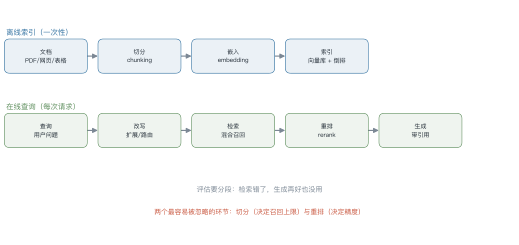
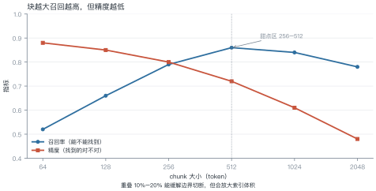
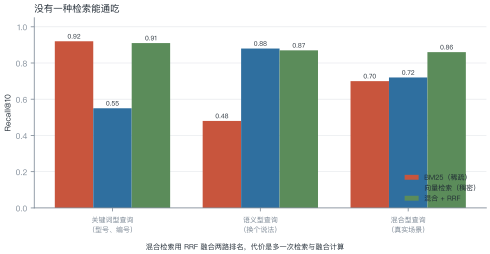
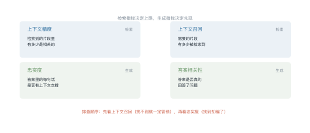

# 第 16 讲　RAG 全链路

!!! abstract "本讲位置"
    第 15 讲讲了怎么组织上下文，本讲解决"上下文从哪来"。RAG（retrieval-augmented generation）是目前最成熟的外部知识接入方式，也是 Agent 的记忆底座。

!!! info "📅 事实核查至 2026-11"
    RAG 原始论文（Lewis et al., 2020）、DPR、RAGAS（Es et al., 2023）、RRF 融合均已核对原文。

## 学习目标

学完本讲，你应该能够：

1. 画出 RAG 的离线索引与在线查询两条链路；
2. 解释 chunk 大小如何同时影响召回与精度，并选出合理值；
3. 用 RRF 手算两路检索的融合得分；
4. 用 RAGAS 的四个指标定位问题出在检索还是生成。

---

## 0 直觉：开卷考试

闭卷考试考记忆，开卷考试考**检索与判断**。

RAG 就是把模型从闭卷改成开卷：不指望它记住所有事实，而是给它一个"随时能翻的资料库"。

这带来三个好处：

- **知识可更新**：改文档就行，不用重训；
- **可溯源**：答案能给出处；
- **成本低**：不用把知识塞进参数。

代价是**多了一条可能出错的链路**——检索错了，生成再强也没用。

!!! note "一句话总结"
    RAG = **先找证据，再基于证据回答**。找错了，一切都错。

---

## 1 索引

<figure markdown="span">
  { width="100%" }
  <figcaption>图 L16-1　读图要点：上半部分是离线索引（一次性），下半部分是在线查询（每次请求）。<b>最容易出问题的两个环节是切分与重排</b>——一个决定召回上限，一个决定精度。</figcaption>
</figure>

### 1.1 切分

切分决定了"检索的最小单位"。三种做法：

| 方式 | 做法 | 适用 |
|---|---|---|
| 固定窗口 | 每 512 token 切一刀，重叠 10% | 通用，最简单 |
| 语义切分 | 按段落/标题/句子边界切 | 结构化文档 |
| 层级切分 | 父块存摘要，子块存细节 | 长文档 |

<figure markdown="span">
  { width="100%" }
  <figcaption>图 L16-2　读图要点：块越大召回越高（上下文更完整），但精度越低（噪声变多）。<b>甜点区在 256–512 token</b>，再大就要靠重排来补救。</figcaption>
</figure>

### 例 16.1　chunk 大小的账

假设 1 万篇文档，平均 2000 token。

| chunk 大小 | 块数 | 索引大小（1024 维 fp32） | 召回率 |
|---|---|---|---|
| 256 | 78,125 | 320 MB | 0.79 |
| 512 | 39,063 | 160 MB | 0.86 |
| 1024 | 19,531 | 80 MB | 0.84 |

**块越小，块数越多**：256 比 512 多一倍块，索引也大一倍，而召回反而低——因为语义被切碎了。

!!! tip "从这个例子里能读出三件事"
    1. **索引大小与块数成正比**：块大小减半，存储翻倍；
    2. **召回不是单调的**：256→512 上升，512→1024 下降；
    3. **重叠有代价**：10% 重叠意味着索引再涨 10%。

### 1.2 嵌入

选嵌入模型看三件事：**中文效果、维度、推理成本**。

| 模型规模 | 维度 | 每千 token 成本 | 适用 |
|---|---|---|---|
| 小（<100M） | 384–768 | 极低 | 海量文档初筛 |
| 中（300M–1B） | 768–1024 | 低 | 通用首选 |
| 大（>1B） | 1024–4096 | 中 | 高精度场景 |

**一个常见误区**：以为维度越高越好。1024 维与 4096 维在多数任务上差距很小，但存储和检索成本差 4 倍。

### 1.3 嵌入模型的选型清单

五个维度，按重要性排序：

1. **中文效果**：MTEB 的中文子集（C-MTEB）比总榜更有参考价值；
2. **维度**：768–1024 是甜点区，4096 维的存储与检索成本高 4 倍，收益通常不到 2 个点；
3. **最大长度**：必须 ≥ chunk 大小，否则长块会被截断；
4. **推理成本**：本地部署看显存，API 看单价；
5. **是否支持指令**：有些模型需要前缀（"为检索生成向量："），漏了会掉点。

**一个反直觉的结论**：换嵌入模型的收益，通常不如**把切分改对**。先调切分，再换模型。

---

## 2 检索

<figure markdown="span">
  { width="100%" }
  <figcaption>图 L16-3　读图要点：BM25 在关键词型查询上 0.92，语义型只有 0.48；向量检索反过来。混合检索在两类上都接近最优，代价是多一次检索。</figcaption>
</figure>

| 方式 | 强项 | 弱项 |
|---|---|---|
| **BM25**（稀疏） | 型号、编号、专有名词的精确匹配 | 换个说法就失效 |
| **向量检索**（稠密） | 语义近似、同义改写 | 精确匹配反而弱 |
| **混合** | 两者互补 | 多一路计算与融合 |

### 2.1 RRF：融合两路排名

**倒数排名融合**（reciprocal rank fusion）不需要归一化分数，只用排名：

$$
\text{score}(d)=\sum_{r\in R}\frac{1}{k+\text{rank}_r(d)},
\qquad k=60
\tag{16.1}
$$

### 例 16.2　手算 RRF

文档 A：BM25 排第 1，向量排第 3。
文档 B：BM25 排第 2，向量排第 1。

$$\text{score}(A)=\frac{1}{60+1}+\frac{1}{60+3}=0.01639+0.01587=0.03226$$

$$\text{score}(B)=\frac{1}{60+2}+\frac{1}{60+1}=0.01613+0.01639=0.03252$$

**B 略胜**——它在两路里都靠前，而 A 有一路掉到第 3。

**$k=60$ 的作用**：压平头部差距。$k$ 越小，第一名越占优势；$k$ 越大，越看重"两路都上榜"。

### 2.2 检索失败的三类原因

调 RAG 时最常见的困惑是"答案不对，但不知道是检索的错还是生成的错"。先把检索失败分成三类，对策完全不同：

| 类型 | 表现 | 根因 | 对策 |
|---|---|---|---|
| **词汇鸿沟** | 用户说"报销"，文档写"费用核销" | 字面不匹配 | 混合检索、查询改写、HyDE |
| **分块切断** | 答案跨两个块，两块都不完整 | 切分边界切断了语义 | 加大重叠、按标题切、父子块 |
| **多跳缺失** | 答案需要 A→B 两步推理 | 单次检索只取一段 | 多轮检索、查询分解 |

**怎么判断是哪一类**：把检索到的 top-5 片段打出来人工看一遍。

- 相关片段根本没出现 → 词汇鸿沟
- 出现了但被切断 → 分块问题
- 每段都对但答不出 → 多跳缺失

**这个 5 分钟的检查，比调任何参数都有效**——大多数团队跳过它，直接去换嵌入模型。

---

## 3 查询侧

用户的问题往往不适合直接检索：

| 问题 | 对策 |
|---|---|
| 太短（"这个怎么配"） | 结合对话历史改写 |
| 太长（整段需求描述） | 拆成多个子查询 |
| 用词与文档不一致 | HyDE：先让模型写一段假答案，再用它检索 |
| 不知道该查哪个库 | 路由：先分类，再选索引 |

**HyDE 的直觉**：问题与答案的用词分布不同。先让模型"编"一段答案，答案的措辞更接近文档，检索命中率更高。

### 2.3 调优顺序

RAG 的环节多，乱调会互相干扰。推荐的顺序与理由：

1. **切分**：决定召回上限，先定 256–512 并做重叠；改这一项，后面所有指标都要重测。
2. **嵌入模型**：在切分固定后对比 2–3 个候选，看 Recall@10。
3. **混合检索**：稀疏+稠密的融合通常带来 5–10 个点，且不依赖模型替换。
4. **重排**：最后做，因为它的收益依赖召回质量——召回烂，重排也救不回来。

**为什么这个顺序**：每一步的收益都建立在前面已经调好的基础上。反过来先调重排，会得到"重排没用"的错误结论。

---

## 4 重排与压缩

**重排**（rerank）用交叉编码器对召回的 top-50 精排到 top-5：

- 召回阶段用双塔（快，但不精确）；
- 重排阶段用交叉编码器（慢，但准）。

**压缩**：把召回的长片段截成只含答案的短句，减少上下文占用。

**经验值**：召回 50 → 重排 10 → 生成用 5。重排通常带来 5–15 个点的精度提升，是性价比最高的一步。

---

## 5 生成与引用

生成阶段要做三件事：

1. **强制引用**：要求每个结论标注来源编号；
2. **允许说不知道**：检索结果不足时明确说"资料里没有"；
3. **格式约束**：用第 15 讲的约束解码保证引用格式合法。

### 5.1 生成阶段的三个硬约束

1. **必须引用**：要求每个结论标 `[1][2]`，没有来源的句子不允许出现。这一条能挡掉大部分幻觉。
2. **允许说不知道**：检索结果与问题无关时，明确输出"资料里没有"。没有这条，模型会硬编。
3. **限制推断**：只允许基于片段做**直接推断**，不允许引入外部知识。需要外部知识时，应该再检索一次。

**怎么落地**：用第 15 讲的约束解码保证引用格式合法；用后处理检查"每个 `[n]` 是否真的出现在上下文里"。

---

## 6 评估

<figure markdown="span">
  { width="100%" }
  <figcaption>图 L16-4　读图要点：四个指标两两分组——上下文精度/召回看检索，忠实度/答案相关性看生成。<b>排查顺序是先召回、后忠实度</b>：找不到就一定答错。</figcaption>
</figure>

| 指标 | 定义 | 看哪一段 |
|---|---|---|
| 上下文精度 | 检索结果里相关片段的比例 | 检索 |
| 上下文召回 | 需要的信息被检索到的比例 | 检索 |
| 忠实度 | 答案中每句话有上下文支撑的比例 | 生成 |
| 答案相关性 | 答案与问题的匹配度 | 生成 |

### 例 16.3　算一次忠实度

某答案有 5 句话：

| 句 | 是否有上下文支撑 |
|---|---|
| 1 | ✓ |
| 2 | ✓ |
| 3 | ✗（模型自己补的） |
| 4 | ✓ |
| 5 | ✓ |

$$\text{faithfulness}=\frac{4}{5}=0.80$$

**怎么用这个数**：0.8 意味着 20% 的内容是"编"的。对事实类问答不可接受，对创意类可以放宽。

```python
def rrf_fuse(rankings: list[list[str]], k: int = 60) -> list[tuple[str, float]]:
    """多路排名融合：rankings 是若干条按名次排好的文档 id 列表"""
    scores: dict[str, float] = {}
    for ranking in rankings:
        for rank, doc in enumerate(ranking, start=1):
            scores[doc] = scores.get(doc, 0.0) + 1.0 / (k + rank)
    return sorted(scores.items(), key=lambda kv: kv[1], reverse=True)


bm25 = ["A", "B", "C", "D"]
dense = ["B", "C", "A", "E"]
print(rrf_fuse([bm25, dense])[:3])
# [('B', 0.0325...), ('A', 0.0322...), ('C', 0.0320...)]
```

---

## 7 工程要点与坑

1. **先测检索，再调生成**：召回 60% 的系统，换再强的模型也没用。
2. **切分要保留标题层级**：把章节标题拼进 chunk，能显著提升召回。
3. **别只用向量**：型号、编号类查询靠 BM25 更稳。
4. **重排模型要小**：交叉编码器很慢，只对 top-50 用。
5. **缓存检索结果**：相同查询直接复用，省一次向量检索。
6. **评估集要含"查不到"的样本**：否则模型永远学不会说"不知道"。

---

## 8 论文与延伸

| 年份 | 论文 | 一句话贡献 |
|---|---|---|
| 2020 | [RAG](https://arxiv.org/abs/2005.11401) | 检索增强生成的原始形式 |
| 2020 | [DPR](https://arxiv.org/abs/2004.04906) | 双塔稠密检索 |
| 2022 | [HyDE](https://arxiv.org/abs/2212.10496) | 用假答案做检索 |
| 2023 | [RAGAS](https://arxiv.org/abs/2309.15217) | 四指标评估框架 |
| 2024 | [Self-RAG](https://arxiv.org/abs/2310.11511) | 让模型自己决定要不要检索 |

---

## 9 习题

**🟢 概念题**

1. 为什么 chunk 太大反而会降低精度？
2. RRF 里的 $k$ 起什么作用？调大调小分别会怎样？

**🟡 推导题**

3. 用 (16.1) 算：文档 C 在 BM25 排第 5、向量排第 2，它的 RRF 得分是多少？
4. 用例 16.1 的数据，算 chunk 从 512 改到 256 后索引大小的变化倍数。

**🔴 实现题**

5. 用 `rrf_fuse` 实现一个双路检索器，在 100 条查询上比较单路与混合的 Recall@10。
6. 构造 20 条"查不到"的查询，测你的 RAG 系统有多少次会诚实地说不知道。

---

## 10 本讲小结

<div class="cheatsheet" markdown>

**两条链路**

离线索引：切分 → 嵌入 → 建索引
在线查询：改写 → 检索 → 重排 → 生成

**两个数字**

- chunk 甜点区 256–512 token
- 重排带来 5–15 个点精度提升

**四个指标**

上下文精度/召回 · 忠实度 · 答案相关性

**一句话**

> RAG 的上限由检索决定，下限由生成决定——先修检索，再调生成。

</div>

---

## 来源

- RAG、DPR、HyDE、RAGAS 的结论核对自原文，链接见 §8，核查日期 2026-11。
