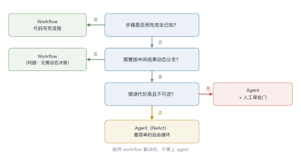
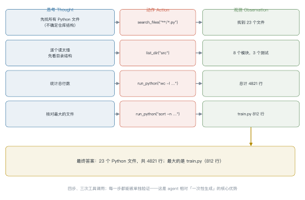
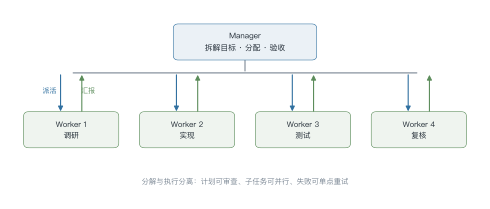
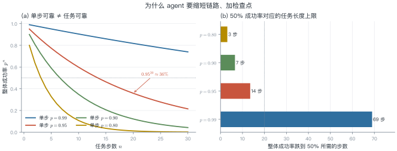
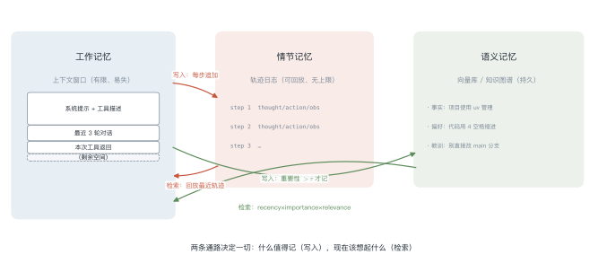
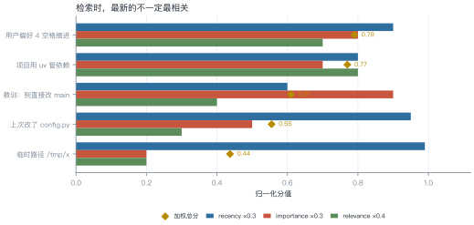
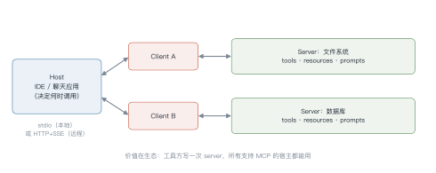

# 第 17 讲　Agent（一）：循环·规划·记忆·工具

!!! abstract "本讲位置"
    第六部分的核心。前置：第 15 讲的上下文工程、第 16 讲的 RAG。本讲回答"一个只会生成文本的模型，如何变成能行动的智能体"；第 18 讲接着讲协议、多智能体、训练与可靠性。

!!! info "📅 事实核查至 2026-11"
    本讲的框架性结论来自 2022–2024 年的经典论文（ReAct、Reflexion、MemGPT 等），均已核对原文；2026 年的综述结论标注了出处，见文末来源表。

## 学习目标

1. 能把 agent 形式化为 POMDP 中的策略，并说清"上下文即状态"这一近似的代价；
2. 能写出 ReAct 循环的完整控制流，解释它相对纯 CoT 的信息论优势；
3. 能定量分析长程任务的误差累积，并据此设计缩短链路、加检查点的工程方案；
4. 能设计一套工具 schema 与记忆策略，并识别其中的安全边界。

---

## 0 直觉：一个只会写字的专家

设想一位被关在房间里的专家。他博览群书，但：

- 看不见外面发生了什么；
- 没有手，不能操作任何设备；
- 每说完一段话就被清空记忆；
- 说话不过脑子，第一遍说什么就是什么。

他能通过门缝递纸条与外界交流。**这就是一个裸的 LLM**：输入 prompt，输出 token，结束。

现在给他配上四样东西：

| 配置 | 对应机制 | 解决什么 |
|---|---|---|
| 一套工具箱 + 一张说明书 | 工具调用（tool use） | 没有手 |
| 一本可以随时翻的笔记本 | 记忆（memory） | 没有持久状态 |
| 一张任务清单 | 规划（planning） | 不知道怎么分解目标 |
| 一个验收员 | 反思与验证（reflection） | 第一遍不可靠 |

这四样加上"循环"，就是 agent 的全部。**没有神秘之处，也没有免费的午餐**——每一样都带来新的失败模式，这正是本讲后半部分的重点。

!!! note "一句话定义"
    Agent = **LLM 策略 + 工具 + 记忆 + 循环控制**。它把"一次生成"变成"多次感知-决策-行动"。

---

## 1 从四个限制出发

### 1.1 LLM 的结构性限制

| 限制 | 表现 | 本质原因 |
|---|---|---|
| **无状态** | 每次调用从零开始 | 参数冻结，状态只能放在上下文里 |
| **无行动** | 只能输出 token | 没有执行接口 |
| **无持久记忆** | 窗口之外全忘 | 上下文长度有限且易失 |
| **单次生成不可靠** | 错了也没机会改 | 一次前向，无验证、无回溯 |

agent 的每一个组件，都对应消除其中一条限制。反过来说：**如果一个任务不需要消除这四条中的任何一条，就不需要 agent**。

### 1.2 Agent 还是 Workflow：一张判定树

这是工程上最重要的一次选择，却经常被跳过。二者的根本区别是：**谁决定控制流**。

<figure markdown="span">
  { width="100%" }
  <figcaption>图 L17-1　读图要点：Agent 还是 Workflow 的判定树。核心判据是"谁决定控制流"：步骤已知就用 workflow，需要动态决策才用 agent。</figcaption>
</figure>


判定要点：

- **Workflow 的优势被严重低估**：可测试、可复现、成本可控、延迟可预测。能用 workflow 解决的，不要上 agent。
- **Agent 的成本是非线性的**：步数越多，token 消耗、延迟、失败概率都超线性增长（见 §4.4）。
- **混合形态最常见**：外层 workflow 保证流程正确，内层 agent 处理开放式子任务。

!!! warning "最常见的架构错误"
    把本该用 workflow 的任务做成自由循环的 agent，然后用大量 prompt 去"约束它别乱走"。这不是 agent 能力不够，是**控制流放错了层**。

---

## 2 形式化：Agent 是 POMDP 里的策略

把 agent 放进部分可观测马尔可夫决策过程（POMDP） $\langle \mathcal{S},\mathcal{A},\mathcal{O},T,R,\gamma\rangle$：

- **状态** $s_t\in\mathcal{S}$：世界的真实状态（文件内容、数据库、网页），agent 永远看不到全貌；
- **观测** $o_t=(\text{用户指令},\ \text{历史动作},\ \text{工具返回})$；
- **动作** $a_t\in\mathcal{A}=\{\text{自然语言},\ \text{工具调用},\ \text{终止}\}$；
- **转移** $T(s_{t+1}\mid s_t,a_t)$：由外部环境决定，agent 不可控；
- **奖励** $R(s_t,a_t)$：通常**稀疏且延迟**——只有任务完成才有信号。

策略由 LLM 参数化：

$$\pi_\theta(a_t\mid h_t),\qquad h_t=(o_1,a_1,o_2,a_2,\dots,o_t)$$

其中 $h_t$ 是把全部历史拼成的上下文。目标：

$$\max_\theta\ \E\left[\sum_{t=0}^{T}\gamma^t R(s_t,a_t)\right]$$

这个形式化看起来只是"把话说得学术"，但它立刻给出三个有价值的推论。

### 2.1 推论一：上下文是状态的有损压缩

真正的状态 $s_t$ 可能包含整个代码仓库，而 $h_t$ 只有几十万 token。$\pi$ 只能在 $h_t$ 上做决策，因此

$$h_t = \text{compress}(s_0,\dots,s_t)$$

**压缩必然有损**。三个具体后果：

1. **容量有限**：超出窗口的信息永久丢失（除非外部存储）；
2. **顺序敏感**：同样的信息放在开头和中间，效果不同（lost-in-the-middle）；
3. **不可回溯**：被摘要掉的内容无法恢复。

> 这就是为什么需要**记忆系统**——不是为了"更聪明"，而是为了**减少压缩损失**。

### 2.2 推论二：奖励稀疏意味着必须靠外部信号

在开放环境里，$R$ 几乎总是 0，只有终局才非零。这使得纯 RL 训练 agent 极其困难，也解释了为什么工业界主流仍是**提示工程 + 少量微调**，而不是端到端 RL。

### 2.3 推论三：策略的"参数"可以不在权重里

$\pi_\theta$ 的 $\theta$ 可以冻结，策略完全由 $h_t$ 的构造方式决定（提示、工具描述、记忆检索策略）。这意味着：

- **改提示 = 改策略**，成本极低，但难以保证一致性；
- **改权重 = 改能力**，成本高，但行为更稳定。

第 18 讲会讨论这条边界在哪里。

---

## 3 核心循环：ReAct

### 3.1 三元组

ReAct（Reason + Act）把每一步拆成三部分：

```
Thought:  我需要先确认仓库里有没有配置文件
Action:   search_files(pattern="*.toml")
Observation: 找到 pyproject.toml，共 42 行
Thought:  读一下依赖部分
Action:   read_file(path="pyproject.toml", lines=[1,20])
...
```

**为什么交替优于纯 CoT？** 从信息论看：

- 纯 CoT 只做**已有信息的重排**。模型参数里没有的事实（今天的股价、这个仓库的结构），CoT 再怎么想也变不出来，只是在放大先验；
- ReAct 通过 Action 从环境取回 Observation，把**新信息注入 $h_t$**。此时后续推理才真正以事实为条件。

一句话：**CoT 改变的是分布的形状，ReAct 改变的是分布的支撑集。**

### 3.2 控制流

```python
def run_agent(task, tools, max_steps=15, max_tokens=100_000):
    h = [system_prompt(tools), user_msg(task)]
    seen = []

    for step in range(max_steps):
        out = llm(h, stop=["Observation:"])       # 一次前向

        if out.final_answer is not None:           # 终止条件 1：显式完成
            return out.final_answer

        if out.tool_call is None:                  # 模型只说不动：强制收敛
            h.append(reminder("请调用工具或给出最终答案"))
            continue

        key = (out.tool_call.name, out.tool_call.args)
        if key in seen[-3:]:                       # 终止条件 2：无进展（重复动作）
            h.append(reminder("你已经重复了同样的调用，请换一种方法或给出答案"))
        seen.append(key)

        obs = execute(out.tool_call, sandbox=True) # 关键：隔离执行
        h.append(out.thought, out.tool_call, truncate(obs, max_chars=4000))

        if token_count(h) > max_tokens:            # 终止条件 3：预算耗尽
            h = compress(h)

    return partial_answer(h)                       # 终止条件 4：步数耗尽，返回部分结果
```

四个终止条件缺一不可。少任何一个，都会出现"无限循环烧钱"或"永远不收敛"的生产事故。

### 例 17.1　一次完整的轨迹

任务："统计这个仓库里 Python 代码的总行数，并找出最大的文件。"

<figure markdown="span">
  { width="100%" }
  <figcaption>图 L17-2　读图要点：四步 ReAct 轨迹。每轮"思考 → 动作 → 观测"只推进一小步，观测结果进入下一轮上下文。</figcaption>
</figure>

| 步 | 思考 | 动作 | 观测 | 累计 token |
|---|---|---|---|---|
| 1 | 先找所有 .py 文件 | `search_files("**/*.py")` | 找到 23 个文件 | 1.2k |
| 2 | 逐个读太慢，先看结构 | `list_dir("src")` | 8 个模块，3 个测试 | 2.8k |
| 3 | 统计总行数 | `run_python("wc -l …")` | 总计 4821 行 | 5.1k |
| 4 | 核对最大的文件 | `run_python("sort -n …")` | train.py 812 行 | 6.9k |
| — | 收敛，输出答案 | — | — | 7.4k |

三个值得注意的细节：

1. **第 2 步是"绕路"，但值得**：直接读 23 个文件会把上下文撑爆；先看目录结构，把问题从"23 个文件"缩小到"8 个模块"。
2. **每一步都能被独立验证**：第 3 步的结果可以用 `find . -name "*.py" | xargs wc -l` 复核。这是 agent 相对"一次性生成"的核心优势——中间结果可以查。
3. **token 增长是超线性的**：每轮都要把完整历史重新送进模型，所以第 4 步的单位成本远高于第 1 步（前缀缓存能缓解，见 §7.4）。

!!! tip "如果任务再复杂一点"
    把第 1 步和第 3 步合并（直接 `run_python` 一次性统计），链路从 4 步降到 3 步，按 (L17.1)，成功率会明显上升。**能用一次工具调用解决的，不要拆成三次。**

### 3.3 从自由文本解析到原生协议

早期 ReAct 靠正则从文本里抠 `Action: xxx[args]`，脆弱且易被注入。现在主流是**原生函数调用**：模型直接输出结构化的 `tool_calls` 字段，由推理引擎保证格式合法。

这一步的意义常被低估：**格式约束从"提示词的软要求"变成了"解码时的硬保证"**。模型不再可能输出半个 JSON。

!!! tip "并行工具调用"
    当多个调用之间没有依赖（例如同时查三个文件），可以让模型一次返回多个 `tool_calls`，并发执行后一起回填。这把"串行 N 步"压成"1 步"，直接对抗 §4.4 的误差累积。

---

## 4 规划

### 4.1 三档分解

| 档位 | 做法 | 适用 | 代价 |
|---|---|---|---|
| **单步** | 直接回答 | 事实问答、简单转换 | 无 |
| **隐式** | ReAct 逐步决定 | 中等复杂度、路径不确定 | 无全局视野，易绕路 |
| **显式** | 先出完整计划，再执行 | 长任务、需审查、可并行 | 计划本身可能错 |

显式计划的收益很具体：

1. **全局一致性**：不会走到第 8 步才发现方向错了；
2. **可审查**：人可以在执行前看计划并否决；
3. **可并行**：无依赖的子任务可以并发；
4. **可恢复**：某步失败只需重跑该步。

代价同样具体：计划基于不完整信息生成，环境一变就失效，必须有 **replan** 机制。

### 4.2 层级规划

Manager–Worker 结构把"分解"与"执行"分开：

<figure markdown="span">
  { width="100%" }
  <figcaption>图 L17-3　读图要点：Manager–Worker 层级规划。Manager 负责分解、分配与验收，Worker 负责执行；分解与执行分离使计划可审查、子任务可并行。</figcaption>
</figure>


它和经典 HTN（层次任务网络）的对应关系很清晰：Manager 负责"方法分解"与"前置条件检查"，Worker 负责"原子动作"。区别在于，HTN 的分解规则是人工写的，这里的分解由 LLM 现场生成——**灵活性换来了不可靠性**。

### 4.3 搜索式规划

当任务需要"试几条路"，可以把推理过程当成搜索树：

- **ToT**（Tree of Thoughts）：每步生成若干候选想法，用 LLM 自评打分，beam search 保留前 $k$；
- **LATS**（Language Agent Tree Search）：在 ToT 基础上加 MCTS，用环境反馈作为价值信号；
- **价值函数从哪来**：LLM 自评（便宜但不可靠）、过程奖励模型 PRM（贵但准）、环境验证器（最准但只适用于可验证任务）。

!!! danger "自评的可靠性天花板"
    LLM 自评存在系统性偏差：偏好自己生成的答案、偏好更长更"像样"的答案、对错误推理给出高置信度。把自评当唯一价值信号，等于用一个有偏的裁判做搜索——**搜索越久，偏差被放大得越多**。

### 4.4 误差累积：为什么必须缩短链路

设单步成功率 $p$，任务需要 $n$ 步且各步独立，则整体成功率

$$P_{\text{task}} = p^n \tag{L17.1}$$

$p=0.95$、$n=20$ 时，$P=0.95^{20}\approx 0.358$。**单步 95% 的可靠性，在 20 步任务上只剩三分之一。**

<figure markdown="span">
  { width="100%" }
  <figcaption>图 L17-4　读图要点：误差累积。(a) 整体成功率随步数指数衰减；(b) 整体成功率跌到 50% 所允许的最长链路：$p=0.99$ 可撑 69 步，$p=0.95$ 只有 14 步。</figcaption>
</figure>

这个公式给出四条工程原则：

1. **缩短链路**：能一次并行做的，不要串行；
2. **提高单步 $p$**：加验证、加约束解码、用更强模型；
3. **加检查点**：把长链切成若干段，每段结束验证并落盘；
4. **允许重试**：单步失败可重采样，把 $p$ 的有效值抬高。

第 4 条值得展开。若允许每步重试 $k$ 次并有一个**可靠的验证器**，有效成功率变成 $1-(1-p)^k$。$p=0.5$、$k=3$ 就能到 0.875。**验证器比生成器更重要**——这也解释了为什么代码类 agent 进步最快：编译器就是免费且可靠的验证器。

### 4.5 反思：什么时候有用，什么时候有害

Reflexion 的做法：任务失败后，让模型写一段"教训"，存进记忆，下次任务开始时检索出来。

但 Huang et al. (2023) 的实验给出了反证：**在没有外部反馈时，LLM 的自我纠错会让性能下降**。原因是模型无法可靠判断自己错在哪，所谓的"反思"往往把对的改成错的。

有效的反思需要满足至少一个条件：

- 有**外部验证器**（测试用例、编译器、检索到的事实）；
- 有**多样本一致性**信号（多次采样，答案不一致说明可能有问题）；
- 有**人类反馈**。

否则，"反思"只是让模型更自信地重复原来的错误。

---

## 5 记忆

### 5.1 三层结构

<figure markdown="span">
  { width="100%" }
  <figcaption>图 L17-5　读图要点：三层记忆与上下文窗口的关系。工作记忆在窗口内，情节记忆是外部的轨迹日志，语义记忆是持久的知识库；三者通过"写入"与"检索"两条通路交换。</figcaption>
</figure>

| 层 | 载体 | 容量 | 读写成本 | 典型内容 |
|---|---|---|---|---|
| 工作记忆 | 上下文窗口 | $n$ token | 极低 | 当前指令、最近几轮 |
| 情节记忆 | 轨迹日志（JSONL） | 无上限 | 低（顺序读） | 每步的 thought/action/obs |
| 语义记忆 | 向量库 / 知识图谱 | 无上限 | 中（检索） | 事实、偏好、教训 |

三层之间只有两条通路：**写入**（什么值得记）和**检索**（现在该想起什么）。所有记忆系统的差异，都在这两条通路上。

### 5.2 写入：什么值得记

不是所有东西都该记。无差别记录会导致检索噪声爆炸。常用的写入判据：

$$\text{write}(m)=\mathbb{1}\big[\underbrace{\text{importance}(m)}_{\text{LLM 打 1–10 分}}>\tau_1\big]\ \wedge\ \underbrace{\max_{m'\in\mathcal{M}}\text{sim}(m,m')<\tau_2}_{\text{去重}}$$

- **重要性**：让 LLM 给候选记忆打分（"这条信息对未来任务有多大帮助？"）；
- **去重**：与已有记忆的余弦相似度超过阈值就合并，而不是新增；
- **冲突消解**：同一事实出现矛盾时，按时间戳与来源可信度取舍，并保留冲突记录。

### 5.3 检索：现在该想起什么

Generative Agents 给出的经典加权打分：

$$\text{score}(m)=\alpha\cdot\text{recency}(m)+\beta\cdot\text{importance}(m)+\gamma\cdot\text{relevance}(m,q) \tag{L17.2}$$

其中 $\text{recency}(m)=0.995^{\,\Delta t}$（$\Delta t$ 为小时数），$\text{relevance}$ 用嵌入余弦相似度，$\text{importance}$ 是写入时的打分。

三个分量各管一件事：recency 防止旧信息主导，importance 让关键事件长期可召回，relevance 保证与当前查询相关。

召回后再用 **MMR**（最大边际相关性）去冗余：

$$\text{MMR}=\arg\max_{m\in R\setminus S}\big[\lambda\,\text{sim}(m,q)-(1-\lambda)\max_{m'\in S}\text{sim}(m,m')\big]$$

只保留"相关且互不重复"的条目。

### 例 17.2　五条记忆的打分

假设记忆库里躺着五条记录，当前任务是"帮我改一下这个项目的代码风格"。按 (L17.2) 打分，取 $\alpha=\beta=0.3,\ \gamma=0.4$：

| 记忆 | recency | importance | relevance | 总分 |
|---|---|---|---|---|
| 用户偏好 4 空格缩进 | 0.90 | 0.8 | 0.7 | **0.79** |
| 项目用 uv 管依赖 | 0.80 | 0.7 | 0.8 | **0.77** |
| 教训：别直接改 main | 0.60 | 0.9 | 0.4 | 0.61 |
| 上次改了 config.py | 0.95 | 0.5 | 0.3 | 0.55 |
| 临时路径 /tmp/x | 0.99 | 0.2 | 0.2 | 0.44 |

<figure markdown="span">
  { width="100%" }
  <figcaption>图 L17-6　读图要点：五条记忆的三个分量与加权总分。最"新"的"临时路径"排在最后，因为 importance 与 relevance 都低。</figcaption>
</figure>

**最"新"的那条排在最后。** "临时路径"的 recency 高达 0.99，全场第一，但另外两项都很低，加权后垫底。反过来，"教训：别直接改 main"已经有点旧（0.60），却靠 0.9 的 importance 排到第三。

!!! tip "为什么不能只用向量相似度"
    纯 relevance 排序会把"项目用 uv 管依赖"（0.8）排第一，但它对"改代码风格"这件事帮助有限。三个分量各管一件事：recency 防旧信息主导，importance 让关键事件长期可召回，relevance 保证切题。缺一个都会出问题。

### 5.4 上下文卸载：MemGPT 的分页类比

MemGPT 把上下文窗口当"内存"、外部存储当"磁盘"，用函数调用实现换入换出：

- 窗口快满时，把不常用的段落**写回**外部存储并摘要；
- 需要时再**读回**具体片段。

这和操作系统的虚拟内存几乎同构，连失败模式都相似：**抖动**（频繁换入换出）、**脏页**（摘要与原文不一致）、**缺页**（检索不到）。

### 5.5 记忆的失败模式

1. **自我强化**：幻觉被写入记忆，之后被检索出来当作事实，进一步强化幻觉；
2. **污染**：外部内容（网页、文件）里藏着指令，被写入记忆后长期生效——这是第 18 讲 prompt injection 的一条主要路径；
3. **过期**：旧事实没有失效机制，与新事实并存导致矛盾输出；
4. **成本失控**：检索与摘要本身消耗 token，粗算会让单任务成本增加 30%–200%。

!!! warning "记忆不是越多越好"
    记忆的收益来自"减少重复探索"，成本来自"检索噪声 + token 消耗"。在短任务上，记忆系统几乎总是负收益。**先测量，再上记忆。**

---

## 6 工具

### 6.1 工具描述就是 prompt

模型选择哪个工具、怎么填参数，完全取决于工具描述。一份好的描述包含五部分：

```json
{
  "name": "search_files",
  "description": "在仓库中按 glob 模式搜索文件路径。只返回路径，不返回内容。适合先定位再读取。",
  "parameters": {
    "type": "object",
    "properties": {
      "pattern": {"type": "string", "description": "glob 模式，如 '**/*.py'"},
      "max_results": {"type": "integer", "default": 20, "maximum": 100}
    },
    "required": ["pattern"]
  },
  "side_effects": "read-only",
  "errors": ["PATTERN_INVALID", "TOO_MANY_MATCHES"]
}
```

四个设计原则：

1. **粒度**：细粒度工具（一个工具一件事）比粗粒度更可靠，但选择空间变大、prompt 变长。经验法则是**每个工具的参数不超过 5 个**；
2. **命名**：动词开头、语义唯一。`get_user` 和 `fetch_user` 并存会让模型随机选；
3. **幂等性**：写操作带幂等键，重试不会重复执行；
4. **副作用标注**：`read-only` / `write` / `destructive` 三级，直接决定要不要人工确认。

### 6.2 错误处理

工具调用失败是常态，不是异常。四种处理手段：

| 手段 | 适用 | 实现 |
|---|---|---|
| 重试 | 瞬时故障（超时、限流） | 指数退避，最多 3 次 |
| 参数修复 | schema 校验失败 | 把错误信息回灌给模型，让它重填 |
| 回退 | 主工具不可用 | 注册备用工具，描述里写明适用场景 |
| 熔断 | 连续失败 | 停用该工具，提示模型换路径 |

**关键细节**：错误信息要**结构化且可读**。返回 `{"error": "PATTERN_INVALID", "hint": "pattern 不能以 / 开头"}` 比返回一坨堆栈有用得多——模型能据此自我修复。

### 例 17.3　一次工具调用失败与修复

工具报错是常态。关键不在"不出错"，而在**错误信息模型能不能读懂**。对比两种返回。

糟糕的返回，模型无从下手：

```json
{"error": "500 Internal Server Error"}
```

结构化的返回，模型能自己修：

```json
{
  "error": "PATTERN_INVALID",
  "message": "pattern 不能以 / 开头",
  "hint": "去掉开头的斜杠，例如用 '**/*.py' 而不是 '/**/*.py'",
  "retryable": true
}
```

收到第二种，模型下一轮会把 pattern 改成 `**/*.py`，一次修复成功；收到第一种，它大概率原样重试，然后卡在同一个错误上——这正是 §4.4 里"单步成功率"被拉低的原因之一。

!!! warning "一个反直觉的经验"
    工具描述和错误信息是写给**模型**看的，不是写给人看的。人类能从堆栈里推断出问题，模型不能——它只看到你给的那几十个 token。

### 6.3 MCP：把工具接口标准化

在 MCP 之前，每个框架都有自己的工具注册方式，换个宿主就要重写。MCP（Model Context Protocol）把这层抽象成 client–server：

<figure markdown="span">
  { width="100%" }
  <figcaption>图 L17-7　读图要点：MCP 的 Host–Client–Server 结构。一个宿主可连接多个 server，每个连接由一个 client 维护；传输层支持本地 stdio 与远程 HTTP+SSE。</figcaption>
</figure>


三类原语：

- **tools**：可调用的函数（有副作用）；
- **resources**：可读取的数据（文件、记录），由宿主决定何时注入；
- **prompts**：预置的提示模板。

传输层支持 stdio（本地进程）与 HTTP+SSE（远程服务）。初始化时双方协商能力集，因此新版本可以向后兼容。

MCP 的真正价值不在技术，而在**生态**：工具提供方写一次 server，所有支持 MCP 的宿主都能用。这让"agent 能操作什么"从框架绑定变成了可插拔。

!!! danger "MCP 扩大了攻击面"
    一个远程 MCP server 返回的内容会直接进入模型上下文。如果它被攻陷，就可以在返回值里夹带指令——这是典型的**间接提示注入**。第 18 讲会专门拆解防御。

### 6.4 安全边界

三条硬规则：

1. **沙箱执行**：工具在容器/子进程中运行，限制文件系统与网络访问；
2. **最小权限**：每个工具用自己的凭证，只授予完成任务所需的最小 scope；
3. **审批门**：`destructive` 类操作（删除、支付、发邮件、推送代码）必须人工确认，且确认信息要包含**具体参数**，不能只显示"是否允许执行工具 X"。

---

## 7 工程落地

### 7.1 状态机优于自由循环

自由循环（while True）写起来快，但难以测试、难以恢复、难以观测。工程上更稳的做法是把它表达成**图**：

- **节点**：一个确定性步骤（调用模型、执行工具、校验）；
- **边**：条件跳转（成功/失败/需要人工）；
- **状态**：显式持久化，可序列化。

LangGraph 之类的框架本质上就是这套抽象。它的收益不是"更方便"，而是**可测试性**：每个节点可以单独跑单测，每条边可以单独构造。

### 7.2 Human-in-the-loop 的三个插入点

1. **计划确认**：执行前给人看计划（成本最低，拦截率最高）；
2. **危险动作**：参数级确认；
3. **终局审核**：结果提交前检查（适合不可逆的对外操作）。

插入点越靠前，拦截成本越低，但打扰也越多。经验值是**默认只在第 2 点插入**，第 1 点按任务风险等级开启。

### 7.3 可观测性

每一步至少记录：

```json
{"step": 3, "thought": "...", "tool": "read_file", "args": {"path": "a.py"},
 "ok": true, "latency_ms": 420, "prompt_tokens": 8123, "completion_tokens": 210,
 "cost_usd": 0.0021}
```

有了这份轨迹，才能做三件事：**回放**（复现失败）、**归因**（失败在哪一层）、**优化**（哪一步最贵）。

### 7.4 成本控制

| 手段 | 效果 | 代价 |
|---|---|---|
| 模型分级路由 | 简单步骤用小模型，成本降 5–10 倍 | 需要路由判据 |
| 前缀缓存 | 系统提示与工具描述复用，省 30%–70% 输入 token | 要求前缀稳定 |
| 上下文裁剪 | 只保留最近 $k$ 轮 + 摘要 | 可能丢关键信息 |
| 结果缓存 | 相同调用直接返回 | 需处理时效性 |

---

## 8 实验：Lab 7 的任务设计

实验要求实现一个 120 行以内的 ReAct agent，跑通三个任务，并做四组消融。

**工具集**（三个，覆盖读/算/写）：

- `search_files(pattern)`：只读，返回路径列表；
- `read_file(path, lines)`：只读，返回片段；
- `run_python(code)`：在子进程沙箱里执行，返回 stdout。

**任务**：

1. 统计仓库里 Python 文件的总行数（需要搜索 + 读取 + 计算）；
2. 找出最大的三个文件（需要排序）；
3. 修复一个故意写错的小脚本并验证（需要读 + 改 + 跑测试）。

**消融矩阵**：

| 配置 | 去掉什么 | 预期观察 |
|---|---|---|
| baseline | — | 成功率、平均步数、token 成本 |
| no-reflection | 去掉"失败后总结"步骤 | 长任务成功率下降 |
| no-memory | 不保留跨任务记忆 | 重复任务成本上升 |
| no-parallel | 强制串行工具调用 | 步数上升，成功率略降 |

**报告要求**：给出成功率、平均步数、平均 token、失败类型分布（用 §4.4 的框架归因）。

---

## 9 论文与延伸

| 年份 | 论文 | 一句话贡献 |
|---|---|---|
| 2022 | [Yao et al., ReAct](https://arxiv.org/abs/2210.03629) | 推理与行动交替的范式 |
| 2023 | [Shinn et al., Reflexion](https://arxiv.org/abs/2303.11366) | 用语言化反思改进后续尝试 |
| 2023 | [Schick et al., Toolformer](https://arxiv.org/abs/2302.04761) | 模型自学何时调用 API |
| 2023 | [Park et al., Generative Agents](https://arxiv.org/abs/2304.03442) | 记忆流 + 检索打分 + 反思 |
| 2023 | [Packer et al., MemGPT](https://arxiv.org/abs/2310.08560) | 上下文分页与虚拟内存类比 |
| 2023 | [Wang et al., Voyager](https://arxiv.org/abs/2305.16291) | 技能库 + 自动课程 |
| 2023 | [Huang et al., LLMs Cannot Self-Correct Reasoning Yet](https://arxiv.org/abs/2310.01798) | 自我纠错的反证 |
| 2024 | [Anthropic, Model Context Protocol](https://www.anthropic.com/news/model-context-protocol) | 工具接口标准化 |
| 2024 | [Yao et al., τ-bench](https://arxiv.org/abs/2406.12045) | 真实工具交互的评测 |
| 2026 | [Autonomous agents and multi-agent systems: a comprehensive review](https://link.springer.com/article/10.1007/s10462-026-11731-2) | 107 篇研究的统一五模块架构 |

---

## 10 习题

**🟢 概念题**

1. 举一个"看起来需要 agent、实际用 workflow 更好"的例子，并说明判据。
2. 为什么说"上下文即状态"是有损压缩？给出三种具体的损失形式。

**🟡 推导题**

3. 设单步成功率 $p=0.9$，每步允许 2 次重试且验证器完全可靠，求 15 步任务的整体成功率；若验证器准确率只有 80%，重新计算并讨论。
4. 用 (L17.2) 的加权打分，构造一个例子说明：当 $\alpha$ 过大时，检索会退化成"总是返回最近的记忆"，并给出一种自适应调整 $\alpha$ 的方案。

**🔴 实现题**

5. 给 Lab7 的 agent 加一个"无进展检测"：若最近 3 步的工具调用与参数完全相同，则注入提醒并改变策略。测量它对平均步数的影响。
6. 实现一个最小的 MCP server（stdio 传输），暴露一个 `read_file` 工具，并写一个 client 完成调用；在返回值里故意夹带一条指令，验证宿主是否会执行（安全意识实验）。

---

## 11 本讲小结

<div class="cheatsheet" markdown>

**一个定义**

> Agent = LLM 策略 + 工具 + 记忆 + 循环控制；把"一次生成"变成"多次感知-决策-行动"。

**两个公式**

- 误差累积：$P_{\text{task}}=p^n$，$0.95^{20}\approx36\%$
- 记忆检索：$\text{score}=\alpha\cdot\text{recency}+\beta\cdot\text{importance}+\gamma\cdot\text{relevance}$

**三个判定**

- 步骤已知 → workflow；否则 → agent
- 错误不可逆 → 加人工审批门
- 无外部验证器 → 反思大概率有害

**四个终止条件**

显式完成 / 步数上限 / 预算耗尽 / 无进展检测

**五个失败模式**

循环、幻觉行动、记忆污染、成本爆炸、不可逆副作用

</div>

---

## 来源

- ReAct、Reflexion、MemGPT、Generative Agents 等结论均核对原文，链接见 §9 论文表。
- 2026 年综述结论（五模块架构、规划-执行-反思角色分工、长程规划仍弱、工具类 agent 普遍易受注入）来自
  [Autonomous agents and multi-agent systems: a comprehensive review](https://link.springer.com/article/10.1007/s10462-026-11731-2)
  与 [The evolution of tool use in LLM agents](https://link.springer.com/article/10.1007/s10462-026-11700-9)，抓取日期 2026-11。
