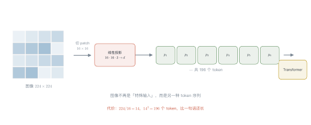
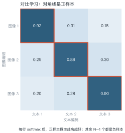
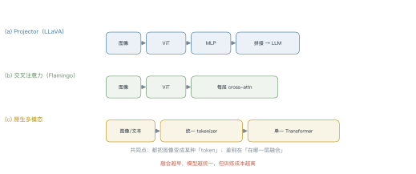
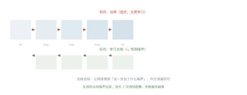

# 第 19 讲　多模态

!!! abstract "本讲位置"
    第五部分的收尾。前面所有讲次都在处理文本，本讲讲"图像怎么进来"——以及进来之后，为什么架构会和语言模型长得一样。

!!! info "📅 事实核查至 2026-11"
    ViT（Dosovitskiy et al., 2020）、CLIP（Radford et al., 2021）、LLaVA（2023）、DDPM（Ho et al., 2020）均已核对原文。

## 学习目标

学完本讲，你应该能够：

1. 算出 ViT 把一张图切成多少 token，并说明代价；
2. 写出 CLIP 的对比损失，手算一次 batch 内的正样本概率；
3. 说出三种视觉-语言架构的融合位置差异；
4. 解释扩散模型的前向与反向过程，以及为什么训练目标只是"预测噪声"。

---

## 0 直觉：图像怎么变成 token

语言模型只认 token。要让图像进来，只有一条路：**把图像也变成一串 token**。

三种做法：

| 做法 | 代表 | 思路 |
|---|---|---|
| 切 patch | ViT | 图像切成小方块，每块当一个 token |
| 对齐到文本空间 | CLIP | 图像编码成向量，与文本向量对齐 |
| 统一 tokenizer | 原生多模态 | 图文共用一个离散词表 |

第一种最通用，也是今天 VLM 的主流。

!!! note "一句话总结"
    多模态的关键不是"加一个视觉模块"，而是**让图像变成 Transformer 能吃的序列**。

---

## 1 ViT：把图像切成 patch

<figure markdown="span">
  { width="100%" }
  <figcaption>图 L19-1　读图要点：$224\times224$ 的图切成 $16\times16$ 的 patch，得到 196 个 token，每个 patch 拉平后过线性层变成 $d$ 维向量。<b>之后就和文本 token 一样进 Transformer</b>。</figcaption>
</figure>

### 例 19.1　算一下 token 数

$224\times224$ 的图，patch 边长 16：

$$\frac{224}{16}=14,\qquad 14\times14=196\ \text{个 token}$$

换成 patch 边长 14：

$$\frac{224}{14}=16,\qquad 16\times16=256\ \text{个 token}$$

**一张图就 196–256 个 token**，比一句话还长。4K 图像（$3840\times2160$）按 patch 16 切：

$$\frac{3840\times2160}{16^2}=32{,}400\ \text{个 token}$$

**这就是高分辨率图像贵的根本原因**——不是算不动，是 token 太多。

!!! tip "从这个例子里能读出三件事"
    1. **token 数随面积增长**：分辨率翻倍，token 数翻四倍；
    2. **patch 越大越省**：但细节丢失，小字看不清；
    3. **工业界做法**：先缩放到 $224$ 或 $336$，需要细节时再切子图（tiling）。

### 1.1 ViT 的位置编码怎么加

图像被切成 patch 后，顺序信息就丢了——和文本一样，需要位置编码。

三种做法：

- **可学习的一维位置编码**：把 196 个 patch 当成 196 个位置，各学一个向量（原版 ViT）；
- **二维位置编码**：分别编码行与列，更符合图像的二维结构；
- **相对位置偏置**：在注意力里加位置偏置，外推到更大分辨率时更稳。

**一个关键差异**：文本长度可变，图像分辨率也可变。用可学习的一维编码时，换个分辨率就得插值——这是 ViT 迁移到高分辨率时的常见麻烦。

---

## 2 CLIP：图文对齐

<figure markdown="span">
  { width="100%" }
  <figcaption>图 L19-2　读图要点：一个 batch 里 $N$ 对图文，算 $N\times N$ 的相似度矩阵，对角线是正样本、其余全是负样本。<b>一个 batch 提供 $N^2$ 个训练信号</b>，这是对比学习高效的原因。</figcaption>
</figure>

CLIP 用两个编码器（图像、文本）把样本映射到同一空间，然后做**对比学习**：

$$
\mathcal{L}=-\frac{1}{N}\sum_{i=1}^{N}\log
\frac{\exp(\boldsymbol{u}_i^\top\boldsymbol{v}_i/\tau)}
{\sum_{j=1}^{N}\exp(\boldsymbol{u}_i^\top\boldsymbol{v}_j/\tau)}
\tag{19.1}
$$

其中 $\boldsymbol{u}_i$ 是图像向量、$\boldsymbol{v}_i$ 是文本向量、$\tau$ 是温度。

### 例 19.2　手算一次对比损失

batch 只有 3 对。第 1 张图与三条文本的相似度是 $[0.92,\ 0.31,\ 0.18]$。

为便于手算，取 $\tau=0.5$（真实 CLIP 用 $0.07$，会更尖锐）：

$$0.92/0.5=1.84,\quad 0.31/0.5=0.62,\quad 0.18/0.5=0.36$$

取指数：

$$e^{1.84}=6.30,\quad e^{0.62}=1.86,\quad e^{0.36}=1.43$$

归一化，正样本概率：

$$p_1=\frac{6.30}{6.30+1.86+1.43}=0.657$$

损失：

$$\mathcal{L}_1=-\log 0.657=0.42$$

**怎么读这个数**：0.657 意味着模型只有 66% 的把握认出"这张图配这段文字"。训练就是把这个数推向 1。

### 2.2 零样本分类为什么能 workork

CLIP 训练完后，做图像分类不需要任何标注：

1. 把每个类别名写成句子（"一张猫的照片"），编码成文本向量；
2. 把待分类图像编码成图像向量；
3. 算余弦相似度，取最高的那一类。

**为什么有效**：训练时模型学的是"图文是否配对"，而不是"这是什么类别"。所以只要类别能用语言描述，它就能分类——**类别空间是开放的**。

**什么时候会失效**：

- 类别无法用语言区分（"这只鸟是哪个亚种"）；
- 类别名有歧义（"bank" 是银行还是河岸）；
- 细粒度任务（CLIP 在鸟类亚种上远不如专用模型）。

---

## 3 三种架构

<figure markdown="span">
  { width="100%" }
  <figcaption>图 L19-3　读图要点：三种架构的差别在"在哪一层融合"——projector 在输入层拼接，cross-attention 在每层注入，原生多模态从一开始就共用一个 Transformer。<b>融合越早越统一，但训练成本越高</b>。</figcaption>
</figure>

| 架构 | 代表 | 优点 | 缺点 |
|---|---|---|---|
| **Projector** | LLaVA | 实现简单，复用现成 LLM | 图像 token 挤占上下文 |
| **Cross-attention** | Flamingo | 图像不占文本位置 | 结构复杂，训练难 |
| **原生** | GPT-4o / Gemini | 真正的统一模型 | 需要从零训练 |

**LLaVA 的做法最省**：冻结视觉编码器与 LLM，只训一个两层 MLP 把图像特征映射到词向量空间。几千条图文指令数据就能出效果。

### 3.1 视觉指令微调的数据长什么样

LLaVA 的做法很直接：把图像特征当成"特殊的词"塞进对话。

一条样本大致是：

```
<image> 这张图里有什么？
<assistant> 一只橘猫趴在键盘上。
```

其中 `<image>` 会被替换成 576 个视觉 token（$24\times24$ 个 patch）。

**关键点**：训练时只对 assistant 部分算损失（第 8 讲的 loss mask），视觉 token 不产生梯度。这让"冻结视觉编码器"成为可能——只训 projector 和 LLM 的适配层。

### 3.2 projector 训练的两个技巧

**技巧一：先对齐、再指令。** 第一阶段只用图文对（"这张图是什么"），冻结 LLM 只训 projector；第二阶段再放开 LLM 做指令微调。一上来就联合训练，容易把语言能力练坏。

**技巧二：控制视觉 token 数。** 一张图 576 个 token 会挤占对话空间。常见做法是**池化**到 256 个，或用 Q-Former 压到 32 个——代价是细节丢失。

**经验值**：projector 通常只有 2 层 MLP（约 20M 参数），却能带来显著效果——因为它做的是"翻译"，不是"理解"。

---

## 4 扩散模型

<figure markdown="span">
  { width="100%" }
  <figcaption>图 L19-4　读图要点：前向是固定的加噪过程（无需学习），反向是学习的去噪过程。<b>训练目标极简：让网络预测"这一步加了什么噪声"</b>，用均方误差即可。</figcaption>
</figure>

### 4.1 前向：加噪

$$
\boldsymbol{x}_t=\sqrt{\bar\alpha_t}\,\boldsymbol{x}_0+\sqrt{1-\bar\alpha_t}\,\boldsymbol{\epsilon},
\qquad \boldsymbol{\epsilon}\sim\mathcal{N}(0,\boldsymbol{I})
\tag{19.2}
$$

其中 $\bar\alpha_t=\prod_{s=1}^{t}(1-\beta_s)$，随 $t$ 递减。

### 4.2 反向：学去噪

网络 $\boldsymbol{\epsilon}_\theta(\boldsymbol{x}_t,t)$ 预测噪声，损失是

$$
\mathcal{L}=\mathbb{E}_{t,\boldsymbol{x}_0,\boldsymbol{\epsilon}}
\big\|\boldsymbol{\epsilon}-\boldsymbol{\epsilon}_\theta(\boldsymbol{x}_t,t)\big\|^2
\tag{19.3}
$$

### 例 19.3　信噪比怎么变

信噪比（SNR）定义为

$$\text{SNR}_t=\frac{\bar\alpha_t}{1-\bar\alpha_t}$$

| $t$ | $\bar\alpha_t$ | SNR | 含义 |
|---|---|---|---|
| 0 | 1.00 | $\infty$ | 原图 |
| 250 | 0.80 | 4.0 | 轻微噪声 |
| 500 | 0.50 | 1.0 | 一半信号一半噪声 |
| 750 | 0.10 | 0.11 | 基本看不清 |
| 1000 | $10^{-5}$ | $10^{-5}$ | 纯噪声 |

**结论**：前 250 步在加"细节噪声"，后 250 步在摧毁结构。所以生成时**早期的步最关键**——它决定整体构图。

```python
import torch


def patchify(img: torch.Tensor, patch: int = 16) -> torch.Tensor:
    """(B, 3, H, W) -> (B, N, 3*patch*patch)"""
    b, c, h, w = img.shape
    assert h % patch == 0 and w % patch == 0
    x = img.reshape(b, c, h // patch, patch, w // patch, patch)
    x = x.permute(0, 2, 4, 1, 3, 5)              # (B, H/p, W/p, C, p, p)
    return x.reshape(b, -1, c * patch * patch)


img = torch.randn(1, 3, 224, 224)
tokens = patchify(img)
print(tokens.shape)      # torch.Size([1, 196, 768])
print(196 * 768)         # 150528 = 3*16*16*196，与输入像素数一致
```

### 4.3 扩散与自回归的取舍

| | 自回归（GPT 类） | 扩散（Stable Diffusion 类） |
|---|---|---|
| 生成方式 | 逐 token | 整体去噪 |
| 速度 | 慢（串行） | 快（并行，几十步） |
| 可控性 | 强（prompt 精确） | 弱（需要额外条件） |
| 适合 | 文本、代码 | 图像、视频、音频 |

**为什么文本不用扩散**：文本是离散的，扩散需要连续空间；图像是连续的，天然适合。

**融合趋势**：2024 年之后出现"统一 tokenizer + 自回归生成图像"的路线（如 Chameleon），把图像也变成离散 token，用同一个模型生成——代价是图像质量暂时不如专用扩散模型。

---

## 5 统一多模态的路线

三条路线在竞争：

1. **拼接派**（LLaVA）：视觉编码器 + projector + LLM，工程上最快；
2. **交叉注意力派**（Flamingo）：保持 LLM 不变，靠新增层注入视觉；
3. **原生派**（GPT-4o、Gemini）：图文音视频从预训练第一天就在一起。

**趋势**：随着算力变便宜，原生派在变强——因为"对齐两个独立编码器"总会损失信息，而联合训练不会。

### 5.1 视频与音频：时间维度的爆炸

图像已经是 196–256 token，视频还要乘上帧数：

$$\text{token 数}=\frac{H\times W}{p^2}\times T_{\text{frames}}$$

一段 10 秒、30fps 的视频有 300 帧，按每帧 196 token 算是 **58,800 token**——远超上下文窗口。

三条对策：

1. **抽帧**：每秒取 1–2 帧，信息损失可接受；
2. **时空 patch**：把时间维也切成 patch（如 $2\times16\times16$）；
3. **压缩成 latent**：先用视频编码器压到低维，再进 LLM。

音频同理：16kHz 采样一秒就是 16000 个采样点，必须先过声学编码器变成几十个 token。

---

## 6 工程要点与坑

1. **分辨率是成本**：4K 图 3 万 token，先缩放再处理。
2. **图像 token 挤占上下文**：一张图 256 token，十张图就吃掉 2560。
3. **CLIP 的零样本很强，但不是万能**：细粒度分类（如鸟类亚种）远不如专用模型。
4. **扩散模型的步数是延迟**：50 步生成一张图，比一次前向慢两个数量级。
5. **图文对齐有偏见**：CLIP 在性别、种族上都有可测量的偏差。
6. **多模态评测要看任务**：VQA、OCR、图表理解，差别很大。

---

## 7 论文与延伸

| 年份 | 论文 | 一句话贡献 |
|---|---|---|
| 2020 | [ViT](https://arxiv.org/abs/2010.11929) | 图像切 patch 进 Transformer |
| 2020 | [DDPM](https://arxiv.org/abs/2006.11239) | 扩散模型 |
| 2021 | [CLIP](https://arxiv.org/abs/2103.00020) | 图文对比学习 |
| 2022 | [Flamingo](https://arxiv.org/abs/2204.14198) | 交叉注意力注入视觉 |
| 2023 | [LLaVA](https://arxiv.org/abs/2304.08485) | projector + 视觉指令微调 |
| 2024 | [Chameleon](https://arxiv.org/abs/2405.09818) | 原生混合模态 |

---

## 8 习题

**🟢 概念题**

1. 为什么说 ViT 让"图像和文本用同一个架构"成为可能？
2. 扩散模型的前向过程为什么不需要学习？

**🟡 推导题**

3. 用 (19.2) 推导 $t$ 步后的信号方差与噪声方差，验证 SNR 的表达式。
4. 用 (19.1) 算：batch=4、正样本相似度 0.8、三个负样本 0.2，$\tau=0.5$ 时的损失。

**🔴 实现题**

5. 跑通 `patchify`，验证输出 token 数与输入像素数的关系。
6. 用 CLIP 类模型做一个零样本分类，统计 10 类的准确率。

---

## 9 本讲小结

<div class="cheatsheet" markdown>

**一个公式**

$$\text{token 数}=\frac{H\times W}{p^2}$$

**三个数字**

- $224\times224$、patch 16 → 196 token
- 4K 图 → 3.2 万 token
- CLIP 的温度 $\tau=0.07$

**三条路线**

projector · cross-attention · 原生

**一句话**

> 多模态不是加模块，是让图像变成序列；融合得越早，模型越统一。

</div>

---

## 来源

- ViT、CLIP、LLaVA、DDPM 的公式与结论核对自原文，链接见 §7，核查日期 2026-11。
