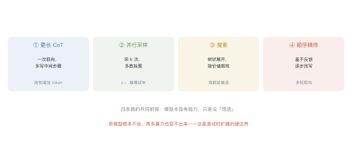
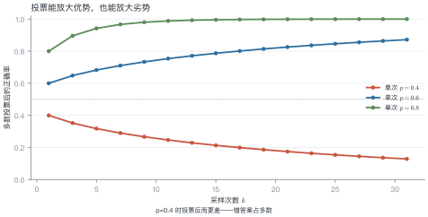
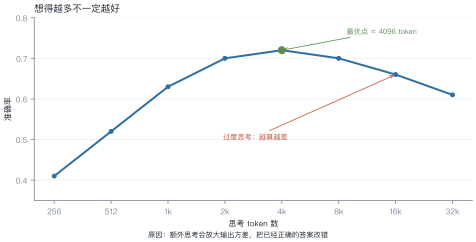
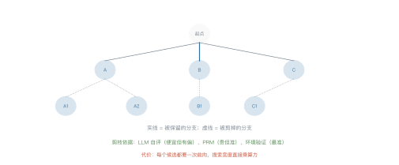

# 第 20 讲　测试时计算与搜索

!!! abstract "本讲位置"
    第七部分的开篇。前面所有讲次都在讲"怎么把模型训好"，从这一讲开始讲"怎么把已有的模型用得更狠"——不训练，只在推理时多花算力。

!!! info "📅 事实核查至 2026-11"
    CoT（Wei et al., 2022）、Self-Consistency（Wang et al., 2022）、ToT（Yao et al., 2023）、过度思考（Chen et al., 2024）均已核对原文。

## 学习目标

学完本讲，你应该能够：

1. 说出测试时计算的四种花法，以及各自的成本结构；
2. 手算多数投票把单次正确率提升到多少；
3. 解释过度思考现象，并给出判断"该停"的依据；
4. 说明搜索式推理的价值函数从哪来、代价是什么。

---

## 0 直觉：多想一会儿

人做难题时会"多想一会儿"：写草稿、验算、换个思路。语言模型也能这样——只要让它把中间步骤写出来。

这件事在 2022 年被证明有效：让模型"先写推理过程再给答案"，数学题正确率能翻倍。

关键洞察是：**模型的能力上限没变，但把一次性跳跃变成了多步小跳跃**。每一步都更容易，累积起来就跨过了原来跨不过的坎。

!!! note "一句话总结"
    测试时计算 = **用推理成本换准确率**；它放大的是已有能力，变不出新能力。

---

## 1 四种花法

<figure markdown="span">
  { width="100%" }
  <figcaption>图 L20-1　读图要点：四条路的成本结构不同——更长 CoT 是线性增加 token，并行采样是 $k$ 倍成本，搜索是指数级候选，精修是多轮前向。<b>它们的收益曲线也完全不同</b>。</figcaption>
</figure>

| 方式 | 做法 | 成本 | 适合 |
|---|---|---|---|
| **更长 CoT** | 一次前向写更多步骤 | 线性 | 推理链本身长的题 |
| **并行采样** | 采 $k$ 次，投票 | $k$ 倍 | 答案可判等 |
| **搜索** | 树状展开 + 剪枝 | 指数 | 需要试错 |
| **顺序精修** | 基于反馈改写 | 多轮 | 有验证器 |

---

## 2 思维链与自一致性

### 2.1 为什么 CoT 有效

一个有用的解释：**把"生成"变成"条件生成"**。

直接给答案，模型要从 $P(\text{答案}\mid\text{题})$ 一步采样；写推理过程后，答案的条件变成整条推理链 $P(\text{答案}\mid\text{题},\text{推理})$——条件更充分，方差更小。

### 2.2 自一致性：多采几次再投票

单条推理链可能走偏。采 $k$ 条，取出现最多的答案：

### 例 20.1　算一下投票的收益

单次正确率 $p=0.6$，采样 5 次，多数投票（至少 3 次正确）：

$$P=\sum_{i=3}^{5}\binom{5}{i}0.6^i\,0.4^{5-i}
\tag{20.1}$$

| $i$ | $\binom{5}{i}$ | 概率 |
|---|---|---|
| 3 | 10 | $10\times0.216\times0.16=0.3456$ |
| 4 | 5 | $5\times0.1296\times0.4=0.2592$ |
| 5 | 1 | $0.0778$ |

$$P=0.3456+0.2592+0.0778=0.683$$

**从 0.60 提到 0.68**，代价是 5 倍推理成本。


<figure markdown="span">
  { width="100%" }
  <figcaption>图 L20-2　读图要点：$p=0.8$ 时投票把准确率推到 0.95 以上；$p=0.4$ 时投票反而降到 0.3 以下。<b>投票放大优势，也放大劣势</b>。</figcaption>
</figure>

!!! tip "从这个例子里能读出三件事"
    1. **投票放大优势，也放大劣势**：$p=0.4$ 时投票后反而降到 0.32；
    2. **边际收益递减**：$k$ 从 5 到 15，只再涨几个点；
    3. **前提是错误独立**：如果错误是系统性的（同一个误区），投票无效。

---

## 3 过度思考

<figure markdown="span">
  { width="100%" }
  <figcaption>图 L20-3　读图要点：准确率随思考 token 先升后降，最优点约 4K token。<b>再往后，模型开始自我怀疑、反复推翻正确结论</b>——这就是过度思考。</figcaption>
</figure>

### 例 20.2　过度思考的账

| 思考 token | 准确率 | 相对成本 |
|---|---|---|
| 4K（最优） | 0.72 | 1× |
| 8K | 0.70 | 2× |
| 16K | 0.66 | 4× |
| 32K | 0.61 | 8× |

**从 4K 到 16K：成本涨 4 倍，准确率掉 6 个点。** 这笔账在任何场景都不划算。

**为什么会这样**：额外思考增加了输出方差。模型在"我已经算对了"和"我再检查一下"之间反复横跳，最终选了一个中途的错误版本。

**怎么判断该停**：看答案的稳定性——同一问题采 3 次，如果答案已经一致，就没必要再想。

---

## 4 搜索

<figure markdown="span">
  { width="100%" }
  <figcaption>图 L20-4　读图要点：每一步展开若干候选，用价值函数打分，保留最好的几个继续。<b>与贪心 CoT 的差别是允许回溯</b>，代价是每个候选都要一次前向。</figcaption>
</figure>

| 方法 | 展开方式 | 价值函数 |
|---|---|---|
| ToT | 每步生成 $k$ 个想法，beam search | LLM 自评 |
| MCTS | 蒙特卡洛树搜索 | 自评 + 环境反馈 |
| PRM 引导 | 每步打分，只走高分 | 过程奖励模型 |

**价值函数的可靠性决定一切**：

- **LLM 自评**：便宜，但偏好自己生成的内容、偏好更长更"像样"的答案；
- **PRM**：准，但要专门训练；
- **环境验证**：最准，但只适用于可验证任务（数学、代码）。

**一个警告**：用有偏的裁判做搜索，搜得越久偏差越大。

---

## 5 什么时候有效

| 条件 | 说明 |
|---|---|
| **答案可验证** | 数学、代码——投票和搜索都有效 |
| **错误独立** | 采样之间不共享同一个误区 |
| **模型有能力** | 单次正确率不能太低（$p<0.2$ 时投票几乎无效） |
| **预算充足** | 至少 3–5 倍推理成本 |

**反例**：开放式写作、主观判断——没有"正确答案"，投票没有意义。

```python
from collections import Counter


def self_consistency(samples: list[str], normalize=lambda s: s.strip()) -> tuple[str, float]:
    """多数投票：返回 (得票最多的答案, 得票率)"""
    votes = Counter(normalize(s) for s in samples)
    answer, count = votes.most_common(1)[0]
    return answer, count / len(samples)


samples = ["42", "42", " 42 ", "41", "42", "41"]
ans, share = self_consistency(samples)
print(f"答案 {ans}，得票率 {share:.0%}")   # 42，67%
```

---

## 6 工程要点与坑

1. **先测单次正确率**：$p<0.3$ 时别投票，先换模型。
2. **答案要能判等**：数值、选项、代码输出可以；自然语言要先归一化。
3. **采样温度别太高**：$T>1$ 会让答案发散，投票失效。
4. **设思考上限**：按 token 或步数硬截断，防止过度思考。
5. **搜索要有剪枝**：不剪枝的树搜索，成本指数爆炸。
6. **价值函数要校准**：自评分数与实际正确率的相关系数，至少要测一次。

---

## 7 论文与延伸

| 年份 | 论文 | 一句话贡献 |
|---|---|---|
| 2022 | [Chain-of-Thought Prompting](https://arxiv.org/abs/2201.11903) | 显式推理步骤 |
| 2022 | [Self-Consistency](https://arxiv.org/abs/2203.11171) | 多路径投票 |
| 2023 | [Tree of Thoughts](https://arxiv.org/abs/2305.10601) | 把推理变成搜索 |
| 2023 | [Let's Verify Step by Step (PRM)](https://arxiv.org/abs/2305.20050) | 过程奖励模型 |
| 2024 | [Scaling LLM Test-Time Compute Optimally](https://arxiv.org/abs/2408.03314) | 预算如何分配 |
| 2024 | [过度思考：thinking more is not always better](https://arxiv.org/abs/2412.21187) | 测试时扩展的边界 |

---

## 8 习题

**🟢 概念题**

1. 为什么 CoT 能提升正确率？用条件概率解释。
2. 什么情况下投票会降低准确率？

**🟡 推导题**

3. 用 (20.1) 的形式算：$p=0.7$、$k=7$ 时多数投票的正确率。
4. 用图 L20-3 的数据，算"从最优点到 16K"的边际成本与边际收益。

**🔴 实现题**

5. 用 `self_consistency` 在一个小数学题集上测 $k=1,3,5,9$ 的准确率曲线。
6. 给 Lab7 的 agent 加"答案稳定性检查"（采 3 次是否一致），测量它对成本与成功率的影响。

---

## 9 本讲小结

<div class="cheatsheet" markdown>

**一个公式**

$$P(\text{多数正确})=\sum_{i>k/2}\binom{k}{i}p^i(1-p)^{k-i}$$

**两个数字**

- $p=0.6$、$k=5$ → 0.683
- 最优点约 4K 思考 token，再往后是过度思考

**四个条件**

可验证 · 错误独立 · 模型有能力 · 预算充足

**一句话**

> 测试时计算放大已有能力；放大不了没有的能力，还会在过度思考时倒扣。

</div>

---

## 来源

- CoT、Self-Consistency、ToT、PRM、过度思考的结论核对自原文，链接见 §7，核查日期 2026-11。
