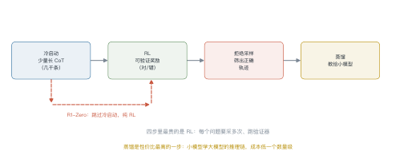
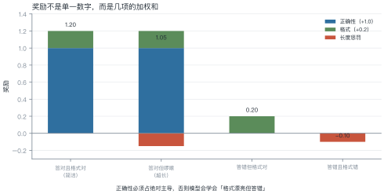
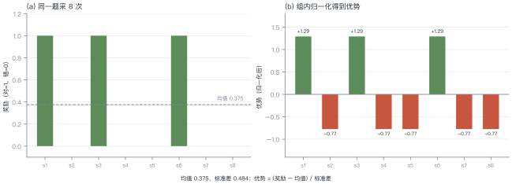
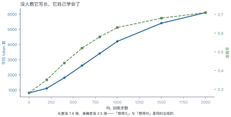

# 第 21 讲　推理模型训练

!!! abstract "本讲位置"
    第 20 讲讲了"推理时多花算力"，本讲讲"怎么把这种能力训进权重"。核心工具只有一个：**可验证奖励 + 强化学习**。

!!! info "📅 事实核查至 2026-11"
    o1（OpenAI, 2024）、R1/R1-Zero（DeepSeek, 2025）、GRPO（DeepSeekMath, 2024）、过程奖励（Lightman et al., 2023）均已核对原文。

## 学习目标

学完本讲，你应该能够：

1. 说出推理模型训练的四步流水线，以及 R1-Zero 跳过了哪一步；
2. 设计一组可验证奖励，并说明各项权重的取舍；
3. 手算 GRPO 的组内优势；
4. 解释"回答长度自发增长"这一现象。

---

## 0 直觉：从"想得久"到"训得会想"

第 20 讲的做法是**推理时**多采样、多投票——能力没变，只是用得更好。

推理模型走得更远：**把这个能力训进权重**。训练后的模型，默认就会写很长的推理链，而且写得比提示工程引导出来的更有效。

关键区别：

| | 测试时扩展 | 推理模型训练 |
|---|---|---|
| 能力来源 | 已有能力 + 搜索 | 权重里学会了"怎么想" |
| 成本 | 每次推理都贵 | 训练一次，推理仍贵但更高效 |
| 上限 | 受基座能力限制 | 可以超过人类示范 |

!!! note "一句话总结"
    推理模型 = **用可验证奖励做 RL，让模型自己发现"长推理有用"**。

---

## 1 训练流水线

<figure markdown="span">
  { width="100%" }
  <figcaption>图 L21-1　读图要点：冷启动 SFT → RL → 拒绝采样 → 蒸馏。<b>R1-Zero 跳过了冷启动</b>，直接纯 RL，反而涌现出"反思""验证"这类行为。</figcaption>
</figure>

### 1.1 四个阶段

| 阶段 | 数据 | 作用 |
|---|---|---|
| **冷启动** | 几千条长 CoT | 给模型一个"长推理"的起点，避免 RL 早期全是乱码 |
| **RL** | 问题 + 验证器 | 学会"怎么想才能答对" |
| **拒绝采样** | 同一问题采多次，留正确的 | 生成高质量 SFT 数据 |
| **蒸馏** | 大模型的推理链 | 把能力搬到小模型 |

### 1.2 R1-Zero 的意义

DeepSeek 做了一个大胆的实验：**完全跳过冷启动**，直接从基座模型开始 RL。

结果出人意料：模型自发学会了延长思考、自我检查、甚至出现"等等，让我重新想想"这样的反思语句。

**这说明**：长推理不是教出来的，是**在"答对给奖励"的压力下自己发现的**。

---

## 2 RLVR：可验证奖励

<figure markdown="span">
  { width="100%" }
  <figcaption>图 L21-2　读图要点：奖励不是单一数字——正确性 +1.0、格式 +0.2、超长 −0.15。<b>正确性必须占绝对主导</b>，否则模型会学会"格式漂亮但答错"。</figcaption>
</figure>

可验证奖励（RLVR）的核心：**用规则或测试用例判定对错**，不需要人类打分。

| 任务 | 验证器 |
|---|---|
| 数学 | 答案匹配（数值/表达式等价） |
| 代码 | 单元测试 |
| 逻辑 | 约束满足检查 |
| 格式 | 正则 / JSON 解析 |

### 例 21.1　算一个样本的奖励

某条回答：答案正确、格式合规、但超长（8000 token，上限 6000）。

$$r=1.0\ (\text{正确})+0.2\ (\text{格式})-0.15\ (\text{超长})=1.05$$

对照：答错但格式对 → $0+0.2=0.2$；答错且格式错 → $0+0-0.1=-0.1$。

**为什么要有长度惩罚**：不加的话，模型会发现"写得越长越可能蒙对"，于是无限啰嗦。

**为什么格式奖励要小**：格式只是手段，不是目的。权重给大了，模型会为了格式牺牲正确性。

---

## 3 GRPO：不要价值网络

<figure markdown="span">
  { width="100%" }
  <figcaption>图 L21-3　读图要点：同一道题采 8 次，用<b>组内均值与标准差</b>归一化出优势，不需要额外的价值网络——这是 GRPO 比 PPO 省显存的原因。</figcaption>
</figure>

PPO 需要一个价值网络估计基线，多一个模型、多一份显存。GRPO 的做法更省：**同一道题采一组，用组内均值当基线**。

$$
A_i=\frac{r_i-\operatorname{mean}(\boldsymbol{r})}{\operatorname{std}(\boldsymbol{r})}
\tag{21.1}
$$

### 例 21.2　手算组内优势

同一题采 8 次，奖励 $\boldsymbol{r}=[1,0,1,0,0,1,0,0]$。

**第一步，均值：**

$$\bar r=\frac{3}{8}=0.375$$

**第二步，标准差：**

$$\sigma=\sqrt{\frac{3(1-0.375)^2+5(0-0.375)^2}{8}}
=\sqrt{\frac{1.172+0.703}{8}}=0.484$$

**第三步，优势：**

$$A_{\text{对}}=\frac{1-0.375}{0.484}=+1.29,\qquad
A_{\text{错}}=\frac{0-0.375}{0.484}=-0.77$$

**怎么读**：答对的样本被正向强化（+1.29），答错的被抑制（−0.77）。幅度不对称——因为答对的是少数。

!!! tip "从这个例子里能读出三件事"
    1. **基线是"这道题的平均水平"**，不是全局平均——同一题内的比较更公平；
    2. **全对或全错时标准差为 0**：这一组没有信号，直接丢弃；
    3. **采样数决定信号质量**：8 个里只有 3 个对，方差大，优势不稳。

---

## 4 长度为什么会长

<figure markdown="span">
  { width="100%" }
  <figcaption>图 L21-4　读图要点：没人教它写长，但 RL 推进时平均长度从 800 涨到 6100，准确率同步从 0.28 涨到 0.71。<b>"想得久"与"想得对"同时出现</b>。</figcaption>
</figure>

### 4.1 三种解释

- **探索的副产品**：RL 鼓励尝试新路径，长推理能容纳更多尝试；
- **验证行为的载体**：模型学会了"算完检查一遍"，检查需要额外 token；
- **奖励塑形**：答对才给分，而长推理提高了答对概率——于是长度被间接强化。

### 4.2 代价

长度涨 7.6 倍，推理成本也涨 7.6 倍。所以后来的工作都在做"**长度控制**"：在奖励里加长度惩罚，或训练模型"该停就停"。

---

## 5 冷启动与蒸馏

### 例 21.3　蒸馏的压缩比

大模型推理一条题平均 8000 token，小模型学完后平均 2000 token：

$$\text{压缩比}=\frac{8000}{2000}=4$$

**为什么能压缩**：大模型的推理链里有大量"自我怀疑"和"重复验证"，蒸馏时这些冗余被过滤掉了——小模型学到的是**主干路径**。

代价是上限降低：小模型在超难题上仍会输给大模型，但差距比"直接训小模型"小得多。

```python
import torch


def grpo_advantages(rewards: torch.Tensor) -> torch.Tensor:
    """组内归一化优势：rewards 形状 (group,)"""
    mean = rewards.mean()
    std = rewards.std(unbiased=False)
    if std < 1e-6:                 # 全对或全错，没有信号
        return torch.zeros_like(rewards)
    return (rewards - mean) / (std + 1e-8)


def grpo_loss(logp: torch.Tensor, logp_old: torch.Tensor,
              adv: torch.Tensor, clip: float = 0.2) -> torch.Tensor:
    """简化版 GRPO 目标（单步、无 KL 项）"""
    ratio = torch.exp(logp - logp_old)
    clipped = torch.clamp(ratio, 1 - clip, 1 + clip)
    return -torch.min(ratio * adv, clipped * adv).mean()


r = torch.tensor([1.0, 0, 1, 0, 0, 1, 0, 0])
print(grpo_advantages(r).round(decimals=2))   # +1.29 / -0.77
```

---

## 6 工程要点与坑

1. **验证器要严**：判定太松，模型会学会钻空子（比如输出"答案是 42"蒙对）。
2. **采样数别太小**：一组少于 4 个，优势估计方差太大。
3. **全对/全错的组要丢**：标准差为 0，没有梯度信号。
4. **长度惩罚要渐进**：一开始就罚，模型会学不会长推理。
5. **冷启动数据质量决定上限**：几千条烂数据，RL 也救不回来。
6. **蒸馏要保留主干**：把大模型的冗余推理链原样喂给小模型，效果反而差。

---

## 7 论文与延伸

| 年份 | 论文 | 一句话贡献 |
|---|---|---|
| 2023 | [Let's Verify Step by Step](https://arxiv.org/abs/2305.20050) | 过程奖励模型 |
| 2024 | [DeepSeekMath (GRPO)](https://arxiv.org/abs/2402.03300) | 组内相对优势 |
| 2024 | [OpenAI o1](https://openai.com/index/learning-to-reason-with-llms/) | 长 CoT 的 RL 训练 |
| 2025 | [DeepSeek-R1](https://arxiv.org/abs/2501.12948) | 纯 RL 涌现推理，能力可蒸馏 |
| 2025 | [s1: Simple Test-Time Scaling](https://arxiv.org/abs/2501.19393) | 1000 条数据的冷启动 |

---

## 8 习题

**🟢 概念题**

1. 为什么 RLVR 不需要人类标注？它的适用边界在哪？
2. R1-Zero 跳过冷启动为什么还能work？冷启动解决的是什么问题？

**🟡 推导题**

3. 用 (21.1) 算：组内奖励 $[1,1,0,0,0,0]$ 的均值、标准差与优势。
4. 用图 L21-4 的数据，算"长度增长"带来的单位准确率成本。

**🔴 实现题**

5. 用 `grpo_advantages` 与 `grpo_loss` 在一个玩具任务（如 24 点）上跑一次 RL，观察长度变化。
6. 设计一组奖励（正确性 + 格式 + 长度），分析不同权重下模型的行为差异。

---

## 9 本讲小结

<div class="cheatsheet" markdown>

**一条流水线**

冷启动 → RL（RLVR）→ 拒绝采样 → 蒸馏

**一个公式**

$$A_i=\frac{r_i-\operatorname{mean}(\boldsymbol{r})}{\operatorname{std}(\boldsymbol{r})}$$

**两个数字**

- 组内 3/8 正确 → 优势 +1.29 / −0.77
- 蒸馏压缩比约 4 倍

**一句话**

> 推理能力不是教出来的，是在"答对给奖励"的压力下自己长出来的。

</div>

---

## 来源

- o1、R1、GRPO、PRM 的结论核对自原文，链接见 §7，核查日期 2026-11。
