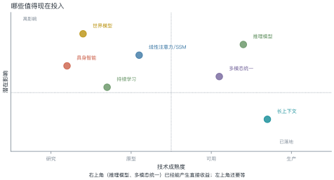
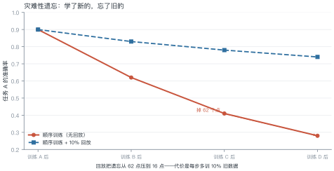
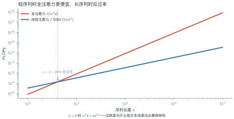
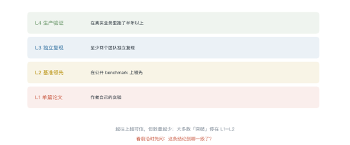

# 第 22 讲　前沿方向

!!! abstract "本讲位置"
    第七部分的收尾。前面 21 讲都是"已经发生的事"，本讲讲"正在发生的事"——并给一套判断标准，让你自己评估新进展。

!!! info "📅 事实核查至 2026-11"
    本讲引用的具体进展均标注了来源与证据等级；对尚未定论的方向，给出正反两面证据。

## 学习目标

学完本讲，你应该能够：

1. 用"成熟度 × 影响"矩阵判断一个方向值不值得投入；
2. 算出全注意力与线性注意力的复杂度交叉点；
3. 解释灾难性遗忘的量化方式与缓解手段；
4. 用四级证据标准评估一条"突破"新闻的可信度。

---

## 0 直觉：分清突破与营销

每年都有几十个"颠覆性突破"。判断标准其实很朴素：

- **能不能复现**：只有作者自己的实验，还是别人也能跑出来？
- **有没有用**：基准上领先，还是真实业务里也管用？
- **代价多大**：效果提升 3%，成本涨 10 倍，值吗？

本讲先介绍四个方向，再给一套证据分级标准。

!!! note "一句话总结"
    前沿判断的核心不是"新不新"，而是**证据到哪一级、代价换来了什么**。

---

## 1 世界模型与具身智能

<figure markdown="span">
  { width="100%" }
  <figcaption>图 L22-1　读图要点：横轴成熟度、纵轴潜在影响。<b>右上角（推理模型、多模态统一）已经能产生直接收益</b>；左上角（世界模型、具身）影响大但还在研究阶段。</figcaption>
</figure>

### 1.1 世界模型

**定义**：能预测"采取某个动作后世界会变成什么样"的内部模型。

与语言模型的区别：

| | 语言模型 | 世界模型 |
|---|---|---|
| 输入 | token 序列 | 状态 + 动作 |
| 输出 | 下一个 token | 下一个状态（或观测） |
| 训练信号 | 文本 | 交互轨迹 / 视频 |

**为什么重要**：能做规划的前提是能预测后果。没有世界模型，agent 只能试错。

**现状**：视频生成模型（Sora 类）被当作"世界模型"的雏形，但它们学的是像素统计，不是物理规律——**能生成"看起来对"的视频，不等于理解因果**。

### 1.2 具身智能

机器人 + 大模型。难点不在模型，在**数据**：真实世界的交互数据比文本少几个数量级，且采集成本极高。

三条路线：仿真里训（Sim2Real）、遥操作采集、视频预训练。

### 1.3 具身智能的三个坑

**坑一：仿真与现实的差距**。在仿真里训练的策略，到了真实机器人上往往失效——摩擦、光照、传感器噪声都对不上。业界把这叫 sim-to-real gap，缓解手段是**域随机化**：训练时随机化物理参数，逼策略学会鲁棒。

**坑二：数据贵且慢**。遥操作采集一条 10 秒的抓取轨迹，需要一个人操作 + 一个人标注，成本是文本数据的几千倍。

**坑三：评测无法自动化**。文本任务可以跑测试用例，机器人任务只能真机试——这直接限制了迭代速度。

**一个判断**：具身智能的瓶颈在**数据与评测**，不在模型。这和语言模型恰好相反。

---

## 2 持续学习

<figure markdown="span">
  { width="100%" }
  <figcaption>图 L22-2　读图要点：顺序训练 A→B→C→D，任务 A 的准确率从 0.90 掉到 0.28。<b>加入 10% 回放能把遗忘从 62 点压到 16 点</b>，但压不到 0。</figcaption>
</figure>

### 例 22.1　量化遗忘

任务 A 训练完是 0.90，训完 D 之后剩 0.28：

$$\text{遗忘率}=\frac{0.90-0.28}{0.90}=68.9\%$$

加 10% 回放后剩 0.74：

$$\text{遗忘率}=\frac{0.90-0.74}{0.90}=17.8\%$$

**代价**：每步多训 10% 的旧数据，训练成本增加约 10%。

**三种缓解手段**：

1. **回放**（replay）：混入旧数据，最有效也最贵；
2. **正则化**（EWC）：惩罚重要参数的改动，便宜但效果有限；
3. **LoRA 隔离**：每个任务一组适配器，完全不共享参数——不遗忘，但也不能迁移。

### 2.1 回放怎么实现

三种粒度，成本递增：

| 粒度 | 做法 | 成本 |
|---|---|---|
| **样本级** | 每步混入 10% 旧任务样本 | +10% 算力 |
| **特征级** | 存旧任务的隐状态，蒸馏回放 | +20%，但不用存原始数据 |
| **参数级** | EWC 惩罚重要参数的变化 | 几乎免费，效果有限 |

**选择建议**：数据能存就用样本级（最简单、最有效）；数据敏感（隐私）用特征级。

**一个坑**：回放比例不是越高越好。超过 30% 后，新任务学得明显变慢，而遗忘只再降几个点。

---

## 3 新架构

<figure markdown="span">
  { width="100%" }
  <figcaption>图 L22-3　读图要点：全注意力 $O(n^2d)$ 与线性注意力 $O(nd^2)$ 在 $n=d$ 处交叉。<b>$n<d$ 时全注意力反而更便宜</b>——这就是短文本场景没必要换架构的原因。</figcaption>
</figure>

### 例 22.2　算一下交叉点

设 $d=4096$，比较两种复杂度：

$$n^2d \quad\text{vs}\quad nd^2$$

令两者相等：

$$n^2 d = n d^2 \ \Longrightarrow\ n=d=4096$$

**结论**：

- $n<4096$（大多数对话场景）：全注意力更省；
- $n>4096$（长文档、代码仓库）：线性方法开始占优。

**但理论复杂度不等于实际速度**：线性注意力的常数项大、硬件利用率低，实测往往要到 $n>32$K 才真正快。

### 3.2 混合架构的工程现实

纯线性架构（Mamba 类）在"精确检索"任务上明显落后：让它从 10 万 token 里找出一句原话，不如全注意力可靠。原因是状态压缩会丢细节。

主流做法是**混合**：大部分层用线性/SSM（省算力），少数层保留全注意力（保检索）。

| 配置 | 算力 | 长文本检索 |
|---|---|---|
| 全注意力 | 1× | 最好 |
| 纯线性 | 0.3× | 明显变差 |
| 混合（1/4 层全注意力） | 0.5× | 接近全注意力 |

**工程含义**：换架构不是"全有或全无"，按比例混合往往性价比最高。Jamba 这类模型就是按这个思路设计的。

```python
def flops(n: int, d: int, linear: bool = False) -> float:
    """粗略 FLOPs：全注意力 O(n²d)，线性注意力 O(nd²)"""
    return 2 * n * d**2 if linear else 2 * n**2 * d


def crossover(d: int) -> int:
    """两种复杂度相等的序列长度"""
    return d


def forgetting(before: float, after: float) -> float:
    """遗忘率"""
    return (before - after) / before


d = 4096
print(f"n=1024 时：全注意力 {flops(1024, d):.1e}，线性 {flops(1024, d, True):.1e}")
print(f"n=16384 时：全注意力 {flops(16384, d):.1e}，线性 {flops(16384, d, True):.1e}")
print(f"交叉点 n = {crossover(d)}")
print(f"遗忘率 {forgetting(0.90, 0.28):.1%}")     # 68.9%
```

### 3.1 三条路线

| 路线 | 代表 | 优势 | 代价 |
|---|---|---|---|
| 线性注意力 | Performer / RWKV | $O(n)$ | 表达力受限 |
| 状态空间模型 | Mamba | 长程建模好 | 检索能力弱 |
| 混合架构 | Jamba | 兼顾两者 | 结构复杂 |

**2026 年的共识**：纯线性架构在"精确检索"任务上仍明显落后于全注意力，主流做法是**混合**——大部分层用线性，少数层保留全注意力。

---

## 4 AI for Science

这是目前**证据等级最高**的方向之一：不是"可能有用"，而是已经产出可验证成果。

| 领域 | 成果 | 证据等级 |
|---|---|---|
| 蛋白质结构 | AlphaFold 系列 | L4（实验验证） |
| 材料发现 | GNoME | L3（部分实验验证） |
| 数学猜想 | 形式化证明辅助 | L3（可机器验证） |
| 药物设计 | 多个候选进入临床 | L2–L3 |

**为什么这个方向证据强**：因为**结果可验证**——蛋白质结构能被实验测定，数学证明能被机器检查。这和第 21 讲的 RLVR 是同一个逻辑：**可验证的领域进步最快**。

---

## 5 证据分级

<figure markdown="span">
  { width="100%" }
  <figcaption>图 L22-4　读图要点：四级证据——单篇论文、独立复现、基准领先、生产验证。<b>大多数"突破"停在 L1–L2</b>，能走到 L4 的极少。</figcaption>
</figure>

### 例 22.3　给一条新闻打分

> "某团队提出新架构，在长文本任务上比 Transformer 快 10 倍。"

逐项核对：

| 维度 | 情况 | 得分 |
|---|---|---|
| 复现 | 只有作者自己的实验 | L1 |
| 对比 | 只比了 Transformer，没比同期的 Mamba | 不充分 |
| 场景 | 长文本（$n>32$K），不是通用 | 有条件 |
| 代价 | 未报告短文本性能 | 未知 |

**结论**：L1–L2 之间，**可以关注，不能据此改架构**。

### 5.1 给一条新闻打分的实操

三步，五分钟：

1. **找原始来源**：是论文、官方博客，还是二手报道？二手报道常有夸大。
2. **看基线**：和谁比？如果是"未优化的 Transformer"，赢是应该的。
3. **看条件**：在什么序列长度、什么 batch、什么硬件下测的？换个条件还成立吗？

**一个常见的夸大手法**：只报"最快的那一项"。比如长文本快 10 倍，但短文本慢 2 倍——只提前者。

**打分表**：三项都通过 → L3；只过两项 → L2；只过一项 → L1。

---

## 6 工程要点与坑

1. **看"在什么条件下"**：多数"快 10 倍"都有前提（序列长度、batch、硬件）。
2. **看基线是否公平**：和未优化的 Transformer 比，赢是应该的。
3. **看代价**：效果 +3%、成本 ×10，通常不值得。
4. **别追新架构**：生态、工具链、算子优化都是成本，切换代价常被低估。
5. **可验证领域优先**：数学、代码、科学——这些方向的进展最可信。
6. **等 L3 再投入**：独立复现之前，只做小规模验证。

---

## 7 论文与延伸

| 年份 | 论文 | 一句话贡献 |
|---|---|---|
| 2021 | [AlphaFold2](https://www.nature.com/articles/s41586-021-03819-2) | 蛋白质结构预测 |
| 2023 | [Mamba](https://arxiv.org/abs/2312.00752) | 选择性状态空间 |
| 2024 | [Jamba](https://arxiv.org/abs/2403.19887) | 混合 SSM-Transformer |
| 2024 | [Genie / 世界模型综述](https://arxiv.org/abs/2402.15391) | 从视频中学世界模型 |
| 2024 | [GNoME](https://www.nature.com/articles/s41586-023-06735-9) | 材料发现 |

---

## 8 习题

**🟢 概念题**

1. 为什么说"视频生成模型不等于世界模型"？
2. 持续学习的三种缓解手段各有什么代价？

**🟡 推导题**

3. 用 $n^2d$ 与 $nd^2$ 的对比，算出 $d=8192$ 时的交叉点，并说明工程含义。
4. 用例 22.1 的方法，算"回放比例从 10% 提到 30%"的遗忘率与成本变化。

**🔴 实现题**

5. 用图 L22-3 的公式画一张"不同 $d$ 下的交叉点"曲线。
6. 找一条最近的前沿新闻，用四级证据标准打分，写出判断依据。

---

## 9 本讲小结

<div class="cheatsheet" markdown>

**一个矩阵**

成熟度 × 影响：右上角值得投入，左上角继续观察

**一个公式**

$$n^2d = nd^2 \Longrightarrow n=d$$

**四级证据**

单篇论文 · 独立复现 · 基准领先 · 生产验证

**一句话**

> 可验证的领域进步最快；不可验证的领域，先看证据到哪一级。

</div>

---

## 来源

- AlphaFold2、Mamba、GNoME 的结论核对自原文；证据分级为本讲义自建标准，核查日期 2026-11。
