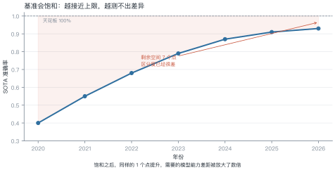
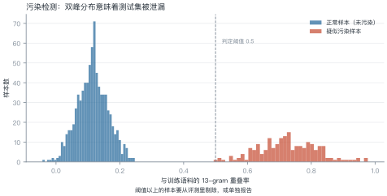
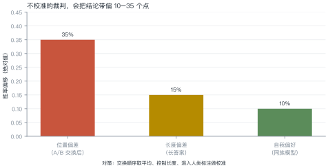
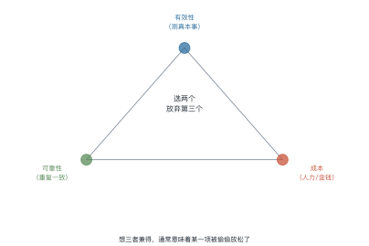

# 第 23 讲　评测与治理

!!! abstract "本讲位置"
    第八部分的开篇。前面所有讲次都在讲"怎么做得更好"，本讲讲"怎么知道它真的更好了"——以及当它出问题时，谁来负责。

!!! info "📅 事实核查至 2026-11"
    MMLU/HELM 的饱和讨论、数据污染检测、LLM-as-a-Judge 偏差研究（Zheng et al., 2023）均已核对原文。

## 学习目标

学完本讲，你应该能够：

1. 判断一个 benchmark 是否已经饱和，并算出它还能撑多久；
2. 用 n-gram 重叠检测数据污染，并估算污染对分数的影响；
3. 说出 LLM 裁判的三种偏差及对应的校准手段；
4. 用"有效性/可靠性/成本"三角解释评测方案的取舍。

---

## 0 直觉：基准会饱和

一个新基准刚出现时，模型只能考 40 分，区分度极高。两年后大家都考 90 分，剩下的 10 分里全是噪声——**基准就死了**。

这不是模型的问题，是基准的宿命：**任何固定测试集，最终都会被"训进去"**。

!!! note "一句话总结"
    评测的核心矛盾：**基准会饱和、测试集会泄漏、裁判会有偏**。三者都只能缓解，不能消除。

---

## 1 谱系与饱和

<figure markdown="span">
  { width="100%" }
  <figcaption>图 L23-1　读图要点：SOTA 从 40% 涨到 93%，但天花板是 100%。<b>剩余空间只有 7 个点，区分度已经很差</b>——同样的 1 个点，现在需要的能力差距比三年前大得多。</figcaption>
</figure>

### 例 23.1　算一下还能撑多久

某基准：2024 年 0.87，2026 年 0.93，两年涨 6 点，年均 3 点。

剩余空间：$1.00-0.93=0.07$，即 7 点。

$$\text{剩余年限}\approx\frac{7}{3}=2.3\ \text{年}$$

**但实际会更短**：越接近上限，提升越难（边际递减），所以 2.3 年是乐观估计。

**饱和之后怎么办**：

| 做法 | 说明 |
|---|---|
| 换更难的基准 | 治标，新基准也会饱和 |
| 加长尾/对抗样本 | 增加区分度 |
| 改评测方式 | 从"答对率"改成"人工偏好" |
| 私有测试集 | 不公开，延缓污染 |

---

## 2 数据污染

<figure markdown="span">
  { width="100%" }
  <figcaption>图 L23-2　读图要点：正常样本与训练语料的重叠率低，污染样本高，形成双峰。<b>阈值以上的样本要从评测里剔除</b>，否则分数虚高。</figcaption>
</figure>

**污染怎么发生**：训练语料从互联网抓取，测试集也在互联网上。抓的时候不知道哪些是测试题。

**三种检测方法**：

| 方法 | 做法 | 灵敏度 |
|---|---|---|
| n-gram 重叠 | 算最长公共子串 / 13-gram 重叠率 | 中 |
| 困惑度异常 | 污染样本的 loss 明显偏低 | 中 |
| 改写检测 | 用同义改写后再测，看分数掉多少 | 高 |

### 例 23.2　算污染对分数的影响

1000 条测试样本，检测出 200 条污染（20%）。

污染样本平均正确率 0.95，干净样本 0.80：

$$\text{报告分数}=0.2\times0.95+0.8\times0.80=0.83$$

剔除后：

$$\text{真实分数}=0.80$$

**虚高 3 个点**。在饱和区间里，3 个点足以改变排名。

!!! tip "从这个例子里能读出三件事"
    1. **污染率越高，虚高越明显**：20% 污染带来 3 点，40% 就是 6 点；
    2. **污染样本的正确率越高，越可疑**：0.95 接近满分，通常意味着"见过原题"；
    3. **剔除后要重算排名**：很多"超越"在剔除后消失。

---

## 3 LLM 当裁判

<figure markdown="span">
  { width="100%" }
  <figcaption>图 L23-3　读图要点：位置偏差最严重（A/B 交换后胜率能差 35 个点），长度偏差 15 点，自我偏好 10 点。<b>不校准的裁判，会把结论带偏几十个点</b>。</figcaption>
</figure>

人工评测贵且慢，于是用强模型当裁判。但裁判有三种系统性偏差：

| 偏差 | 表现 | 校准手段 |
|---|---|---|
| **位置** | 总偏好第一个回答 | A/B 交换取平均 |
| **长度** | 偏好更长的回答 | 控制长度或做长度归一 |
| **自我偏好** | 偏好同族模型的输出 | 混入人类标注校准 |

### 例 23.3　位置偏差怎么校准

模型 A 与 B 比较：

- A 在前时，A 胜率 0.65；
- B 在前时，A 胜率 0.35（即 B 胜率 0.65）。

**说明裁判有强烈的"选第一个"倾向**。取平均：

$$\text{校准后 A 的胜率}=\frac{0.65+0.35}{2}=0.50$$

**真实结论是打平**——不校准的话，会得出"A 比 B 强 30 个点"的错误结论。

---

## 4 幻觉度量

幻觉没有统一定义，常用的三种近似：

| 指标 | 做法 | 局限 |
|---|---|---|
| 事实性 | 与知识库比对 | 依赖知识库覆盖 |
| 忠实度 | 答案是否有上下文支撑 | 只适用于 RAG |
| 一致性 | 同一问题多次采样是否一致 | 一致也可能是稳定地错 |

**实用建议**：至少同时报告两个指标。单一指标都能被"刷"。

---

## 5 治理与合规

| 框架 | 范围 | 核心要求 |
|---|---|---|
| **EU AI Act** | 欧盟 | 按风险分级，高风险系统需合规评估 |
| **生成式 AI 管理办法** | 中国 | 备案、内容标识、训练数据合法性 |
| **NIST AI RMF** | 美国（自愿） | 风险管理框架 |

**开源 vs 闭源的治理差异**：

- 闭源：责任明确（厂商），但外部无法审计；
- 开源：可审计，但责任分散，且权重一旦发布就收不回。

---

## 6 评测三角

<figure markdown="span">
  { width="100%" }
  <figcaption>图 L23-4　读图要点：有效性、可靠性、成本三者只能取其二。<b>想三者兼得，通常意味着某一项被偷偷放松了</b>——最常见的是牺牲有效性（用便宜的代理指标）。</figcaption>
</figure>

| 方案 | 有效 | 可靠 | 便宜 |
|---|---|---|---|
| 人工双盲 | ✓ | ✓ | ✗ |
| LLM 裁判 | ✓ | ✗ | ✓ |
| 自动指标（BLEU） | ✗ | ✓ | ✓ |

**结论**：没有完美方案，只能按场景取舍。高风险场景用人工双盲，快速迭代用自动指标 + 抽样人工复核。

```python
def ngram_overlap(test: str, corpus: str, n: int = 13) -> float:
    """测试样本与训练语料的 n-gram 重叠率（粗粒度污染检测）"""
    def grams(s: str) -> set[str]:
        s = "".join(s.split())
        return {s[i: i + n] for i in range(max(0, len(s) - n + 1))}

    g_test, g_corpus = grams(test), grams(corpus)
    if not g_test:
        return 0.0
    return len(g_test & g_corpus) / len(g_test)


train = "深度学习模型的训练需要大量数据与算力资源"
sample = "深度学习模型的训练需要大量数据与算力"
print(f"重叠率 {ngram_overlap(sample, train, n=8):.0%}")   # 100%
```

---

## 7 工程要点与坑

1. **先查污染再比分数**：不查污染的对比基本无效。
2. **裁判必须交换顺序**：位置偏差能到 35 个点。
3. **控制长度**：长答案天然占优，要么截断，要么归一。
4. **报告置信区间**：50 条样本的 95% 区间宽约 ±14 点。
5. **别用训练集当评测集**：哪怕只重合 1%，也会虚高。
6. **评测集要版本化**：改一次题就换一个版本号，否则结果不可比。

---

## 8 论文与延伸

| 年份 | 论文 | 一句话贡献 |
|---|---|---|
| 2020 | [MMLU](https://arxiv.org/abs/2009.03300) | 多学科知识基准 |
| 2022 | [HELM](https://arxiv.org/abs/2211.09110) | 系统化评测框架 |
| 2023 | [Judging LLM-as-a-Judge with MT-Bench](https://arxiv.org/abs/2306.05685) | 裁判偏差的系统研究 |
| 2024 | [RULER](https://arxiv.org/abs/2404.06654) | 长上下文真实评测 |
| 2024 | [Data contamination survey](https://arxiv.org/abs/2311.09783) | 污染检测方法综述 |

---

## 9 习题

**🟢 概念题**

1. 为什么基准必然会饱和？有没有办法避免？
2. LLM 裁判的位置偏差为什么这么严重？从自回归生成的角度解释。

**🟡 推导题**

3. 用 (23.2) 的形式算：污染率 35%、污染样本正确率 0.92、干净样本 0.78 时的虚高幅度。
4. 用二项分布算：100 条样本、观测正确率 0.8 时的 95% 置信区间。

**🔴 实现题**

5. 用 `ngram_overlap` 扫描一个公开测试集，统计污染率分布。
6. 用同一组样本让 LLM 裁判评两次（交换顺序），统计位置偏差幅度。

---

## 10 本讲小结

<div class="cheatsheet" markdown>

**三个问题**

基准会饱和 · 测试集会泄漏 · 裁判会有偏

**两个数字**

- 位置偏差可达 35 个点
- 50 条样本的置信区间约 ±14 点

**一个三角**

有效性 · 可靠性 · 成本，取二

**一句话**

> 评测不是"跑个分"，是设计一套能经受质疑的证据链。

</div>

---

## 来源

- MMLU、HELM、MT-Bench 裁判偏差、污染检测方法的结论核对自原文，链接见 §8，核查日期 2026-11。
