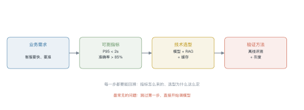
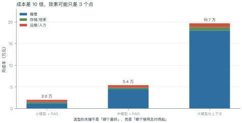
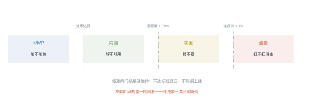
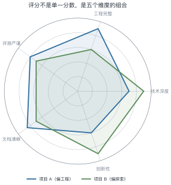

# 第 24 讲　综合实践

!!! abstract "本讲位置"
    全书收尾。前面 23 讲各自解决一个问题，本讲把它们串成一条线：**从一句业务需求，到一个能上线的系统**。

!!! info "📅 事实核查至 2026-11"
    本讲是方法论总结，不涉及具体厂商数据；成本示例均为量级估算。

## 学习目标

学完本讲，你应该能够：

1. 把模糊的业务需求翻译成可测的技术指标；
2. 用成本与效果的权衡做选型，而不是"用最好的"；
3. 设计四个阶段与三道闸门的交付路径；
4. 按评分表自评一个项目，找出最短的那块板。

---

## 0 直觉：从"知道"到"做出来"

学完 23 讲，你知道注意力怎么算、MoE 怎么路由、RAG 怎么切分。但真让你做一个系统，第一个问题往往不是技术问题：

> "客服说想要一个智能助手，要快、要准、要能处理复杂问题。"

这句话里没有一个可执行的指标。**"快"是多快？"准"是多准？"复杂"是什么？**

本讲就从这个翻译开始。

!!! note "一句话总结"
    工程能力 = **把模糊需求翻译成可测指标，再用成本约束下的最优方案去满足它**。

---

## 1 需求翻译

<figure markdown="span">
  { width="100%" }
  <figcaption>图 L24-1　读图要点：业务需求 → 可测指标 → 技术选型 → 验证方法，四步环环相扣。<b>跳过第一步直接调模型，是最常见的失败起点</b>。</figcaption>
</figure>

### 例 24.1　把"要快"翻译成延迟预算

业务说"响应要在 2 秒内"。拆开看：

| 环节 | 预算 | 说明 |
|---|---|---|
| 网络往返 | 200 ms | 客户端到服务端 |
| 检索（RAG） | 200 ms | 向量检索 + 重排 |
| 首 token 延迟 | 400 ms | prefill |
| 生成 20 token | 1200 ms | 60 ms/token |
| **合计** | **2000 ms** | 刚好卡满，没有余量 |

**结论**：这个预算**没有任何冗余**。要么把生成压到 15 token（省 300 ms），要么加缓存（命中率 30% 就能省 600 ms）。

**这就是"可测指标"的价值**：它把"要快"变成了"哪一环超了就砍哪一环"。

---

## 2 选型

<figure markdown="span">
  { width="100%" }
  <figcaption>图 L24-2　读图要点：小模型 + RAG 月成本约 2 万，大模型长上下文要 19.7 万，<b>差 10 倍，而效果可能只差 3 个点</b>。</figcaption>
</figure>

### 2.1 决策顺序

1. **先问效果下限**：低于这个线，方案直接淘汰；
2. **再算成本**：在达标的方案里选最便宜的；
3. **最后看可维护性**：团队能不能 hold 住。

**反直觉的结论**：很多场景下"小模型 + 好的检索 + 好的提示"能打到"大模型裸跑"的 95%，而成本只有 1/10。

### 例 24.2　算一次月度成本

假设：100 万次请求/月，平均每次输入 1200 token、输出 300 token。

$$100\times10^{4}\times1500=1.5\times10^{9}\ \text{token/月}$$

按每百万 token 2 元估算：

$$\frac{1.5\times10^{9}}{10^{6}}\times2=3000\ \text{元/月}$$

加上检索存储（约 3000 元）与运维人力（约 1 万），总成本约 **1.6 万/月**。

**对照**：换成大模型（单价 20 元/百万），光推理就是 3 万/月，总成本 4.5 万。

---

## 3 实现路径

<figure markdown="span">
  { width="100%" }
  <figcaption>图 L24-3　读图要点：MVP 只验证"能不能做"，内测验证"好不好用"，灰度验证"稳不稳"，最后全量。<b>每道闸门都是硬性的</b>：不达标就退回。</figcaption>
</figure>

| 阶段 | 目标 | 通过标准 | 典型工期 |
|---|---|---|---|
| MVP | 跑通链路 | 20 条样本能出结果 | 1–2 周 |
| 内测 | 验证效果 | 满意度 > 70% | 2–4 周 |
| 灰度 | 验证稳定性 | 错误率 < 1%，可回滚 | 2 周 |
| 全量 | 验证容量 | 峰值 QPS 下 P95 达标 | 持续 |

**MVP 的关键是"窄"**：只做一类问题、一个数据源、一个模型。宽了就做不完。

---

## 4 评测与上线

三层评测（第 23 讲）：

| 层 | 指标 | 阈值 |
|---|---|---|
| 检索 | 上下文召回 | > 0.85 |
| 生成 | 忠实度 | > 0.90 |
| 端到端 | 任务成功率 | > 0.80 |

**灰度三件事**：

1. **流量切分**：1% → 5% → 20% → 100%；
2. **一键回滚**：任何指标异常，30 秒内切回旧版本；
3. **对比监控**：新旧版本的核心指标并排看。

---

## 5 课程项目与评分

<figure markdown="span">
  { width="100%" }
  <figcaption>图 L24-4　读图要点：五个维度——技术深度、工程完整、评测严谨、文档清晰、创新性。<b>评分不是单一分数，是五个维度的组合</b>，任何一项太弱都会拖后腿。</figcaption>
</figure>

### 5.1 项目模板

```
project/
├── README.md          问题定义、指标、结论
├── design.md          选型理由与备选方案对比
├── src/               可运行代码
├── eval/              评测集 + 评测脚本 + 结果
├── results/           基线与消融的表格
└── slides/            10 分钟汇报
```

### 例 24.3　算一次加权总分

权重：技术深度 0.30、工程完整 0.25、评测严谨 0.20、文档 0.15、创新 0.10。

项目 A 得分 $[0.7,\ 0.9,\ 0.8,\ 0.85,\ 0.6]$：

$$
0.7\times0.30+0.9\times0.25+0.8\times0.20+0.85\times0.15+0.6\times0.10
=0.21+0.225+0.16+0.1275+0.06=0.7825
$$

**怎么用这个数**：看哪一项拉低了总分。A 的创新性只有 0.6，如果提到 0.8，总分能到 0.8025——**提升创新比提升技术深度更划算**。

```python
WEIGHTS = {
    "技术深度": 0.30,
    "工程完整": 0.25,
    "评测严谨": 0.20,
    "文档清晰": 0.15,
    "创新性": 0.10,
}


def score(scores: dict[str, float]) -> float:
    return sum(scores[k] * w for k, w in WEIGHTS.items())


def weakest(scores: dict[str, float]) -> str:
    """找出「提升空间 × 权重」最大的维度"""
    return max(WEIGHTS, key=lambda k: (1 - scores[k]) * WEIGHTS[k])


a = {"技术深度": 0.7, "工程完整": 0.9, "评测严谨": 0.8, "文档清晰": 0.85, "创新性": 0.6}
print(f"总分 {score(a):.4f}，最该补的是「{weakest(a)}」")   # 0.7825，创新性
```

---

## 6 工程要点与坑

1. **先写指标再写代码**：没有验收标准的项目，永远做不完。
2. **MVP 要窄**：一类问题、一个数据源、一个模型。
3. **成本先算**：别等上线才发现账单超预算 10 倍。
4. **回滚是底线**：没有一键回滚，就不要灰度。
5. **评测集自己造**：公开基准测不出你的业务效果。
6. **文档写给下一个人**：三个月后的你，就是那个"下一个人"。

---

## 7 论文与延伸阅读

| 主题 | 推荐 |
|---|---|
| 系统设计 | 本讲义 L13–L14（推理与训练系统） |
| 应用架构 | L15–L19（上下文、RAG、Agent、多模态） |
| 评测 | L23（评测与治理） |
| 工程实践 | Anthropic, *Building Effective Agents* |

---

## 8 习题

**🟢 概念题**

1. 为什么"要快"不是可测指标？给出三个可测的替代。
2. MVP 阶段为什么要"窄"？宽了会怎样？

**🟡 推导题**

3. 用例 24.1 的方法，给一个"代码补全"场景做延迟预算（目标 500 ms）。
4. 用例 24.3 的权重，算项目 B 的总分，并指出它最该补哪一项。

**🔴 实现题**

5. 用 `score` 与 `weakest` 写一个自评脚本，输入五项得分，输出总分与改进建议。
6. 从零做一个最小系统：一个 RAG + 一个评测集 + 一张结果表，两周内完成。

---

## 9 本讲小结

<div class="cheatsheet" markdown>

**四步翻译**

业务需求 → 可测指标 → 技术选型 → 验证方法

**三个阶段**

MVP（能不能做）→ 灰度（稳不稳）→ 全量（扛不扛得住）

**一个原则**

> 选型不是选最好的，是选**够用且付得起**的。

**一句话**

> 工程能力 = 把模糊需求翻译成可测指标，再用成本约束下的最优方案满足它。

</div>

---

## 来源

- 本讲为方法论总结，案例数据为量级估算；引用框架见 §7。
