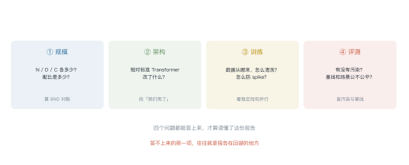
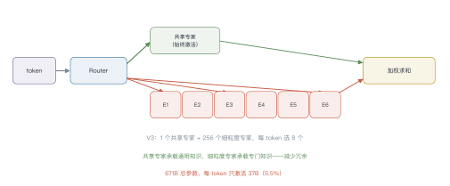
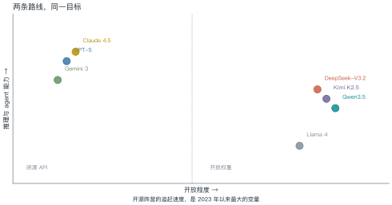
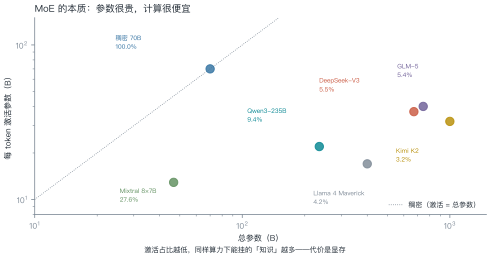
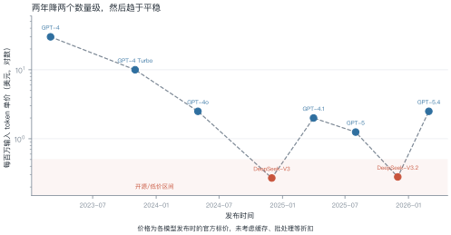

# 第 25 讲　热门模型解剖

!!! abstract "本讲位置"
    全书的收束。前 24 讲把零件拆开讲了一遍，本讲把零件装回四台"真机"：GPT、DeepSeek、Claude、Gemini——看它们各自在哪一层做了不同的取舍。

!!! info "📅 事实核查至 2026-11"
    本讲的规格与定价来自各家技术报告与官方文档（2025–2026），已与两个聚合站交叉核对；标注 ⚠️ 的为尚未独立复现的信息。

## 学习目标

学完本讲，你应该能够：

1. 用"规模 / 架构 / 训练 / 评测"四个问题快速读懂一份技术报告；
2. 说出 DeepSeek 的 MLA 与细粒度 MoE 各解决什么问题；
3. 解释 GPT-5 的"路由式统一系统"与 Claude 的"混合推理"有什么共同点；
4. 用参数、激活占比、单价算清一次推理的成本。

---

## 0 直觉：读报告只看四件事

技术报告动辄几十页，但真正需要核对的只有四件事：

<figure markdown="span">
  { width="100%" }
  <figcaption>图 L25-1　读图要点：规模、架构、训练、评测——每项都有可核对的具体数字。<b>答不上来的那一项，往往就是报告在回避的地方</b>。</figcaption>
</figure>

| 问题 | 找什么 | 怎么验 |
|---|---|---|
| **规模** | $N$、$D$、$C$ | 用 $C\approx6ND$ 对账 |
| **架构** | 相对标准 Transformer 改了什么 | 找"我们采用/提出" |
| **训练** | 数据来源、并行策略、稳定性处理 | 看 loss 曲线与 spike 处理 |
| **评测** | 污染、基线、场景 | 查去污染方法与对照 |

可直接复制的填写模板见[技术报告阅读模板](../appendix/report-template.md)。

!!! note "一句话总结"
    模型之间的差别，**九成落在"架构改了什么"和"数据怎么配"这两件事上**，剩下的才是规模。

---

## 1 GPT 系列：从规模到路由

| 代际 | 关键变化 | 留下的问题 |
|---|---|---|
| GPT-3 | 175B + 上下文学习 | 只会补全，不会听话 |
| GPT-4 | 多模态输入 + 对齐 | 成本高、延迟大 |
| GPT-4o | 端到端多模态，延迟接近实时 | 推理能力有限 |
| o1 | 长思维链 RL，推理时扩展 | 慢、贵 |
| **GPT-5** | **路由式统一系统**：实时判断该用"快模型"还是"推理模型" | 路由本身可解释性差 |

**GPT-5 的关键设计**：不再让用户选模型，而是用一个轻量路由在**同一次请求内**决定走哪条路径。简单问题走快模型（低延迟），复杂问题自动切到推理模型（长 CoT）。

这解决了一个真实痛点：用户不知道自己的问题"有多难"。

---

## 2 DeepSeek：把成本压到极致

DeepSeek 的路线很清晰：**用架构创新换成本**。三个关键件：

<figure markdown="span">
  { width="100%" }
  <figcaption>图 L25-2　读图要点：共享专家对所有 token 激活（承载通用知识），256 个细粒度专家每个 token 只选 8 个。<b>671B 总参数，每 token 只算 37B</b>。</figcaption>
</figure>

| 组件 | 作用 | 效果 |
|---|---|---|
| **MLA**（多头潜在注意力） | 把 KV 压到低维潜空间 | KV cache 降约 10 倍 |
| **细粒度 MoE** | 256 个小专家选 8 个 + 共享专家 | 同算力下参数更多、冗余更少 |
| **FP8 训练** | 权重与激活用 FP8 | 训练显存与带宽减半 |

### 2.1 MLA 为什么能省十倍

标准多头注意力要为每个 token 存 K 和 V，每层每头都是 $d_h$ 维。层数一多、头数一多，KV cache 就成了显存黑洞（第 13 讲算过：7B 模型 128K 上下文要 69 GB）。

MLA 的做法：**先把 K/V 压到一个低维潜向量，用时再投影回来**。

- 存储的是潜向量（如 512 维），而不是每头独立的 K/V；
- 推理时用上投影矩阵还原出 K/V，多出来的计算相对带宽开销可以忽略；
- 结果：KV cache 降约 10 倍，128K 上下文的显存从 69 GB 降到个位数。

**代价**：多了一次投影计算，且训练时要保证潜空间不塌缩——这也是为什么 MLA 论文花了大量篇幅讲初始化与归一化。

### 例 25.1　算一下"参数很贵、计算很便宜"

DeepSeek-V3：总参数 671B，每 token 激活 37B。

$$\text{激活占比}=\frac{37}{671}=5.5\%
\tag{25.1}$$

**显存**（bf16）：$671\times10^9\times2\ \text{B}=1.34\ \text{TB}$——必须多卡。
**算力**：每 token 约 $2\times37\text{B}=74$ GFLOPs，与一个 37B 稠密模型相当。

**这就是 MoE 的本质**：显存按总参数付，算力按激活参数付。

!!! tip "从这个例子里能读出三件事"
    1. **MoE 不是"免费变大"**：显存账单是实打实的 1.34 TB；
    2. **激活占比越低，推理越便宜**：5.5% 意味着算力只有稠密的 1/18；
    3. **部署 MoE 的瓶颈在显存**，不在算力——这和 L11 的结论一致。

---

## 3 Claude：把"安全"写进训练目标

Claude 的差异化在**对齐方法**，不在架构：

- **Constitutional AI**：用一组明文规则（"宪法"）让模型自我批评、自我修订，减少对人工标注的依赖；
- **混合推理**（Claude 3.7 起）：同一个模型可切换"即时回答"与"扩展思考"，用户按需付费；
- **长上下文**：Opus 4.6 起支持 100 万 token（beta）。

**和 GPT-5 的共同点**：都在做"**按需分配算力**"——GPT-5 用路由，Claude 用开关。区别是 GPT-5 自动，Claude 让用户选。

### 3.1 Constitutional AI 的两个阶段

1. **自我批评**：模型对自己的回答按"宪法"逐条挑毛病，再改写；
2. **偏好学习**：用改写前后的回答对训练奖励模型，做 RLHF。

**为什么这很聪明**：把"什么算有害"从**隐式的标注员偏好**变成了**明文的规则**。规则可以审计、可以修改、可以跨语言复用——而标注员的偏好不行。

代价是规则本身的覆盖度决定上限：宪法里没写的风险，模型学不到。

---

## 4 Gemini：原生多模态

Gemini 的路线是"**从预训练第一天就多模态**"，而不是"给语言模型加一个视觉编码器"。

| 特点 | 说明 |
|---|---|
| 原生多模态 | 文本、图像、音频、视频共用一套 tokenizer 与 Transformer |
| 超长上下文 | 100 万 token 起步，直接吃整本书/整段视频 |
| MoE 骨干 | 用稀疏激活控制推理成本 |

**代价**：训练成本极高，且"统一 tokenizer"意味着任何模态的改进都要重训整个模型。

---

## 5 开源阵营：追赶的速度

<figure markdown="span">
  { width="100%" }
  <figcaption>图 L25-3　读图要点：横轴开放程度、纵轴能力。闭源三家在右上，开源阵营紧追——<b>2025 年之后，开源与闭源的能力差距从"一代"缩到"几个月"</b>。</figcaption>
</figure>

<figure markdown="span">
  { width="100%" }
  <figcaption>图 L25-4　读图要点：对角线是稠密模型（激活=总参数），右下角全是 MoE。<b>激活占比从 Mixtral 的 27.6% 一路降到 Kimi K2 的 3.2%</b>——稀疏化越来越激进。</figcaption>
</figure>

### 例 25.2　算一次请求的成本

一次请求：1000 input token + 500 output token。

| 模型 | 输入单价（$/M） | 输出单价（$/M） | 单次成本 |
|---|---|---|---|
| GPT-5 级 | 1.25 | 10 | $0.0063 |
| DeepSeek-V3 | 0.27 | 1.10 | $0.00082 |

$$\text{成本比}=\frac{0.0063}{0.00082}\approx7.7\ \text{倍}$$

**怎么用这个数**：如果一天 10 万次请求，差价是 \$548/天，约 \$16 万/年。

---

## 6 横向对比

| | GPT-5 | Claude 4.5 | Gemini 3 | DeepSeek-V3.2 | Qwen3.5 |
|---|---|---|---|---|---|
| 开放 | 闭源 | 闭源 | 闭源 | **MIT** | **Apache 2.0** |
| 骨干 | 未公开 | 未公开 | MoE | MoE 671/37 | MoE 397/17 |
| 上下文 | 400K | 200K–1M | 1M | 128K | 256K |
| 特色 | 路由 | 宪法 AI + 混合推理 | 原生多模态 | 极致性价比 | 开源 + 原生视觉 |

**读这张表的正确方式**：不要比"谁最强"，要比"谁在你的场景里性价比最高"。


<figure markdown="span">
  { width="100%" }
  <figcaption>图 L25-5　读图要点：纵轴是对数刻度。GPT-4 到 DeepSeek-V3 两年降了约 100 倍，之后价格带分成两层——<b>闭源在 $1–3，开源在 $0.3 以下</b>。</figcaption>
</figure>

### 6.1 怎么选：三个问题

1. **数据能不能出内网？** 不能 → 只能自部署开源模型（Qwen / DeepSeek / Llama）。
2. **一天多少次请求？** 低频 → 用 API，省运维；高频（>10 万/天）→ 算一下自部署的摊薄成本。
3. **要不要长上下文？** 需要 100 万 token → 目前只有少数几家；否则 128K 够用。

**一个常见的误判**：以为"开源 = 免费"。真实的开源成本包括 GPU 折旧、运维人力、微调数据与工程——小规模下往往比 API 贵。

### 6.2 一个选型复盘

某团队做法律合同审阅，最初选了最强闭源模型，月成本 8 万，准确率 88%。半年后换成"中等开源模型 + 更好的检索 + 规则后处理"，月成本 1.2 万，准确率 91%。

三个动作：

- **把"模型能力"换成"系统能力"**：合同里的条款位置固定，用规则先定位再让模型判断，比让模型读全文更准；
- **按任务分级**：80% 的常规条款走小模型，20% 的复杂条款才调大模型；
- **用评测集说话**：自建 300 条标注数据，每次换模型都跑一遍，而不是看榜单。

**结论**：模型选型只是系统工程的一环。**把检索、规则、分级路由做对，常常比换一个更强的模型更有效**。

---

## 7 工程坑

1. **别拿总参数当成本**：MoE 的 671B 是显存账，算力账看 37B。
2. **别信"支持 1M 上下文"**：能装 ≠ 能用，用 RULER 类测试验一下。
3. **单价会变**：2025–2026 年主流模型降过 3–5 次价，选型要按当期价格算。
4. **开源模型的"免费"有隐性成本**：部署、运维、微调都要人。
5. **路由/开关类设计影响可复现性**：同一个 prompt 可能走不同路径。

```python
def request_cost(in_tok: int, out_tok: int,
                 in_price: float, out_price: float) -> float:
    """单次请求成本（美元）。price 单位：美元 / 百万 token"""
    return (in_tok * in_price + out_tok * out_price) / 1e6


models = {
    "GPT-5 级": (1.25, 10.0),
    "Claude 4.5": (5.0, 25.0),
    "DeepSeek-V3": (0.27, 1.10),
    "Qwen3.5": (0.4, 1.2),
}

for name, (pi, po) in models.items():
    c = request_cost(1000, 500, pi, po)
    print(f"{name:<12} ${c:.5f}／次　日 10 万次 ≈ ${c * 1e5:,.0f}")
```

---

## 8 论文与延伸

| 年份 | 文献 | 一句话贡献 |
|---|---|---|
| 2024 | [DeepSeek-V2（MLA）](https://arxiv.org/abs/2405.04434) | 低维潜空间压缩 KV |
| 2024 | [DeepSeek-V3](https://arxiv.org/abs/2412.19437) | 671B/37B，FP8 训练 |
| 2025 | [DeepSeek-R1](https://arxiv.org/abs/2501.12948) | 纯 RL 的推理能力 |
| 2025 | [GPT-5 发布说明](https://openai.com/index/introducing-gpt-5/) | 路由式统一系统 |
| 2025 | [Claude 4](https://www.anthropic.com/news/claude-4) | 混合推理与编码 agent |
| 2025 | [Qwen3](https://qwenlm.github.io/blog/qwen3/) | 开源 + 混合思考 |
| 2025 | [Kimi K2](https://moonshotai.github.io/Kimi-K2/) | 1T/32B 的极致稀疏 |

---

## 9 习题

**🟢 概念题**

1. GPT-5 的"路由"与 Claude 的"混合推理"解决的是同一个问题吗？
2. 为什么 MoE 模型的部署瓶颈在显存而不是算力？

**🟡 推导题**

3. 用 (25.1) 算：某 MoE 总参数 400B、激活 17B，它的激活占比与"等效稠密规模"。
4. 用例 25.2 的单价，算"每天 10 万次请求"下 GPT-5 与 V3 的年成本差。

**🔴 实现题**

5. 跑通 `request_cost`，把 2026 年主流模型的定价填进去，画一张"成本 vs 上下文长度"图。
6. 找一份 2025 年后的技术报告，用四问法写一页阅读笔记。

---

## 10 本讲小结

<div class="cheatsheet" markdown>

**四问法**

规模 · 架构 · 训练 · 评测

**三个数字**

- DeepSeek-V3：671B / 37B（5.5%）
- 一次请求成本差 7.7 倍
- 开源与闭源的差距缩到"几个月"

**两条路线**

闭源：按需分配算力（路由 / 开关）
开源：用架构换成本（MLA / 细粒度 MoE / FP8）

**一句话**

> 模型之间的差别，九成在"架构改了什么"和"数据怎么配"。

</div>

---

## 来源

- 各模型规格与定价来自官方技术报告与 API 文档，2025–2026 年数据，核查日期 2026-11；标注 ⚠️ 的条目尚未独立复现。
